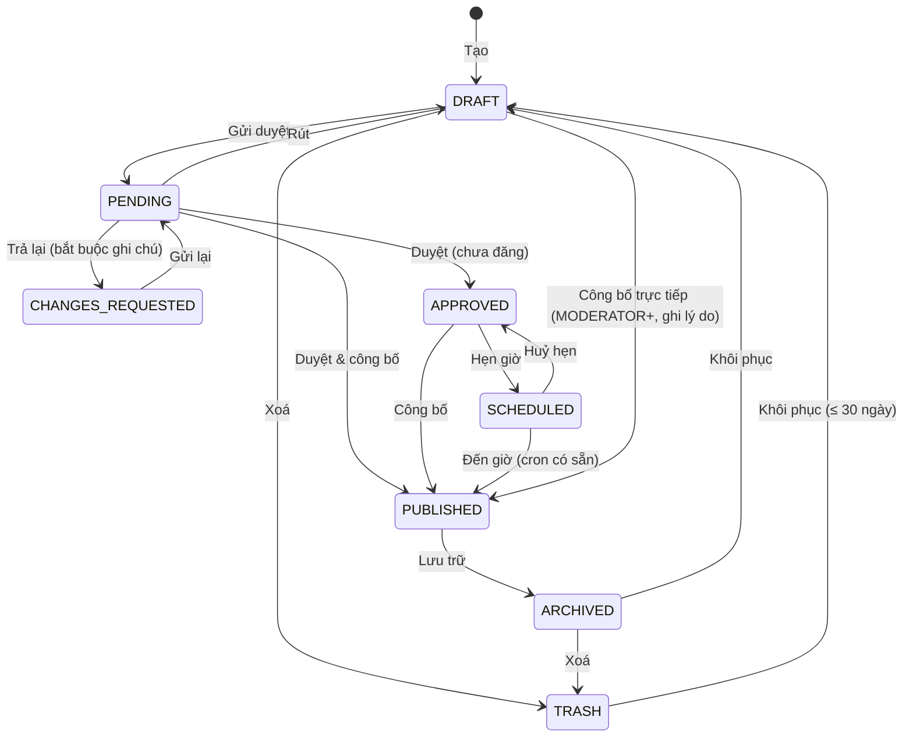
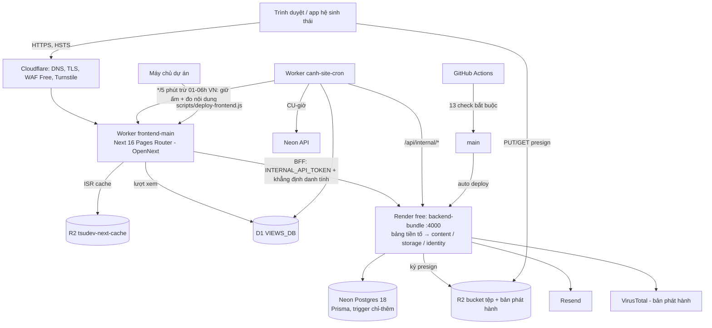
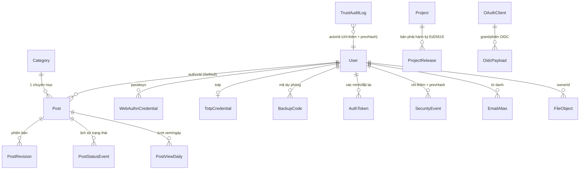

# TÀI LIỆU THIẾT KẾ KỸ THUẬT

# Tái cấu trúc toàn diện hệ thống website TsuDEV (tsudev.com) - v2.0

| Thuộc tính          | Giá trị                                                                                                                      |
| ------------------- | ---------------------------------------------------------------------------------------------------------------------------- |
| Mã tài liệu         | TSU-TDD-2026-001                                                                                                             |
| Phiên bản           | **2.0** (thay v1.0 cùng ngày; v1.0 giữ nguyên làm hồ sơ)                                                                     |
| Ngày lập            | 19/11/2026                                                                                                                   |
| Chủ sở hữu sản phẩm | TsuDEV (vai trò OWNER)                                                                                                       |
| Đối tượng đọc       | Lập trình viên full-stack, kỹ sư hạ tầng/bảo mật, UI/UX                                                                      |
| Nguồn hiện trạng    | `docs/thiet-ke/ra-quet-20261119.md` (rà quét P1, mã F-xx / F-P1-xx) + mã nguồn repo `tsudev-org/tsudev` tại commit `f1d6225` |
| Kế hoạch thực thi   | phiếu `logs/handover/20261119-65_ke-hoach-tai-cau-truc-toan-dien.md` (phase P4-P9)                                           |
| Trạng thái          | **Hoàn chỉnh** chương 1-23 (P2: 1-13, P3: 14-23, 19/11/2026); thực thi theo chương 23 (P4-P9)                                |
| Bản sao review      | `docs/thiet-ke/tsu-tdd-v2.md` trong repo (qua PR). Tệp này và bản sao phải giống nhau                                        |

> **Quy ước từ khoá**: **PHẢI** = bắt buộc; **NÊN** = khuyến nghị mạnh, bỏ qua phải ghi lý do; **CÓ THỂ** = tuỳ chọn.
> Mỗi yêu cầu có mã để truy vết trong PR và test nghiệm thu:
> `PR-` nguyên tắc · `IA-` kiến trúc thông tin · `DS-` design system · `UI-` app shell · `PG-` trang công khai ·
> `ED-` Studio/trình soạn · `WF-` quy trình duyệt · `ST-` Settings · `AD-` Admin · `MD-` modal/popup/toast ·
> `MO-` chuyển động. Cột **Giải quyết** dẫn mã phát hiện ở bản rà quét; cột **File sẽ sửa** là đường dẫn có thật trong
> repo tại ngày lập (đường dẫn kết thúc bằng `(mới)` là tệp sẽ tạo). Cột **Phase** khớp mục 2 của phiếu kế hoạch.
>
> **Khác v1.0 ở đâu**: v1.0 viết từ ảnh chụp, không đọc mã. v2.0 bám hiện trạng thật: Next 16 **Pages Router** trên
> Cloudflare Workers (OpenNext), 3 service Express gộp `backend-bundle` trên Render free, Neon Postgres 18, R2, hạn
> mức **0đ**; Tiptap 3 + Markdown (ADR-0001, ADR-0003); token từ `.standards/` + `tokens/extensions.tsudev-web.json`;
> font Chivo Mono; chỉ chế độ Sáng · Tối · Hệ thống. Đề xuất nào của v1.0 trái các điều đó đều bị thay, có ghi lý do.

---

## Mục lục

1. Tóm tắt điều hành
2. Hiện trạng đã đo (tóm từ rà quét P1)
3. Mục tiêu, nguyên tắc, chỉ số thành công
4. Kiến trúc thông tin & sơ đồ URL (Pages Router)
5. Design system theo token thật
6. App shell
7. Đặc tả trang công khai
8. TsuDEV Studio - viết và xuất bản
9. Quy trình kiểm duyệt, phát hành, gắn nhãn
10. Khu vực Tài khoản (Settings)
11. Khu vực Quản trị (Admin)
12. Danh mục Modal / Popup / Drawer / Toast
13. Chuyển động & vi tương tác
14. Kiến trúc kỹ thuật (hiện trạng + đích 0đ)
15. Mô hình dữ liệu (Prisma)
16. API - mở rộng route hiện có
17. Bảo mật - đối chiếu `docs/security-plan.md`, mức ASVS
18. Tuân thủ pháp luật Việt Nam
19. Giám sát, nhật ký & ứng phó sự cố
20. Hiệu năng, SEO & khả năng tiếp cận
21. Kiểm thử, CI/CD & chuỗi cung ứng
22. Sổ quyết định, đính chính, rủi ro & phụ lục
23. Lộ trình P4-P9 và nghiệm thu

---

## 1. Tóm tắt điều hành

tsudev.com là cổng phát hành của hệ sinh thái TsuDEV: danh bạ ứng dụng (`/apps`, dữ liệu tĩnh `ECOSYSTEM_APPS`),
bản phát hành có SHA-256 do máy chủ tính + chữ ký Ed25519, blog, tài liệu, tài khoản dùng chung (mật khẩu Argon2id,
TOTP, passkey, OIDC provider cho app khác). Phần nền **mạnh hơn v1.0 tưởng**: đã có quy trình
Nháp → Chờ duyệt → Hẹn giờ → Công khai → Lưu trữ, lịch sử phiên bản, trình soạn Tiptap, trung tâm bảo mật cá nhân
và quản trị, nhật ký kiểm toán chỉ-thêm, CSP có băm/nonce, HSTS preload.

Cái yếu là **lớp trình bày và sự gắn kết**: trang `/author` dồn form + thống kê + danh sách vào một trang 2.618 px
(F-04), có hai lối tạo bài song song (form thô và trình soạn); trang công khai **vẽ sai** phần lớn cú pháp mà trình
soạn cho chèn (F-P1-01, P0); giao diện admin mở cho MEMBER (F-P1-02, API vẫn chặn); `/settings/profile` một cột dài
có lỗi a11y critical (F-10, F-P1-05); menu tài khoản thiếu lối vào Studio/Quản trị/Bảo mật (F-15); không có bảng lệnh
Ctrl+K (F-P1-12), không có trang chi tiết app (F-11), changelog, security.txt (F-18); xác nhận nguy hiểm dùng
`confirm()` của trình duyệt ở 9 tệp.

Đợt tái cấu trúc làm 5 việc, mỗi việc gắn phase:

1. **Sửa cái đang hỏng trước** (đầu P4): bộ vẽ Markdown dùng chung `marked` (ADR-0003), bỏ mặc định "Công bố" (F-01,
   F-P1-08), tràn ngang trang chủ 390 px (F-P1-03).
2. **Studio** (P4 frontend, P7 có migration): `/author` thành không gian làm việc 3 vùng, một lối viết duy nhất, tự
   lưu, tải ảnh R2, xem trước thật, điểm SEO; sau đó trạng thái Yêu cầu sửa / Đã duyệt / Thùng rác, nhãn biên tập,
   checklist phía máy chủ.
3. **App shell + Settings** (P5): menu tài khoản đủ lối vào, bảng lệnh Ctrl+K dùng `/api/search`, mega-menu Hệ sinh
   thái, chân trang gọn; `SettingsLayout` có thanh bên; `AdminGate` + `AdminLayout` dùng chung.
4. **Trang công khai** (P6): `/apps/[slug]`, docs 3 cột, blog theo chuyên mục, `/changelog`, `/security`.
5. **Tuân thủ và cứng hoá** (P8-P9): báo cáo nội dung, takedown có SLA, xuất/xoá dữ liệu cá nhân, header và CSP chặt
   hơn, đo liên tục (Lighthouse CI, axe trong E2E).

Mọi đề xuất giữ **0đ** (`docs/free-tier.md`): không Valkey, Meilisearch, ClamAV, Vault, K8s hay máy chủ WebSocket
thường trực. Tìm kiếm = Postgres + `unaccent`; quét tệp = magic bytes + danh sách loại (bản phát hành đã có
VirusTotal); WAF = Cloudflare; nhật ký = Workers Logs/Render + bảng sự kiện trong Postgres.

---

## 2. Hiện trạng đã đo (tóm từ rà quét P1)

Chi tiết và cách đo: `docs/thiet-ke/ra-quet-20261119.md`. Chương này chỉ giữ những gì các chương sau dẫn tới.

### 2.1. Nền tảng

| Lớp             | Hiện trạng                                                                                                                                    |
| --------------- | --------------------------------------------------------------------------------------------------------------------------------------------- |
| Frontend        | MỘT app `apps/frontend-main`: Next 16 **Pages Router**, React 19, Tailwind 4, OpenNext trên Cloudflare Workers; 7 trang đọc là ISR (cache R2) |
| BFF             | `pages/api/*/[...path].ts` proxy tới service; ký khẳng định danh tính bằng `INTERNAL_IDENTITY_SECRET`; IP người gọi qua `lib/clientIp.ts`     |
| Backend         | content (4001), storage (4002), auth (4004) - Express, gộp `services/backend-bundle` trên Render free                                         |
| Dữ liệu         | Neon Postgres 18 qua `@tsudev/db` (Prisma); R2 cho tệp phát hành + ảnh                                                                        |
| Trình soạn      | Tiptap 3 + `@tiptap/markdown` (`components/MarkdownEditor.tsx`) ở `/author/posts/[slug]` (gồm `new`); form textarea thô ở `/author`           |
| Bộ vẽ công khai | `lib/md.ts` - regex tự viết, **lệch trình soạn** (F-P1-01) ⇒ ADR-0003 thay bằng `marked` 17.0.6                                               |
| Giao diện chung | `packages/ui`: `SiteHeader`, `SiteFooter`, `Layout`, `Modal`, `Toast`, `Input`, `Button`, `Card`, `Badge`, `EmptyState`, `TableOfContents`... |
| Quyền           | `Role` GUEST<MEMBER<VIP<AUTHOR<MODERATOR<ADMIN<OWNER; `requireRole()` đọc DB, fail closed; ADMIN/OWNER bắt buộc TOTP (`MFA_REQUIRED`)         |

### 2.2. Điểm mạnh giữ nguyên

- Quy trình bài viết có trạng thái, hẹn giờ, lịch sử phiên bản (`/author/posts/[slug]/history`), so khác biệt theo
  dòng (`lib/lineDiff.ts`), xoá mềm có trigger chặn xoá cứng.
- Bảo mật: Argon2id, passkey, TOTP + mã dự phòng, step-up (`StepUpDialog`), thu hồi phiên (`sessionVersion`),
  `SecurityEvent`, `TrustAuditLog` chỉ-thêm, Turnstile, rate limit trên Postgres, CSP băm + nonce, HSTS preload,
  `X-Frame-Options: DENY`, COOP/CORP.
- Tương phản màu: 0 lỗi ở cả Sáng lẫn Tối (cổng `packages/ui/test/contrast.test.ts`). CLS ≈ 0 mọi trang.
- RSS (`/feed.xml`), sitemap, ISR giữ bản cũ khi upstream lỗi (`keepStaleOnFailure`).

### 2.3. Phát hiện còn mở (đầu vào của chương 3-13)

| Mã      | Mức | Tóm tắt                                                                                  | Chương xử lý |
| ------- | --- | ---------------------------------------------------------------------------------------- | ------------ |
| F-P1-01 | P0  | Trang công khai không vẽ nghiêng/gạch/H4/danh sách số/`---`/bảng/trích dẫn/chú thích ảnh | 7, 8         |
| F-01    | P1  | Ô "Công bố" mặc định tích ở `/author`                                                    | 8            |
| F-P1-08 | P2  | Như F-01 ở form "Thêm dự án mới" `/admin/projects`                                       | 11           |
| F-P1-02 | P1  | MEMBER/AUTHOR mở được giao diện 4 trang `/admin/*`                                       | 4, 11        |
| F-P1-03 | P1  | Trang chủ cuộn ngang 24 px ở 390 px (`HomeShowcase.tsx`)                                 | 7            |
| F-P1-04 | P1  | Nút Menu di động thiếu `aria-expanded`; 768-1279 px không có ô tìm                       | 6            |
| F-P1-05 | P1  | `/settings/profile` 5 ô không gắn nhãn (axe critical)                                    | 10           |
| F-02    | P2  | Không tự lưu, không thùng rác; "Xoá" ở danh sách xoá ngay                                | 8, 9         |
| F-04    | P2  | `/author` một trang dài, tham số URL trộn                                                | 8            |
| F-05    | P2  | Hai lối tạo bài (form thô + Tiptap)                                                      | 8            |
| F-06    | P2  | Nhóm tài liệu là chữ tự do                                                               | 8, 9         |
| F-07    | P2  | `/docs` danh sách không có thanh bên                                                     | 7            |
| F-08    | P2  | "Viết bài" ở menu công khai                                                              | 6            |
| F-10    | P2  | `/settings/profile` 4 thẻ dọc 2.470 px, mỗi thẻ một nút lưu                              | 10           |
| F-11    | P2  | Không có `/apps/[slug]`                                                                  | 7            |
| F-12    | P3  | Ô chọn trên thẻ app không chú thích                                                      | 7            |
| F-13    | P2  | Blog chưa có trang chuyên mục/thẻ, ảnh bìa trên danh sách                                | 7            |
| F-14    | P2  | Chân trang cột Hệ sinh thái 11 dòng, lộ tên repo                                         | 6            |
| F-15    | P1  | Menu tài khoản chỉ có Hồ sơ/Đăng xuất (cả OWNER)                                         | 6            |
| F-16    | P2  | `/docs` một cột chừa trống nửa phải                                                      | 7            |
| F-17    | P3  | Thống kê tác giả chỉ 2 số                                                                | 8            |
| F-18    | P2  | Không có `/.well-known/security.txt`, `/changelog`                                       | 7            |
| F-P1-06 | P2  | Chân trang: `heading-order` + `link-in-text-block` ở mọi trang                           | 6            |
| F-P1-07 | P2  | `/search`: `nested-interactive`, listbox không tên                                       | 6, 7         |
| F-P1-09 | P2  | Nút thanh công cụ trình soạn: nhãn ARIA khác chữ hiện                                    | 8            |
| F-P1-10 | P2  | 3 trang admin không có `h1`                                                              | 11           |
| F-P1-11 | P2  | Turnstile `aria-prohibited-attr`; `definition-list` ở `/ung-ho`; hai `nav` trùng nhãn    | 6, 7         |
| F-P1-12 | P2  | Không có bảng lệnh Ctrl+K                                                                | 6            |
| F-P1-13 | P3  | `/author/posts/new/history` trả 200 thay vì 404                                          | 8            |
| F-P1-14 | P3  | CSP `connect-src` chặn `data:` từ Turnstile (ồn nhật ký)                                 | P3 (ch. 17)  |
| F-P1-15 | P3  | Trang gác quyền trả 200 + vỏ, không `noindex`                                            | 4            |
| F-MOD   | P2  | `confirm()` trình duyệt ở 9 tệp; không hệ toast chung; trạng thái rỗng là chữ trơn       | 12           |

`F-MOD` gom ghi chép mục 7 của bản rà quét (không có mã riêng ở đó). F-03 sai (đã có trung tâm bảo mật), F-09 đã
đóng - không có yêu cầu nào trong tài liệu này cho hai mã đó.

---

## 3. Mục tiêu, nguyên tắc, chỉ số thành công

### 3.1. Nguyên tắc

| Mã    | Nguyên tắc                                                                                                                                                                                                          |
| ----- | ------------------------------------------------------------------------------------------------------------------------------------------------------------------------------------------------------------------- |
| PR-01 | **Tách vùng theo vai trò**: Công khai · Tài khoản · Studio · Quản trị. Người đọc không thấy công cụ nội bộ trong điều hướng công khai; lối vào Studio/Quản trị nằm trong menu tài khoản.                            |
| PR-02 | **API là ranh giới thật, giao diện chỉ là lịch sự**. Gác quyền ở trang (`AdminGate`) để không vẽ form vô nghĩa; quyền vẫn do `requireRole()` đọc DB quyết định. Không thêm hệ quyền thứ hai.                        |
| PR-03 | **An toàn theo mặc định**: mọi thao tác có hậu quả công khai (đăng, xoá, đổi quyền, thu hồi) mặc định ở trạng thái an toàn, có xác nhận bằng `Modal` (không `confirm()`), và hoàn tác được khi dữ liệu cho phép.    |
| PR-04 | **Một nguồn sự thật cho mỗi thứ**: Markdown cho nội dung (ADR-0003), `config/topology.json` cho cổng/tên miền, token `.standards/` + `tokens/extensions.tsudev-web.json` cho màu, `ECOSYSTEM_APPS` cho danh bạ app. |
| PR-05 | **0đ là ràng buộc cứng**: đề xuất cần dịch vụ trả phí hoặc tiến trình thường trực thứ hai ⇒ ghi "không làm" kèm lý do, hoặc thay bằng phương án chạy trên Workers/Render free/Neon/R2.                              |
| PR-06 | **Tiếng Việt trước tiên**: nhãn, lỗi, slug không dấu; ngày `DD/MM/YYYY` qua `lib/format.ts`; gạch ngang chỉ `-`.                                                                                                    |
| PR-07 | **A11y và hiệu năng là điều kiện nghiệm thu**: mỗi phase giao diện kết thúc với 0 lỗi axe critical + serious trên các trang nó chạm, không cuộn ngang ở 390 px.                                                     |
| PR-08 | **Không giả**: mục chưa có backend ghi "sắp có" và vô hiệu, không vẽ dữ liệu giả (luật phiếu P5).                                                                                                                   |
| PR-09 | **Cổng chống tái phát đi cùng bản sửa**: mỗi lỗi đã đo (F-xx) khi sửa PHẢI kèm test hoặc kiểm tra CI bắt lại được nó (vd. test khứ hồi ADR-0003, kiểm `overflowX` 390 px, axe trong E2E).                           |

### 3.2. Chỉ số thành công (đo 60 ngày sau P9)

Mốc gốc lấy từ rà quét P1 mục 6 (lượt 2, máy đo có tải - mốc thô). v1.0 đặt "Hiệu năng ≥ 95"; v2.0 hạ về mức đạt
được trên Workers free với trang chủ có băng chuyền, và đo bằng Lighthouse CI thay vì máy dev có tải.

| Chỉ số                                                | Mốc 19/11/2026                       | Mục tiêu                        |
| ----------------------------------------------------- | ------------------------------------ | ------------------------------- |
| Lighthouse di động `/` `/apps` `/blog` `/docs` (Perf) | 65 / 80 / 89 / 59                    | ≥ 85 cả bốn (Lighthouse CI, P9) |
| Lighthouse A11y / Best Practices / SEO                | 95 / 100 / 100                       | 100 / 100 / 100                 |
| LCP di động p75                                       | 1,9-3,2 s                            | < 2,5 s                         |
| CLS                                                   | ≈ 0                                  | < 0,05 (giữ)                    |
| axe critical + serious trên 33 route                  | ≥ 7 luật vi phạm (bản rà quét mục 5) | 0                               |
| Cuộn ngang ở 390 px                                   | 1 trang (`/`)                        | 0, có kiểm trong E2E            |
| Cú pháp thanh công cụ vẽ sai trên trang công khai     | 8 loại (ADR-0003)                    | 0, có test khứ hồi              |
| Trang `/admin/*` vẽ form cho người thiếu quyền        | 4/7                                  | 0/7                             |
| `confirm()` của trình duyệt                           | 9 tệp                                | 0 (grep trong CI)               |
| Header bảo mật (securityheaders.com)                  | chưa đo điểm; thiếu security.txt     | A+ và có security.txt (P9)      |
| Tài khoản ADMIN/OWNER có 2FA                          | 100 % (backend ép `MFA_REQUIRED`)    | giữ 100 %                       |
| Bài đăng nhầm do mặc định "Công bố"                   | có khả năng (F-01)                   | 0 - mặc định Nháp               |

---

## 4. Kiến trúc thông tin & sơ đồ URL (Pages Router)

### 4.1. Bốn vùng

| Vùng      | Ai vào                      | Vỏ trang (chương 6)     | Gác ở trang                    | Gác thật (API)                                   |
| --------- | --------------------------- | ----------------------- | ------------------------------ | ------------------------------------------------ |
| Công khai | mọi người                   | `Layout` + `SiteHeader` | -                              | `/api` content: xác thực tuỳ chọn                |
| Tài khoản | MEMBER+                     | `SettingsLayout` (mới)  | `useSession` ⇒ chuyển `/login` | `/api/identity/*` theo phiên                     |
| Studio    | AUTHOR+ (duyệt: MODERATOR+) | `StudioLayout` (mới)    | `RoleGate min="AUTHOR"` (mới)  | `/api/author/*` `requireRole('AUTHOR')`          |
| Quản trị  | ADMIN+ (accounts: OWNER)    | `AdminLayout` (mới)     | `RoleGate min="ADMIN"`         | `/api/admin/*` `requireAdmin()` + `MFA_REQUIRED` |

v1.0 đề xuất route groups của App Router; v2.0 giữ **Pages Router**: mỗi vùng là một component vỏ bọc trang (gán qua
`Page.getLayout` trong `pages/_app.tsx`), không đổi router (đổi router cần ADR riêng và đụng ISR/OpenNext - không
có lợi ích tương xứng ở quy mô này).

### 4.2. Sơ đồ URL

Ký hiệu: **(có)** đã tồn tại · **(mới)** tạo mới · **(đổi)** đổi đường dẫn, có chuyển hướng. Trang ISR giữ nguyên
danh sách trong `test/isrPages.test.ts`; trang mới công khai có dữ liệu từ DB thì PHẢI vào danh sách đó.

```
CÔNG KHAI
/                                  Trang chủ                                    (có, ISR)
/apps                              Danh bạ ứng dụng (tĩnh, ECOSYSTEM_APPS)      (có)
/apps/[slug]                       Chi tiết ứng dụng + bản phát hành            (mới, P6, ISR)
/install                           Cài bằng một lệnh (tách khay từ /apps)       (mới, P6, tĩnh)
/blog  /blog/[slug]                Blog                                         (có, ISR)
/blog/chuyen-muc/[slug]            Bài theo chuyên mục (model Category có sẵn) (mới, P6, ISR)
/docs  /docs/[slug]                Tài liệu (3 cột ở P6)                        (có, ISR)
/projects  /projects/[slug]        /projects → /apps (có); [slug] giữ cho dự án không phải app
/changelog                         Nhật ký thay đổi từ bản phát hành             (mới, P6, ISR)
/security                          Chính sách bảo mật, công bố lỗ hổng          (mới, P6, tĩnh)
/.well-known/security.txt          RFC 9116                                     (mới, P6)
/search?q=                         Tìm kiếm hợp nhất                            (có)
/privacy /terms /rules /ung-ho     Pháp lý, ủng hộ                              (có)
/feed.xml /sitemap.xml /robots.txt                                              (có)

XÁC THỰC (giữ nguyên đường dẫn - link trong thư đã gửi trỏ vào chúng)
/login /signup /forgot-password /reset-password /verify-email
/confirm-email-change /revoke-sessions /oidc/interaction/[uid]

TÀI KHOẢN (đăng nhập)
/settings                          → /settings/profile                          (mới, P5)
/settings/profile                  Hồ sơ công khai                              (có, làm lại P5)
/settings/account                  Email, tên đăng nhập, bí danh email           (mới, P5 - tách từ profile)
/settings/security                 Mật khẩu, 2FA, passkey, tư thế bảo mật       (có)
/settings/sessions                 Phiên & thiết bị                             (mới, P5 - tách từ security)
/settings/privacy                  Quyền riêng tư, xuất/xoá dữ liệu             (mới, P5 vỏ; P8 chức năng)
/settings/activity                 Sự kiện bảo mật của chính mình               (mới, P5 - SecurityEventList có sẵn)
/settings/connected                Ứng dụng OIDC đã cấp quyền                   (mới, P5 vỏ "sắp có" nếu chưa có API)

STUDIO (AUTHOR+)
/studio                            Tổng quan cá nhân                            (đổi từ /author, P4)
/studio/posts                      Bảng bài viết                                (mới, P4 - tách từ /author)
/studio/posts/[slug]               Trình soạn ("new" = bài mới)                 (đổi từ /author/posts/[slug])
/studio/posts/[slug]/history       Lịch sử & so sánh                            (đổi)
/studio/docs  /studio/docs/[slug]  Tài liệu                                     (mới, P4 - từ AuthorDocs)
/studio/media                      Ảnh đã tải lên R2 (GET /api/files)            (mới, P4)
/studio/review                     Hàng chờ duyệt (MODERATOR+)                   (đổi từ /admin/review, P7)

QUẢN TRỊ (ADMIN+)
/admin                             Bảng điều khiển                              (có)
/admin/accounts                    Tài khoản & vai trò (OWNER)                  (có)
/admin/content                     Nội dung toàn site                           (có)
/admin/projects                    Dự án & bản phát hành                        (có)
/admin/security                    Trung tâm bảo mật                            (có)
/admin/release-security            An ninh phát hành                            (có)
/admin/moderation                  Báo cáo nội dung + takedown SLA              (mới, P8)
/admin/audit                       Nhật ký kiểm toán (TrustAuditLog, SecurityEvent) (mới, P8)
```

**Không làm so với v1.0 (có lý do):** `/games/*` (trò chơi là site ngoài, danh bạ `ECO_GAMES` đã đủ); `/status`
(cần máy đo ngoài thường trực - P9 dùng dịch vụ uptime miễn phí và chỉ liên kết ra); `/authors/[username]`,
`/blog/series/*`, `/studio/calendar`, `/studio/analytics` riêng (để sau P7 khi có `seriesId`; lịch hẹn giờ hiển thị
trong `/studio/posts` lọc theo SCHEDULED); `/admin/roles` (thang vai trò cố định trong enum - xem chương 9);
`/admin/redirects`, `/admin/settings` cờ tính năng (không có kho cấu hình động 0đ đáng làm); `/feed.json`; tiền tố
`/legal/*` (đổi `/privacy` `/terms` làm gãy link trong thư và trang đồng ý OIDC, không được gì); `/mfa`, `/logout`
riêng (đã nằm trong luồng `/login` và next-auth).

### 4.3. Yêu cầu

| Mã    | Yêu cầu                                                                                                                                                                                                                                                                   | Giải quyết       | File sẽ sửa                                                                                                  | Phase |
| ----- | ------------------------------------------------------------------------------------------------------------------------------------------------------------------------------------------------------------------------------------------------------------------------- | ---------------- | ------------------------------------------------------------------------------------------------------------ | ----- |
| IA-01 | Mỗi trang gác quyền khai `Page.getLayout` + vai trò tối thiểu; `RoleGate` đọc `session.role`, trong lúc chờ phiên vẽ khung xương, thiếu quyền vẽ `EmptyState` "Không có quyền" + liên kết về trang trước. KHÔNG gọi API khi thiếu quyền.                                  | F-P1-02          | `pages/_app.tsx`, `components/RoleGate.tsx` (mới)                                                            | P5    |
| IA-02 | `/author*` → `/studio*` bằng `redirects()` **308** (giữ query); giữ chuyển hướng vô thời hạn (rẻ, không có lý do bỏ). Liên kết nội bộ đổi sang `/studio` trong cùng PR; grep `'/author'` trong `apps/` và `packages/ui` phải còn 0 ngoài bảng chuyển hướng.               | F-04             | `next.config.js`, `packages/ui/src/components/SiteHeader.tsx`, `pages/author.tsx` → `pages/studio/index.tsx` | P4    |
| IA-03 | `/admin/review` → `/studio/review` (308) khi trang chuyển vùng; quyền xem = MODERATOR+.                                                                                                                                                                                   | -                | `next.config.js`, `pages/admin/review.tsx`                                                                   | P7    |
| IA-04 | Danh sách dùng `page`/`page_size` (+ `sort`, `status`, `q`) theo `.standards/docs/DATA_TABLE.md` qua `lib/useUrlPaging.ts`. MỘT danh sách mỗi URL - bỏ cặp `doc_page`/`doc_page_size` khi Bài viết và Tài liệu tách trang. (v1.0 đề xuất `per_page`: trái quy ước chung.) | F-04             | `lib/useUrlPaging.ts`, `pages/studio/posts.tsx` (mới), `pages/studio/docs/index.tsx` (mới)                   | P4    |
| IA-05 | Tiền tố riêng tư `/studio`, `/settings`, `/admin`, `/author` trả `X-Robots-Tag: noindex, nofollow` và `Cache-Control: private, no-store` từ `proxy.ts`; `robots.txt` thêm `Disallow` cho các tiền tố đó.                                                                  | F-P1-15          | `proxy.ts`, `pages/robots.txt.ts`, `test/csp.test.ts`                                                        | P5    |
| IA-06 | Trang công khai mới có dữ liệu DB (`/apps/[slug]`, `/blog/chuyen-muc/[slug]`, `/changelog`) là ISR, dùng `keepStaleOnFailure()` và được thêm vào `test/isrPages.test.ts`; vào `sitemap.xml`.                                                                              | F-11, F-13, F-18 | `lib/isr.ts`, `test/isrPages.test.ts`, `pages/sitemap.xml.ts`                                                | P6    |
| IA-07 | `/settings` (không đuôi) chuyển `/settings/profile`; mục Settings chưa có API vẽ trạng thái "Sắp có" vô hiệu (PR-08), không ẩn.                                                                                                                                           | F-10             | `next.config.js`, `components/SettingsLayout.tsx` (mới)                                                      | P5    |

---

## 5. Design system theo token thật

### 5.1. Định hướng thẩm mỹ

Giữ đúng hướng chủ dự án đã chốt (10/11 và 16/11/2026), không dựng "Owl Terminal" của v1.0 thành hệ màu mới:

- **Đen tuyền `#0A0A0A` + xanh logo** (`--primary` `#38BDF8` Tối / `#0868C4` Sáng; nhấn `--accent` `#3B9EFF`/`#0E7490`),
  bố cục học supabase.com: một nền liền mạch, thẻ = bề mặt + viền hairline, hover đậm viền.
- **Chỉ Sáng · Tối · Hệ thống**; "Hệ thống" giải trong JavaScript trước khi vẽ, không treo `prefers-color-scheme`.
  Bộ chọn ở chân trang (`ThemeToggle.tsx`).
- Dấu ấn riêng được GIỮ từ v1.0 vì làm được bằng token sẵn có: **dải lệnh** (lệnh cài đặt có dấu nhắc + nút Chép +
  "Đã chép") - đã có ở `components/InstallCommands.tsx`, chuẩn hoá thành component dùng chung; **lưới mạch mờ** ở hero
  dùng `--grid-line` + `--glow` (đã có `tsu-hero-bg`).
- **Không** thêm màu riêng cho từng sản phẩm như v1.0 đề xuất: 10+ màu nhấn làm vỡ mã màu nhóm hành động `--icon-*`
  (giới hạn 6 có chủ đích, `docs/design-system.md`). Phân biệt app bằng biểu tượng (`ecosystem.ts > icon`, ô
  `.tsu-monogram`) và màu nền tảng `--platform-*` có sẵn.

### 5.2. Token (nguồn duy nhất)

Đường đi: `.standards/tokens/design-tokens.json` (chỉ đọc) + `tokens/extensions.tsudev-web.json` ⇒ `npm run
tokens:sync` ⇒ `packages/ui/src/tokens.css` (artifact, KHÔNG sửa tay; `tokens:check` canh). Bảng ánh xạ v1.0 → token thật
để lập trình viên đọc v1.0 không đặt biến mới:

| v1.0 đề xuất                              | Token thật                                                                                                                                       |
| ----------------------------------------- | ------------------------------------------------------------------------------------------------------------------------------------------------ |
| `--bg`, `--surface-1..3`                  | `--bg-base`, `--bg-surface`, `--bg-subtle`, `--bg-hover`                                                                                         |
| `--border`, `--border-strong`             | `--border`, `--border-strong` (chỉ trang trí), `--border-control` (ranh giới ô/nút, ≥ 3:1)                                                       |
| `--text`, `--text-muted`, `--text-subtle` | `--text-primary`, `--text-secondary`, `--text-muted`, `--text-link`                                                                              |
| `--brand-400/500/600`, `--brand-glow`     | `--primary`, `--primary-hover`, `--primary-active`, `--on-primary`, `--accent`, `--glow`                                                         |
| `--success/warning/danger/info`           | như tên + `-ink` (chữ) + `-tint` (nền nhạt) + `--on-status`                                                                                      |
| `--radius-*`, `--space-*`                 | `--radius-none/sm/md/lg`, `--sp-1..12`                                                                                                           |
| `--dur-*`, `--ease-*`                     | `--motion-fast/base/slow`, `--motion-easing(-enter/-exit/-emphasized)`, `--motion-stagger-1..3`                                                  |
| (không có)                                | `--z-dropdown/sticky/modal-overlay/modal/toast/tooltip`, `--overlay`, `--focus-ring`, `--shadow-sm/md/lg`, `--control-h`, `--row-h`, `--measure` |

### 5.3. Kiểu chữ

| Vai trò             | Font / token                                | Ghi chú                                                            |
| ------------------- | ------------------------------------------- | ------------------------------------------------------------------ |
| Giao diện, nội dung | Be Vietnam Pro (`--font-family`)            | Đã có, subset `vietnamese`; số 0 trơn                              |
| Mã, lệnh, slug      | **Chivo Mono** (`--font-mono`)              | v1.0 nói JetBrains Mono - SAI, chủ dự án đã bỏ (số 0 có chấm)      |
| Thang cỡ            | `--fs-xs/sm/body-web/h4..h1/display-sm..lg` | Thân bài: `--fs-body-web-lg`, `--lh-long`, rộng tối đa `--measure` |

### 5.4. Thư viện thành phần

Không thêm Radix/Chromatic như v1.0 (phụ thuộc lớn cho lợi ích nhỏ; Chromatic không 0đ). Mở rộng `packages/ui` hiện
có, mỗi component mới có story trong `packages/ui/src/stories/` và test vai trò ARIA:

| Có sẵn (giữ)                                                                                                                                                                                | Thêm mới (phase)                                                                                                                                                                                                                                                                                                     |
| ------------------------------------------------------------------------------------------------------------------------------------------------------------------------------------------- | -------------------------------------------------------------------------------------------------------------------------------------------------------------------------------------------------------------------------------------------------------------------------------------------------------------------- |
| `Button`, `Input`, `Card`, `Badge`, `Avatar`, `Modal`, `Toast`, `Upload`, `EmptyState`, `Stat`, `TableOfContents`, `SectionHeading`, `Article`, `Container`, `Icon`, `Logo`, `RecordFooter` | `ConfirmDialog` (P4), `Drawer` (P4), `Disclosure` (nút + `aria-expanded`, KHÔNG `role=menu` - lý do ở `SiteHeader.tsx` `UserMenu`, P5), `Tabs` (P4), `CommandPalette` (P5), `CommandStrip` (P6, rút từ `InstallCommands`), `Skeleton` (P4), `Callout` (P4), `TagInput` chip (P4), `StickyBar` (P4/P5), `Switch` (P5) |

### 5.5. Yêu cầu

| Mã    | Yêu cầu                                                                                                                                                                                              | Giải quyết | File sẽ sửa                                                                           | Phase |
| ----- | ---------------------------------------------------------------------------------------------------------------------------------------------------------------------------------------------------- | ---------- | ------------------------------------------------------------------------------------- | ----- |
| DS-01 | Component mới chỉ dùng token (grep mã hex trong `packages/ui/src/components` = 0 ngoài `Logo`). Màu chữ trên nền đặc dùng `--on-primary`/`--on-status`, không cắm trắng.                             | -          | `packages/ui/src/components/*` (mới)                                                  | P4-P6 |
| DS-02 | Mỗi cặp màu mới (vd. nền `Callout` × chữ) thêm vào `packages/ui/test/contrast.test.ts`, đạt AA ở cả hai chế độ.                                                                                      | -          | `packages/ui/test/contrast.test.ts`                                                   | P4    |
| DS-03 | `ConfirmDialog` dựng trên `Modal` có sẵn: tiêu đề, mô tả hậu quả, nút nguy hiểm dùng `--danger`, tuỳ chọn "gõ lại tên để xác nhận"; trả Promise để thay `confirm()` một-đổi-một.                     | F-MOD      | `packages/ui/src/components/ConfirmDialog.tsx` (mới), `packages/ui/src/index.tsx`     | P4    |
| DS-04 | `Input` bắt buộc gắn nhãn: nhận `label` và tự sinh `id` (`useId`) cho `<label htmlFor>`; thiếu `label` và `aria-label` ⇒ cảnh báo dev.                                                               | F-P1-05    | `packages/ui/src/components/Input.tsx`                                                | P5    |
| DS-05 | `CommandStrip` (dải lệnh) dùng chung cho `/apps`, `/install`, `/apps/[slug]`, khối mã trong bài: `--font-mono`, dấu nhắc trang trí `aria-hidden`, nút Chép có trạng thái đọc cho trình đọc màn hình. | F-11       | `packages/ui/src/components/CommandStrip.tsx` (mới), `components/InstallCommands.tsx` | P6    |
| DS-06 | `EmptyState` có biến thể `error` và `forbidden`, nhận hành động gợi ý (nút/liên kết); thay các câu chữ trơn "Không tải được..." ở trang admin/studio.                                                | F-MOD      | `packages/ui/src/components/EmptyState.tsx`                                           | P4-P5 |
| DS-07 | Storybook: mỗi component mới một story; nghiệm thu bằng đếm story vẽ được (Storybook không nằm trong CI - `docs/design-system.md` §Storybook).                                                       | -          | `packages/ui/src/stories/*` (mới)                                                     | P4-P6 |
| DS-08 | Mật độ `data-density="compact"` bật mặc định trong `StudioLayout` và `AdminLayout` (bảng nhiều dòng); công khai giữ comfortable.                                                                     | F-04       | `components/StudioLayout.tsx` (mới), `components/AdminLayout.tsx` (mới)               | P4-P5 |

---

## 6. App shell

### 6.1. Bốn vỏ trang

| Vỏ                | Dùng cho                  | Cấu trúc                                                                                                                                                  | Tệp                                                                                      |
| ----------------- | ------------------------- | --------------------------------------------------------------------------------------------------------------------------------------------------------- | ---------------------------------------------------------------------------------------- |
| `Layout` (có)     | trang công khai, xác thực | `SiteHeader` + nội dung (`Container`) + `SiteFooter`                                                                                                      | `packages/ui/src/components/Layout.tsx`                                                  |
| `DocsLayout`      | `/docs/[slug]`            | `Layout` + thanh bên trái (cây theo chuyên mục) + nội dung `--measure` + mục lục phải (`TableOfContents` có sẵn); dưới 1024 px gập thanh bên vào `Drawer` | `components/DocsLayout.tsx` (mới)                                                        |
| `SettingsLayout`  | `/settings/*`             | `Layout` + thanh bên trái (nhóm mục) + nội dung tối đa 720 px + `StickyBar` lưu                                                                           | `components/SettingsLayout.tsx` (mới)                                                    |
| `WorkspaceLayout` | `/studio/*`, `/admin/*`   | `SiteHeader` thu gọn + thanh bên thu gọn được (nhớ trạng thái ở localStorage) + vùng làm việc toàn rộng; KHÔNG `SiteFooter`; `data-density="compact"`     | `components/WorkspaceLayout.tsx` (mới); `StudioLayout`, `AdminLayout` là cấu hình của nó |

### 6.2. Header công khai

```
┌──────────────────────────────────────────────────────────────────────────────────────┐
│ [logo tsudev]  Hệ sinh thái ▾  Ứng dụng  Tài liệu  Blog      [Tìm…  Ctrl K]  [Avatar ▾] │
└──────────────────────────────────────────────────────────────────────────────────────┘
Khách: thay Avatar bằng  Đăng nhập (ghost) + Tải ứng dụng (primary)  - giữ như hiện nay.
```

- Bỏ "Trang chủ" (logo đã là lối về) và "Viết bài" (vào menu tài khoản) - F-08.
- Không chuông thông báo (chưa có hệ thông báo; PR-08) và không nút giao diện ở header (bộ chọn đã chốt ở chân trang).
- "Trò chơi" không lên header: là site ngoài, nằm trong mega-menu.
- Mega-menu **Hệ sinh thái**: lưới theo `EcoCategory` (Hệ thống · Tệp · Mạng · Tiện ích) + cột "Trò chơi" từ `ECO_GAMES`;
  mỗi mục: biểu tượng (`EcoIcon`), tên, mô tả một dòng, chấm nền tảng; cột phải "Cài bằng một lệnh" → `/install`.
  Dữ liệu lấy thẳng `ECOSYSTEM_APPS` (tĩnh, không gọi API). Mẫu disclosure: mở bằng bấm/Enter/Space (KHÔNG mở bằng
  hover - hover gây mở nhầm và không dùng được trên cảm ứng), đóng bằng Esc/bấm ngoài/focus rời, trả focus về nút.
- Ô tìm hiện từ `md` (768 px) dạng nút "Tìm… Ctrl K" mở `CommandPalette`; ô gõ trực tiếp hiện nay (chỉ ≥ `xl`) bỏ - F-P1-04.

### 6.3. Bảng lệnh `Ctrl/⌘ + K`

- Hộp thoại (`Modal` + combobox ARIA 1.2): nhóm **Ứng dụng** (lọc cục bộ `ECOSYSTEM_APPS`, không cần mạng), **Bài viết
  & Tài liệu** (gọi `/api/search?q=&page_size=5`, debounce 200 ms, hủy bằng `AbortController`), **Lệnh nhanh** theo vai
  trò (Viết bài mới, Mở Studio, Quản trị, Bảo mật tài khoản, Đổi giao diện, Đăng xuất).
- Tìm không dấu do backend lo (`unaccent` + `searchBodyNorm` - SEARCH_AND_FILTER); lọc app cục bộ dùng cùng hàm bỏ dấu.
  v1.0 đòi "chịu lỗi gõ": không làm (cần `pg_trgm` - để P3 cân nhắc ở chương dữ liệu).
- Phím: ↑↓ chọn, Enter mở, Ctrl/⌘+Enter tab mới, Esc đóng; `/` khi không ở ô nhập cũng mở. Phím tắt không bắt khi
  đang gõ trong ô nhập/trình soạn (trình soạn có `/` riêng).
- Một combobox dùng lại cho `/search` - sửa F-P1-07 một lần (option KHÔNG chứa liên kết lồng; listbox có `aria-label`).

### 6.4. Menu tài khoản

```
┌──────────────────────────────┐
│ (Avatar) Tên hiển thị        │
│ @username · Tác giả          │   ← vai trò bằng chữ Việt, không lộ email đầy đủ
├──────────────────────────────┤
│ Studio                       │   ← AUTHOR+
│ Quản trị                     │   ← ADMIN+
├──────────────────────────────┤
│ Hồ sơ                        │
│ Bảo mật                      │
│ Cài đặt                      │
├──────────────────────────────┤
│ Đăng xuất                    │
└──────────────────────────────┘
```

Giữ mẫu disclosure có sẵn (Tab qua các liên kết; Esc trả focus). Email chỉ hiện ở `/settings/account` (giảm lộ khi
chia sẻ màn hình). Mục theo vai trò đọc `session.role`; khi phiên `pending` dùng `authHint` như cơ chế hiện có để
không nháy.

### 6.5. Chân trang

```
┌─────────────────────────────────────────────────────────────────────────────┐
│ [logo] TsuDEV - mô tả 2 dòng      Sản phẩm   Tài nguyên   Tài khoản   Pháp lý │
├─────────────────────────────────────────────────────────────────────────────┤
│ Hệ sinh thái: [ic][ic][ic][ic][ic][ic][ic][ic][ic][ic]   Xem tất cả →        │
├─────────────────────────────────────────────────────────────────────────────┤
│ © tsudev  [Sáng | Tối | Hệ thống]                                            │
└─────────────────────────────────────────────────────────────────────────────┘
```

Lưới biểu tượng thay cột 11 dòng (F-14); nhãn là **tên sản phẩm** (`name`), không tên repo (phiếu TC1). Bỏ "Trạng
thái" và số phiên bản của v1.0 (không có nguồn đo 0đ thường trực - chương 19). ⚠️ Chân trang + logo chạm cổng "Bảo vệ
bản quyền" ⇒ PR P5 phần này cần `nguyentrangtinhsu` duyệt; agent dừng và báo.

### 6.6. Di động (< 768 px)

- Header: logo + nút tìm (mở `CommandPalette` toàn màn hình) + nút Menu mở `Drawer` (trái → phải) có accordion Hệ sinh
  thái; nút Menu có `aria-expanded` + `aria-controls` (F-P1-04).
- Studio/Admin dưới 1024 px: đọc, duyệt/trả lại, sửa nhanh; trình soạn đầy đủ hiện gợi ý "dùng màn hình ≥ 1024 px"
  nhưng KHÔNG chặn (vẫn soạn được).
- Vùng chạm ≥ 44 × 44 px (`--control-h` comfortable ≥ 36 px + đệm).

### 6.7. Yêu cầu

| Mã    | Yêu cầu                                                                                                                                                                                                | Giải quyết       | File sẽ sửa                                                                                                | Phase                |
| ----- | ------------------------------------------------------------------------------------------------------------------------------------------------------------------------------------------------------ | ---------------- | ---------------------------------------------------------------------------------------------------------- | -------------------- |
| UI-01 | Bỏ mục `home` và `author` khỏi `NAV`; thêm nút "Hệ sinh thái" (mega-menu, mục 6.2).                                                                                                                    | F-08             | `packages/ui/src/components/SiteHeader.tsx`                                                                | P5                   |
| UI-02 | Mega-menu đọc `ECOSYSTEM_APPS` + `ECO_GAMES`, nhãn là tên sản phẩm; disclosure bấm-để-mở, Esc/bấm-ngoài đóng; test bàn phím.                                                                           | F-14             | `packages/ui/src/components/EcosystemMenu.tsx` (mới), `packages/ui/src/lib/ecosystem.ts`                   | P5                   |
| UI-03 | `CommandPalette` theo mục 6.3; mở bằng Ctrl/⌘+K và `/`; gọi `/api/search` (không thêm endpoint); kết quả là `option` không chứa liên kết lồng.                                                         | F-P1-12, F-P1-07 | `packages/ui/src/components/CommandPalette.tsx` (mới), `pages/api/search.ts` (không đổi), `pages/_app.tsx` | P5                   |
| UI-04 | `/search` dùng lại combobox của UI-03; listbox có tên; axe 0 serious.                                                                                                                                  | F-P1-07          | `pages/search.tsx`                                                                                         | P5                   |
| UI-05 | Menu tài khoản thêm Studio (AUTHOR+), Quản trị (ADMIN+), Bảo mật, Cài đặt; hiện vai trò bằng chữ; bỏ email đầy đủ.                                                                                     | F-15             | `packages/ui/src/components/SiteHeader.tsx` (`UserMenu`)                                                   | P5                   |
| UI-06 | Nút Menu di động: `aria-expanded`, `aria-controls`, mở `Drawer` có bẫy focus; hai `nav` có nhãn khác nhau ("Chính", "Chính - di động").                                                                | F-P1-04, F-P1-11 | `packages/ui/src/components/SiteHeader.tsx`, `packages/ui/src/components/Drawer.tsx` (mới)                 | P5                   |
| UI-07 | Chân trang: tiêu đề cột `h2.sr-only` "Liên kết chân trang" + cột là `h3` (hết `heading-order`); liên kết trong đoạn mô tả gạch chân (hết `link-in-text-block`); lưới biểu tượng thay cột Hệ sinh thái. | F-P1-06, F-14    | `packages/ui/src/components/SiteFooter.tsx`                                                                | P5 ⛔ cổng bản quyền |
| UI-08 | `WorkspaceLayout` (thanh bên thu gọn, breadcrumb, nút tạo chính) dùng cho Studio + Admin; không `SiteFooter`.                                                                                          | F-04, F-P1-10    | `components/WorkspaceLayout.tsx` (mới), `pages/_app.tsx`                                                   | P4-P5                |
| UI-09 | E2E kiểm `document.documentElement.scrollWidth <= 390` trên mọi trang công khai ở khổ 390 px.                                                                                                          | F-P1-03          | `e2e/tests/layout-390.spec.js` (mới)                                                                       | P5                   |

---

## 7. Đặc tả trang công khai

Áp chung cho mọi trang chương này: bộ vẽ Markdown theo ADR-0003 (PG-01) là điều kiện trước mọi khối nội dung mới;
trang có dữ liệu DB là ISR (IA-06); không cuộn ngang ở 390 px (UI-09); ngày qua `lib/format.ts`.

### 7.1. Bộ vẽ nội dung (nền của blog, docs, dự án, xem trước)

Thay `lib/md.ts` (regex) bằng `marked` 17.0.6 + lớp an toàn đúng như ADR-0003 mục 4; giữ chữ ký `renderMarkdown`,
`extractHeadings`, `slugifyHeading`. Phần tử vẽ ra và lớp CSS:

| Markdown                        | HTML                                  | Ghi chú giao diện                                                                                          |
| ------------------------------- | ------------------------------------- | ---------------------------------------------------------------------------------------------------------- |
| `*a*` `~~a~~` `**a**` `` `a` `` | `em` `del` `strong` `code`            | `code` nội dòng nền `--bg-subtle`, `--font-mono`                                                           |
| `##`-`####`                     | `h2`-`h4` có `id` (slug)              | neo `#` hiện khi hover, sao chép liên kết mục                                                              |
| `1.` `-` lồng, `- [ ]`          | `ol` `ul` lồng, ô việc chỉ đọc        | ô việc `disabled`, có nhãn                                                                                 |
| `---`, bảng GFM                 | `hr`, `table` trong khung cuộn ngang  | bảng bọc `div[tabindex=0][role=region][aria-label]` để cuộn được bằng bàn phím, không làm trang cuộn ngang |
| `> a`, `> [!NOTE]`...           | `blockquote`, `aside.callout-<loại>`  | 5 loại map `--info/--success/--primary/--warning/--danger` + `-tint`                                       |
| ``       | `figure > img + figcaption`           | `loading="lazy"`, `decoding="async"`; ảnh R2 có `width/height` nếu biết                                    |
| dòng URL YouTube/Vimeo riêng    | `iframe` `youtube-nocookie.com`/Vimeo | `title` bắt buộc; CSP `frame-src` mở đúng 2 miền (`proxy.ts`)                                              |
| khối mã ` ```lang `             | `pre > code.language-*` + nút Chép    | tô màu cú pháp phía máy chủ lúc ISR nếu gói ≤ 30 KB; không thì để P9                                       |

### 7.2. Trang chủ `/`

Giữ khối hiện có (hero, tìm app, băng chuyền, ziczac #327, blog mới) - chủ dự án vừa duyệt ở phiên 64. Chỉ sửa:
tràn ngang 390 px của `article.tsu-sc` (F-P1-03); băng chuyền và hiệu ứng hiện dần tôn trọng
`prefers-reduced-motion` (chương 13); thêm khối "Mới phát hành" (5 bản gần nhất, từ cùng nguồn `/changelog`) và
"Vì sao tin TsuDEV" (ký Ed25519 + SHA-256 máy chủ + liên kết `/security`). KHÔNG làm terminal gõ chữ tự chạy của
v1.0 (TBT di động trang chủ đã cao nhất - rà quét mục 6) và không "đăng ký nhận tin" (cần dịch vụ thư hàng loạt +
quản lý đồng ý - ngoài 0đ).

### 7.3. Danh bạ `/apps` và `/install`

- Bộ lọc nền tảng/danh mục + sắp xếp (Tên · Mới cập nhật) phản ánh vào URL (`?platform=&category=&sort=`); trang vẫn
  tĩnh, đọc query phía trình duyệt.
- Ô chọn trên thẻ (`SelectCircle`) có nhãn hiện "Thêm vào lệnh cài" + `aria-pressed` (F-12); khi ≥ 1 app được chọn,
  thanh nổi đáy (`InstallTray` có sẵn) hiện lệnh theo nền tảng đoán từ UA (`guessInstallTarget`) + nút Chép.
- Bấm thân thẻ → `/apps/[id]`; nút Website/GitHub là nút phụ mở tab mới, `rel="noopener noreferrer"`.
- `/install`: toàn bộ khối "Cài bằng lệnh" + bộ dựng lệnh (hệ điều hành → kênh → app, dùng `installPlan()`), hướng dẫn
  kiểm khoá APT/RPM và SHA-256 từng bước. `/apps` giữ bản rút gọn + liên kết.

### 7.4. Chi tiết ứng dụng `/apps/[slug]` (mới)

`slug` = `EcoApp.id`. Dữ liệu: phần tĩnh từ `ECOSYSTEM_APPS` (tên, mô tả, nền tảng, kênh cài, website, releases); phần
động - nếu tồn tại `Project` cùng slug - lấy bản phát hành đã niêm phong qua `/api/projects/:slug` (đường hiện có của
`/projects/[slug]`). App không có `Project` vẫn có trang đầy đủ, tab Phát hành chỉ liên kết GitHub Releases.

```
┌──────────────────────────────────────────────────────────────────────────┐
│ Ứng dụng / Hệ thống / Tsu Cwico                                            │
│ [icon]  Tsu Cwico                                                          │
│         Một dòng mô tả                                                     │
│         [Windows] [Hệ thống]                                               │
│         [Tải về (nền tảng đoán từ UA)]  [Website ↗]  [GitHub ↗]            │
├── Tổng quan | Cài đặt | Phát hành | Tài liệu | Bài viết ──────────────────┤
│ Mô tả (Markdown của Project nếu có)          │ Cài nhanh (CommandStrip)    │
│                                              │ SHA-256 [Chép] · Chữ ký ✓   │
│                                              │ Cách tự kiểm tra →          │
└──────────────────────────────────────────────┴─────────────────────────────┘
```

Tab là liên kết neo trong trang (một URL, không tải lại); "Tài liệu"/"Bài viết" lọc qua `/api/search?q=<tên app>` cho
tới khi P7 có liên kết bài ↔ app thật. JSON-LD `SoftwareApplication` (`operatingSystem`, `applicationCategory`,
`softwareVersion` nếu có bản phát hành). KHÔNG đọc User-Agent Client Hints mới (đã có `guessInstallTarget(ua)`).
KHÔNG nút "Theo dõi" (chưa có hệ thông báo).

### 7.5. Blog

- `/blog`: bài ghim (sau P7 khi có `featured`; trước đó bài mới nhất) · chip chuyên mục (từ `Category`) · lưới thẻ
  (ảnh bìa nếu có, chuyên mục, tiêu đề, tóm tắt, ngày, thời gian đọc) · phân trang `page`/`page_size`.
- `/blog/chuyen-muc/[slug]`: như trên, lọc một chuyên mục, có `feed.xml?category=` (mở rộng `pages/feed.xml.ts`).
- `/blog/[slug]`: thanh tiến độ đọc (CSS `animation-timeline: scroll()` nếu trình duyệt hỗ trợ, không thì ẩn - không
  JS cuộn); breadcrumb; tác giả · ngày · thời gian đọc · "Cập nhật lần cuối" (từ `updatedAt` khi khác `publishedAt`
  > 24 h); mục lục dính bên phải ≥ 1280 px; cuối bài: bài trước/sau cùng chuyên mục, nút **Báo cáo nội dung** (modal
  > MD-08, chức năng P8).
- Bình luận: không làm (v1.0 cũng hoãn).

### 7.6. Tài liệu

- `/docs`: ô tìm (mở `CommandPalette` lọc `type=doc`), lưới chuyên mục (`lib/docCategories.ts`), "Cập nhật gần đây".
  Bỏ khoảng trống nửa phải (F-16) bằng lưới 2-3 cột.
- `/docs/[slug]`: `DocsLayout` 3 cột (cây chuyên mục · nội dung · mục lục), trước/sau trong cùng chuyên mục, "Cập
  nhật DD/MM/YYYY". Giữ URL phẳng `/docs/[slug]` - KHÔNG đổi sang `/docs/:product/:path` của v1.0 (gãy mọi liên kết đã
  phát ra trong app và README; lợi ích đạt được bằng chuyên mục + breadcrumb). Không phiên bản tài liệu theo phiên
  bản phần mềm (chưa có nhu cầu đo được). Nút "Trang này có hữu ích?" - không làm tới khi có nơi lưu (P8 cân nhắc).

### 7.7. Trang khác

- `/changelog` (mới): dòng thời gian bản phát hành đã công bố (`ProjectRelease` đã niêm phong) lọc theo app; nguồn
  RSS riêng `feed.xml?type=release` (mở rộng route có sẵn).
- `/security` (mới) + `/.well-known/security.txt` (RFC 9116: `Contact`, `Expires` ≤ 1 năm, `Policy`,
  `Preferred-Languages: vi, en`, `Canonical`): chính sách công bố lỗ hổng, JWKS ký bản phát hành
  (`/.well-known/tsudev-release-jwks.json` có sẵn), cách tự kiểm chữ ký. Tệp tĩnh trong `public/.well-known/`.
- Trang lỗi: giữ `pages/404.tsx`, `pages/_error.tsx` (503 + `Retry-After`, mã `UPSTREAM_UNAVAILABLE`) - thêm ô tìm và
  liên kết về; KHÔNG thêm `pages/500.tsx` (nuốt mã 503 - CLAUDE.md). Không lộ stack trace.
- `/ung-ho`: sửa `definition-list` (F-P1-11). Turnstile ở `/signup` `/ung-ho`: bỏ `aria-label` khỏi khung không vai trò
  (F-P1-11).

### 7.8. Yêu cầu

| Mã    | Yêu cầu                                                                                                                                                    | Giải quyết | File sẽ sửa                                                                                         | Phase            |
| ----- | ---------------------------------------------------------------------------------------------------------------------------------------------------------- | ---------- | --------------------------------------------------------------------------------------------------- | ---------------- |
| PG-01 | Bộ vẽ `marked` 17.0.6 + lớp an toàn (ADR-0003); test khứ hồi cho mọi nút thanh công cụ; `md.test.ts`/`md.property.test.ts` xanh không nới kỳ vọng an toàn. | F-P1-01    | `lib/md.ts`, `apps/frontend-main/package.json`, `test/md.test.ts`, `test/mdRoundTrip.test.ts` (mới) | P4 (đầu)         |
| PG-02 | CSS nội dung cho `figure`, `aside.callout-*`, bảng cuộn, `ol` lồng, ô việc - chỉ dùng token.                                                               | F-P1-01    | `styles/globals.css`, `packages/ui/src/components/Article.tsx`                                      | P4               |
| PG-03 | CSP `frame-src` thêm đúng `https://www.youtube-nocookie.com https://player.vimeo.com`; test khẳng định không có `*`.                                       | F-P1-01    | `proxy.ts`, `test/csp.test.ts`                                                                      | P4               |
| PG-04 | Sửa tràn ngang khối ziczac ở 390 px (`w-full` + bỏ lề âm/`md:w-[88%]` chỉ từ `md`), kiểm bằng UI-09.                                                       | F-P1-03    | `components/HomeShowcase.tsx`                                                                       | P5 (vá sớm được) |
| PG-05 | `SelectCircle` có nhãn hiện + `aria-pressed`; bộ lọc `/apps` vào URL.                                                                                      | F-12       | `components/SelectCircle.tsx`, `components/EcoAppCard.tsx`, `pages/apps.tsx`                        | P6               |
| PG-06 | Trang `/install` tách khối cài đặt + bộ dựng lệnh.                                                                                                         | -          | `pages/install.tsx` (mới), `components/InstallCommands.tsx`, `components/InstallTray.tsx`           | P6               |
| PG-07 | `/apps/[slug]` theo mục 7.4, `getStaticPaths` từ `ECOSYSTEM_APPS`, ISR khi gọi Project; JSON-LD hợp lệ (test).                                             | F-11       | `pages/apps/[slug].tsx` (mới), `components/Seo.tsx`, `test/isrPages.test.ts`                        | P6               |
| PG-08 | `/blog` chip chuyên mục + `/blog/chuyen-muc/[slug]` + `feed.xml?category=`.                                                                                | F-13       | `pages/blog/index.tsx`, `pages/blog/chuyen-muc/[slug].tsx` (mới), `pages/feed.xml.ts`               | P6               |
| PG-09 | `/blog/[slug]`: tiến độ đọc CSS, "Cập nhật lần cuối", bài trước/sau, nút Báo cáo (vỏ).                                                                     | F-13       | `pages/blog/[slug].tsx`                                                                             | P6               |
| PG-10 | `DocsLayout` 3 cột; `/docs` lưới chuyên mục hết khoảng trống phải.                                                                                         | F-07, F-16 | `components/DocsLayout.tsx` (mới), `pages/docs/index.tsx`, `pages/docs/[slug].tsx`                  | P6               |
| PG-11 | `/changelog` + RSS bản phát hành.                                                                                                                          | F-18       | `pages/changelog.tsx` (mới), `pages/feed.xml.ts`                                                    | P6               |
| PG-12 | `/security` + `public/.well-known/security.txt` (Expires có lịch nhắc gia hạn trong `logs/STATE.md`).                                                      | F-18       | `pages/security.tsx` (mới), `apps/frontend-main/public/.well-known/security.txt` (mới)              | P6               |
| PG-13 | Trang lỗi có ô tìm + liên kết về; giữ 503/`Retry-After`.                                                                                                   | -          | `pages/404.tsx`, `pages/_error.tsx`                                                                 | P6               |
| PG-14 | `/ung-ho` `dl` hợp lệ; Turnstile bỏ `aria-label` sai.                                                                                                      | F-P1-11    | `pages/ung-ho.tsx`, `components/Turnstile.tsx`                                                      | P6               |

---

## 8. TsuDEV Studio - viết và xuất bản

Nền: `docs/de-xuat-trang-viet-bai.md` (đã chốt: Giai đoạn A trước, ảnh R2) + ADR-0001/0003 (Markdown, `marked`).
v1.0 đề xuất TipTap 2 + JSON + Yjs/Hocuspocus: **bác** - đã có Tiptap 3, ADR-0003 giữ Markdown, cộng tác thời gian
thực cần máy chủ WebSocket thường trực (ngoài 0đ, đề xuất mục Giai đoạn C).

### 8.1. Bố cục `WorkspaceLayout` cho Studio

```
┌────┬──────────────────────────────────────────────────────────────────┐
│logo│ Studio / Bài viết                        [Tìm Ctrl K] [+ Viết bài] (Av) │
├────┼──────────────────────────────────────────────────────────────────┤
│ Tq │                                                                  │
│ Bv │                       Vùng làm việc                              │
│ Tl │                                                                  │
│ Ản │                                                                  │
│ Dy │  ← Hàng chờ duyệt (MODERATOR+, kèm số đếm)                       │
│ «  │                                                                  │
└────┴──────────────────────────────────────────────────────────────────┘
```

Thanh bên: Tổng quan · Bài viết · Tài liệu · Ảnh · Hàng chờ duyệt (MODERATOR+). Biểu tượng có nhãn chữ khi mở rộng,
`title` + `aria-label` khi thu gọn. Bỏ so với v1.0: Lịch xuất bản, Phân tích, Chuỗi bài, Cài đặt Studio (mục 4.2).

### 8.2. Tổng quan `/studio`

- Thẻ số (`Stat`): Nháp của tôi · Chờ duyệt · Hẹn giờ · Đã công bố · Lượt xem 30 ngày + tổng (dữ liệu
  `PostViewDaily` có sẵn; v1.0 muốn sparkline 7/30 ngày - làm được từ cùng bảng, thêm ở P7 cùng F-17).
- "Tiếp tục viết": 3 nháp sửa gần nhất. "Cần bạn xử lý": bài bị trả lại (sau P7), bài hẹn giờ 7 ngày tới.
- Bỏ form "Viết bài mới" 13 ô của `/author` (F-04, F-05): MỘT lối tạo bài là nút "+ Viết bài" → `/studio/posts/new`.

### 8.3. Danh sách `/studio/posts`

```
Bộ lọc trạng thái (tab): Tất cả | Nháp | Chờ duyệt | Hẹn giờ | Đã công bố | Lưu trữ | (Thùng rác - P7)
┌─────────────────────────────────────────────────────────────────────────┐
│ Tìm…  [Chuyên mục ▾]  [Tác giả ▾ - MODERATOR+]          Số dòng [10 ▾]   │
├──┬───────────────────────────┬────────────┬────────┬────────┬──────────┬─┤
│☐ │ Tiêu đề                   │ Trạng thái │ Tác giả│ Lượt xem│ Cập nhật │⋯│
└──┴───────────────────────────┴────────────┴────────┴────────┴──────────┴─┘
Chọn nhiều: Gửi duyệt · Lưu trữ · Xoá (ConfirmDialog)
```

- Bảng theo `.standards/docs/DATA_TABLE.md` (bộ chọn số dòng, `RecordFooter`), phân trang máy chủ qua
  `/api/author/posts?status=&q=&page=&page_size=`. Không ảo hoá (quy mô vài trăm bài).
- Menu `⋯`: Mở · Xem trước · Lịch sử · Sao chép liên kết · Nhân bản (P7) · Lưu trữ · Xoá. "Sửa nhanh" = `Drawer`
  phải (tiêu đề, slug nếu chưa công bố, chuyên mục, thẻ, hẹn giờ) thay form "Sửa nhanh" hiện tại.
- "Xoá" mở `ConfirmDialog` nêu rõ "bài chuyển sang trạng thái đã xoá, khôi phục được ở Thùng rác" (sau P7) - không
  còn `window.confirm` (F-MOD, F-02).

### 8.4. Trình soạn `/studio/posts/[slug]`

Bố cục 3 vùng + thanh hành động dính đúng như `docs/de-xuat-trang-viet-bai.md` mục 2 (không chép lại). Thanh
thanh tra (phải) có tab: **Xuất bản** · **Phân loại** · **SEO & chia sẻ** · **Kiểm tra** · **Lịch sử** (· **Duyệt**
sau P7). Nút chính theo vai trò + trạng thái:

| Vai trò    | Bài Nháp                               | Bài Chờ duyệt                   | Bài Công khai                                     |
| ---------- | -------------------------------------- | ------------------------------- | ------------------------------------------------- |
| AUTHOR     | **Gửi duyệt** (phụ: Lưu nháp)          | Rút về nháp                     | Cập nhật (vào lại hàng duyệt nếu luật P7 yêu cầu) |
| MODERATOR+ | **Công bố ▾** (Công bố ngay · Hẹn giờ) | **Duyệt & công bố ▾** / Trả lại | Cập nhật · Lưu trữ                                |

Không ô "Công bố" kiểu checkbox ở bất kỳ đâu (F-01). Mọi chuyển trạng thái đi qua `/api/author/posts/:slug/transition`
có sẵn (bảng chuyển hợp lệ ở `services/content-service/src/postWorkflow.ts`).

### 8.5. Thư viện ảnh `/studio/media`

- Lưới ảnh đã tải (`GET /api/files` có sẵn, MEMBER+ - Studio chỉ hiện ảnh của chính mình, MODERATOR+ thấy tất).
  Chi tiết: kích thước, định dạng, ngày, nút Chép Markdown ``.
- Alt bắt buộc ở thời điểm CHÈN vào bài (lưu trong Markdown) - không có bảng media để lưu alt riêng (cần migration;
  để P7 cân nhắc). "Nơi đang dùng": tìm `url` trong `contentMd` qua `/api/search` - không làm ở A.
- Không chuyển mã video/HLS (ngoài 0đ): video chỉ nhúng YouTube/Vimeo (ADR-0003).

### 8.6. Ảnh OG

Không dựng dịch vụ ảnh OG (Satori trên Workers tốn CPU-ms của gói free và cần nạp font ~ 1 MB). Thay: ảnh OG mặc định
tĩnh theo chuyên mục trong `public/brand/` + `coverImageUrl` khi có. Đánh giá lại ở P9 nếu số đo CPU cho phép.

### 8.7. Thống kê

Giữ thuật toán lượt xem hiện có (`lib/luotXem.ts`, `pages/api/views.ts`, `PostViewDaily` - không lưu IP thô). Không
dùng Plausible/Umami/ClickHouse (v1.0) - thêm tiến trình hoặc dịch vụ. Độ sâu cuộn/thời gian đọc: không làm.

### 8.8. Yêu cầu

| Mã    | Yêu cầu                                                                                                                                                                                                                                                                                                                                           | Giải quyết | File sẽ sửa                                                                                                                               | Phase    |
| ----- | ------------------------------------------------------------------------------------------------------------------------------------------------------------------------------------------------------------------------------------------------------------------------------------------------------------------------------------------------- | ---------- | ----------------------------------------------------------------------------------------------------------------------------------------- | -------- |
| ED-01 | Bỏ `published: true` khỏi giá trị khởi tạo; form nhanh bị gỡ hẳn khi `/studio` thay `/author` - trước đó đổi mặc định thành Nháp ngay đầu P4.                                                                                                                                                                                                     | F-01       | `pages/author.tsx` (dòng 84, nhãn dòng 606)                                                                                               | P4 (đầu) |
| ED-02 | MỘT lối tạo bài: `/studio` không còn form 13 ô; nút "+ Viết bài" → `/studio/posts/new`.                                                                                                                                                                                                                                                           | F-04, F-05 | `pages/author.tsx` → `pages/studio/index.tsx`, `pages/studio/posts.tsx` (mới)                                                             | P4       |
| ED-03 | `WorkspaceLayout` cho Studio (mục 8.1), trang tách: tổng quan / bài / tài liệu / ảnh; `AuthorDocs` thành `/studio/docs`.                                                                                                                                                                                                                          | F-04       | `components/WorkspaceLayout.tsx` (mới), `components/AuthorDocs.tsx`, `pages/studio/docs/index.tsx` (mới)                                  | P4       |
| ED-04 | Trình soạn 3 vùng + thanh hành động dính + trạng thái lưu ("Đang lưu… / Đã lưu HH:mm / Lỗi - thử lại").                                                                                                                                                                                                                                           | F-04       | `pages/author/posts/[slug].tsx` → `pages/studio/posts/[slug].tsx`                                                                         | P4       |
| ED-05 | Menu `/` chèn khối, menu nổi khi bôi chọn, bảng, danh sách việc, chú thích ảnh, callout `> [!NOTE]`, nhúng video - mỗi khối có ca trong test khứ hồi (PG-01).                                                                                                                                                                                     | F-P1-01    | `components/MarkdownEditor.tsx`, `test/mdRoundTrip.test.ts` (mới)                                                                         | P4       |
| ED-06 | Nhãn ARIA nút thanh công cụ bắt đầu bằng chữ hiện ("H2 - Tiêu đề cấp 2").                                                                                                                                                                                                                                                                         | F-P1-09    | `components/MarkdownEditor.tsx`                                                                                                           | P4       |
| ED-07 | Tải ảnh: kéo-thả/dán/chọn tệp → nén WebP ở trình duyệt (canvas, cạnh dài ≤ 2000 px, chất lượng 0,82) → presign PUT `/api/storage/*` → chèn Markdown; hộp thoại alt bắt buộc trước khi chèn. Máy chủ: presign chỉ ký `image/webp`, `png`, `jpeg`, `gif`, `avif` và trần kích thước (việc backend nhỏ, không migration; chi tiết ở chương 17 - P3). | -          | `components/MarkdownEditor.tsx`, `lib/imageUpload.ts` (mới), `services/storage-service/src/index.ts`                                      | P4       |
| ED-08 | Tự lưu: localStorage mỗi lần gõ (debounce 1 s, khoá theo slug, khôi phục có hỏi); máy chủ mỗi 30 s KHI nội dung đổi và bài là Nháp. Vì mỗi lần lưu hiện tạo `PostRevision` (`recordRevision`), backend PHẢI gộp: cùng người sửa trong 10 phút ⇒ cập nhật revision cuối thay vì thêm (không migration).                                            | F-02       | `pages/studio/posts/[slug].tsx` (đổi tên ở ED-04), `lib/useAutosave.ts` (mới), `services/content-service/src/index.ts` (`recordRevision`) | P4       |
| ED-09 | Cảnh báo rời trang khi chưa lưu (`beforeunload` + chặn `routeChangeStart` bằng `ConfirmDialog`).                                                                                                                                                                                                                                                  | F-02       | `pages/studio/posts/[slug].tsx` (đổi tên ở ED-04)                                                                                         | P4       |
| ED-10 | Phát hiện sửa chồng: client gửi `updatedAt` đã đọc; máy chủ trả **409** nếu khác, giao diện mở `ConfirmDialog` "Bài đã được sửa lúc HH:mm bởi X" (Tải bản mới / Xem khác biệt / Ghi đè - ghi đè chỉ MODERATOR+). P4 làm ở mức so `updatedAt` (không migration); P7 nâng lên `If-Match`.                                                           | F-02       | `pages/studio/posts/[slug].tsx` (đổi tên ở ED-04), `services/content-service/src/index.ts`                                                | P4       |
| ED-11 | Xem trước dùng đúng `renderMarkdown` + CSS bài thật, chuyển Máy tính/Di động (khung 390 px), Sáng/Tối. Không "liên kết xem trước có ký" của v1.0 ở A (cần token + route mới - để P7).                                                                                                                                                             | -          | `pages/studio/posts/[slug].tsx` (đổi tên ở ED-04), `packages/ui/src/components/Article.tsx`                                               | P4       |
| ED-12 | Tab Kiểm tra (phía trình duyệt ở A): tiêu đề ≤ 70, mô tả ≤ 160, có ảnh bìa, ảnh thiếu alt, tiêu đề nhảy cấp, liên kết `http:`, đoạn > 120 từ, số từ, thời gian đọc. Cùng hàm dùng lại phía máy chủ ở P7 (WF-05).                                                                                                                                  | F-17       | `lib/contentChecks.ts` (mới), `lib/seoTitle.ts`                                                                                           | P4       |
| ED-13 | Ô thẻ dạng chip có gợi ý từ thẻ đã dùng; slug tự suy không dấu, khoá sau khi công bố (đổi slug đã công bố cần chuyển hướng - P7).                                                                                                                                                                                                                 | F-06       | `packages/ui/src/components/TagInput.tsx` (mới), `pages/studio/posts/[slug].tsx` (đổi tên ở ED-04)                                        | P4       |
| ED-14 | Phím tắt: Ctrl+S lưu, Ctrl+Shift+P xem trước, Ctrl+Enter hành động chính; bảng phím tắt `?`.                                                                                                                                                                                                                                                      | -          | `pages/studio/posts/[slug].tsx` (đổi tên ở ED-04)                                                                                         | P4       |
| ED-15 | `/studio/posts/new/history` (và slug không tồn tại) trả 404.                                                                                                                                                                                                                                                                                      | F-P1-13    | `pages/author/posts/[slug]/history.tsx` → `pages/studio/posts/[slug]/history.tsx`                                                         | P4       |
| ED-16 | `/studio/media`: lưới ảnh từ `GET /api/files`, chép Markdown.                                                                                                                                                                                                                                                                                     | -          | `pages/studio/media.tsx` (mới)                                                                                                            | P4       |
| ED-17 | Ô nhóm tài liệu chọn từ danh sách `lib/docCategories.ts` (không còn chữ tự do); thêm nhóm mới chỉ MODERATOR+.                                                                                                                                                                                                                                     | F-06       | `components/AuthorDocs.tsx`, `lib/docCategories.ts`                                                                                       | P4       |
| ED-18 | E2E: viết → tải ảnh → lưu → gửi duyệt → MODERATOR công bố → trang công khai vẽ đủ khối; đăng nhập qua bước TOTP (`totpCode()`).                                                                                                                                                                                                                   | PR-09      | `e2e/tests/cms.spec.js`, `e2e/tests/upload.spec.js`                                                                                       | P4       |

---

## 9. Quy trình kiểm duyệt, phát hành, gắn nhãn

### 9.1. Vai trò và quyền

Không đổi thang `Role` và không thêm hệ "chuỗi quyền" hay Row-Level Security như v1.0: CLAUDE.md cấm dựng hệ phân
quyền thứ hai; `requireRole()` đọc `User.role` trong DB, fail closed, là nguồn duy nhất. Ánh xạ vai trò v1.0:

| v1.0                 | Vai trò thật | Ghi chú                                                              |
| -------------------- | ------------ | -------------------------------------------------------------------- |
| Member               | MEMBER       | đọc, báo cáo nội dung (P8), tải ảnh (`/api/storage` MEMBER+ hiện có) |
| Contributor / Author | AUTHOR       | viết, gửi duyệt, rút, lưu trữ bài của mình; KHÔNG tự công bố         |
| Reviewer / Editor    | MODERATOR    | duyệt, trả lại, công bố, sửa bài người khác, quản lý chuyên mục/nhãn |
| Admin                | ADMIN        | + trang quản trị, dự án/bản phát hành, xử lý báo cáo; bắt buộc TOTP  |
| Owner                | OWNER        | + quản lý tài khoản (cấp tối đa ADMIN); chỉ cấp bằng seed/DB         |

Quy tắc giữ/thêm:

- Kiểm ở **service** (`postWorkflow.ts` + `requireRole`), giao diện chỉ ẩn nút (PR-02).
- **Hai người** (người duyệt khác tác giả): NÊN, không PHẢI - hiện site có rất ít MODERATOR, ép four-eyes sẽ khoá
  OWNER khỏi bài của chính mình. Thay bằng: MODERATOR+ tự công bố bài của mình được, nhưng PHẢI ghi lý do khi bỏ qua
  hàng duyệt (`note` trong `PostStatusEvent` - có sẵn cột) và sự kiện hiện trong nhật ký kiểm toán (P8).
- Không ai tự nâng vai trò; useradmin cấp tối đa ADMIN (đã đúng, giữ).

### 9.2. Máy trạng thái

Hiện có (`services/content-service/src/postWorkflow.ts`): DRAFT, PENDING, SCHEDULED, PUBLISHED, ARCHIVED; `reject`
và `withdraw` đều về DRAFT (ghi chú trả lại chỉ nằm ở `PostStatusEvent`); AUTHOR sửa tiêu đề/nội dung bài đã đăng ⇒
bài về PENDING (gỡ khỏi công khai trong lúc chờ). Đích P7 (migration thêm giá trị enum - Postgres `ADD VALUE` được,
không `DROP`):



- **TRASH không phải giá trị enum mới**: là `deletedAt IS NOT NULL` (cột + trigger chặn xoá cứng đã có từ migration
  `20260817220700_newsroom_no_hard_delete`). Thùng rác = danh sách `deletedAt` trong 30 ngày, khôi phục = đặt `deletedAt`
  về null. Sau 30 ngày: không khôi phục được từ giao diện; xoá vĩnh viễn hay giữ là câu hỏi lưu trữ dữ liệu của
  chương 18 (P3) - trigger hiện cố ý chặn, KHÔNG gỡ trong P7.
- **Sửa bài đã công bố**: giữ quyết định 14/11/2026 (về PENDING khi AUTHOR sửa) vì `contentMd` là nguồn sự thật duy
  nhất (không có "bản sửa chờ duyệt" song song như v1.0 - cần bảng thứ hai). P7 bổ sung "Sửa nhỏ" cho MODERATOR+: giữ
  PUBLISHED, vẫn ghi revision + sự kiện.
- **Hạn chế pháp lý (RESTRICTED, HTTP 451)**: không thêm ở P7; thuộc takedown của P8 (chương 11, 18).
- Mọi chuyển trạng thái chỉ qua `POST /api/author/posts/:slug/transition` có sẵn; cạnh không có trong bảng ⇒ 409 (giữ).

### 9.3. Kiểm tra trước công bố (phía máy chủ, P7)

Cùng một hàm `contentChecks` (ED-12) chạy ở trình duyệt (gợi ý) và ở service khi `approve`/`publish` (chặn). Chỉ giữ
kiểm tra làm được không cần dịch vụ ngoài:

| Kiểm tra                                                                                       | Mức                                |
| ---------------------------------------------------------------------------------------------- | ---------------------------------- |
| Có tiêu đề, mô tả (`metaDescription`), chuyên mục                                              | Chặn                               |
| Mọi ảnh có alt (Markdown `` alt rỗng)                                                     | Chặn                               |
| Không có bí mật lộ: mẫu khoá riêng (`-----BEGIN`), token kiểu `ghp_`/`sk-`/AWS, email/SĐT/CCCD | Chặn (MODERATOR+ bỏ qua kèm lý do) |
| Liên kết `http:` (không TLS)                                                                   | Cảnh báo                           |
| Tiêu đề ≤ 70, mô tả ≤ 160, tiêu đề không nhảy cấp                                              | Cảnh báo                           |
| Nhãn "Đã kiểm chứng" ⇒ có ≥ 1 nguồn tham khảo (`references` có sẵn)                            | Chặn                               |
| Tác giả đánh dấu "có dùng AI" ⇒ phải có nhãn "Có hỗ trợ AI"                                    | Chặn                               |

Bỏ so với v1.0: kiểm liên kết gãy nền (cần job HTTP định kỳ), Google Safe Browsing/URLhaus (khoá API + gọi ngoài từ
Render - để P9 cân nhắc), bộ lọc từ khoá cấm (quản trị danh sách từ khoá chưa có chủ - để P8 cân nhắc cùng báo cáo).

### 9.4. Phân loại và nhãn

1. **Chuyên mục** (`Category` có sẵn, 1 bài = 1 chuyên mục): quản lý ở `/admin/content` (có sẵn API
   `/api/admin/categories`). Không phân cấp.
2. **Thẻ** (`Post.tags String[]` + chỉ mục GIN có sẵn): phẳng; gợi ý từ thẻ đã dùng (ED-13). Gộp thẻ trùng = thao tác
   MODERATOR+ đổi hàng loạt (P7, không bảng mới).
3. **Nhãn biên tập** (P7, migration: cột `labels` mảng enum `EditorialLabel` trên `Post`):

| Nhãn          | Hiện      | Ai gắn     | Ý nghĩa                               |
| ------------- | --------- | ---------- | ------------------------------------- |
| Đã kiểm chứng | Công khai | MODERATOR+ | Người duyệt đã kiểm nguồn             |
| Có hỗ trợ AI  | Công khai | tác giả    | Có dùng AI tạo sinh cho chữ/ảnh       |
| Đã cập nhật   | Công khai | tự động    | Sửa nội dung > 24 h sau khi công bố   |
| Lỗi thời      | Công khai | MODERATOR+ | Không còn đúng với phiên bản hiện tại |
| Ưu tiên       | Nội bộ    | MODERATOR+ | Cần duyệt gấp (sắp đầu hàng chờ)      |
| Giữ pháp lý   | Nội bộ    | ADMIN+     | Cấm sửa/xoá (P8, gắn với takedown)    |

Bỏ "Nội dung tài trợ" (không có quan hệ thương mại nào để gắn) và "Cần rà soát" theo hạn (cần cron mới). Bookmark cá
nhân trong Studio: không làm (bảng mới, giá trị thấp ở quy mô vài người viết).

### 9.5. Thông báo

v1.0 đòi trung tâm thông báo SSE/WebSocket + Telegram/Slack: **không làm** (kết nối thường trực trên Render free ngủ
sau 15 phút). Thay:

- Trong ứng dụng: số đếm "Chờ duyệt" trên thanh bên Studio + "Cần bạn xử lý" ở `/studio` - lấy khi tải trang
  (`/api/author/posts?status=`), không đẩy.
- Thư điện tử (P7, tuỳ chọn mỗi người ở `/settings/notifications` - cần cột tuỳ chọn): bài bị trả lại / được công bố
  ⇒ tác giả; bài mới chờ duyệt ⇒ MODERATOR+. Dùng `sendMail` có sẵn của auth-service (cùng hạn mức gửi thư của
  `docs/free-tier.md`); content-service gọi qua đường nội bộ có `INTERNAL_API_TOKEN`.

### 9.6. Yêu cầu

| Mã    | Yêu cầu                                                                                                                                                                                                                  | Giải quyết | File sẽ sửa                                                                                                               | Phase      |
| ----- | ------------------------------------------------------------------------------------------------------------------------------------------------------------------------------------------------------------------------ | ---------- | ------------------------------------------------------------------------------------------------------------------------- | ---------- |
| WF-01 | Thêm `CHANGES_REQUESTED`, `APPROVED` vào `PostStatus` (migration mới); `reject` → CHANGES_REQUESTED; cạnh theo 9.2; `statusFields` cập nhật (`published` chỉ PUBLISHED/SCHEDULED).                                       | F-02       | `packages/db/prisma/schema.prisma`, `packages/db/prisma/migrations/<mới>`, `services/content-service/src/postWorkflow.ts` | P7 ⛔ Neon |
| WF-02 | Thùng rác: danh sách `deletedAt` ≤ 30 ngày + khôi phục; "Xoá" ở Studio = đặt `deletedAt` (đã là xoá mềm) kèm `ConfirmDialog`.                                                                                            | F-02       | `services/content-service/src/index.ts`, `pages/studio/posts.tsx` (mới)                                                   | P7         |
| WF-03 | Công bố bỏ qua hàng duyệt bởi MODERATOR+ bắt buộc `note`; hiện trong nhật ký kiểm toán.                                                                                                                                  | -          | `services/content-service/src/postWorkflow.ts`                                                                            | P7         |
| WF-04 | "Sửa nhỏ" MODERATOR+ giữ PUBLISHED, ghi revision + `PostStatusEvent` loại `minor_edit`.                                                                                                                                  | -          | `services/content-service/src/index.ts`, `pages/studio/posts/[slug].tsx` (đổi tên ở ED-04)                                | P7         |
| WF-05 | `contentChecks` chạy phía service khi approve/publish; mục Chặn ⇒ 422 kèm danh sách; dùng chung mã với ED-12 (đặt trong `packages/types` hoặc package thuần dùng được trên cả Workers lẫn Node).                         | -          | `packages/types/src/contentChecks.ts` (mới), `services/content-service/src/postWorkflow.ts`, `lib/contentChecks.ts`       | P7         |
| WF-06 | Nhãn biên tập (enum + cột mảng), gắn theo quyền ở bảng 9.4; nhãn công khai hiện trên `/blog/[slug]` (`Badge`).                                                                                                           | -          | `packages/db/prisma/schema.prisma`, `services/content-service/src/index.ts`, `pages/blog/[slug].tsx`                      | P7 ⛔ Neon |
| WF-07 | Khoá lạc quan đầy đủ: `If-Match` = `updatedAt` ISO trên PUT bài; 412 khi lệch (nâng ED-10).                                                                                                                              | F-02       | `services/content-service/src/index.ts`, `pages/api/content/[...path].ts`                                                 | P7         |
| WF-08 | Cột Giai đoạn B (`subtitle`, `coverCaption`, `coverCredit`, `seoTitle`, `canonicalUrl`, `ogImageUrl`, `noindex`, `featured`, `seriesId`) theo `docs/de-xuat-trang-viet-bai.md`; thứ tự migration do chương 15 (P3) chốt. | -          | `packages/db/prisma/schema.prisma`                                                                                        | P7 ⛔ Neon |
| WF-09 | Thư thông báo duyệt (tuỳ chọn mỗi người) qua `sendMail` của auth-service, endpoint nội bộ.                                                                                                                               | -          | `services/auth-service/src/index.ts`, `services/content-service/src/index.ts`                                             | P7         |
| WF-10 | `/studio/review`: hàng chờ PENDING sắp theo nhãn Ưu tiên rồi thời gian gửi; xem khác biệt so với bản công bố trước (`lib/lineDiff.ts`); Duyệt / Trả lại (ghi chú bắt buộc).                                              | -          | `pages/admin/review.tsx` → `pages/studio/review.tsx`                                                                      | P7         |

---

## 10. Khu vực Tài khoản (Settings)

### 10.1. Bố cục `SettingsLayout`

```
┌───────────────────────────────────────────────────────────────────────────┐
│ SiteHeader                                                                │
├───────────────────┬───────────────────────────────────────────────────────┤
│ (Avatar) Tên      │  Hồ sơ                                                │
│ @username · Tác giả│  Thông tin này hiện CÔNG KHAI dưới bài viết của bạn   │
│ ───────────────── │  ┌───────────────────────────────────────────────┐    │
│ Hồ sơ          ●  │  │ Avatar [Đổi]   Tên hiển thị [............]      │    │
│ Tài khoản         │  │ Giới thiệu [.......................] 63/500    │    │
│ Bảo mật        !  │  │ Xem trước thẻ tác giả                           │    │
│ Phiên & thiết bị  │  └───────────────────────────────────────────────┘    │
│ Thông báo  Sắp có │                                                       │
│ Quyền riêng tư    │                                                       │
│ Hoạt động         │                                                       │
│ Ứng dụng kết nối  │ ┌ Thanh lưu dính (chỉ khi có thay đổi) ────────────┐ │
│                   │ │ Có thay đổi chưa lưu      [Huỷ]  [Lưu thay đổi]   │ │
└───────────────────┴─┴───────────────────────────────────────────────────┴─┘
```

- Thanh bên là `nav aria-label="Cài đặt"`, mục hiện tại `aria-current="page"`; dấu `!` ở Bảo mật khi
  `securityPosture` báo thiếu 2FA/passkey (dữ liệu `/api/identity/security/posture` có sẵn).
- MỘT nút lưu cho mỗi trang (thanh dính), thay "mỗi thẻ một nút lưu" (F-10); trừ thao tác tự thân là luồng riêng
  (đổi mật khẩu, đổi email, thêm passkey) - giữ nút riêng trong thẻ của nó vì cần step-up.
- Di động: `/settings` là danh sách mục; mỗi mục mở trang con có nút "← Cài đặt".

### 10.2. Nội dung từng mục (theo API có thật)

| Trang                     | Nội dung                                                                                                                                                                               | API (có sẵn trừ khi ghi)                                       |
| ------------------------- | -------------------------------------------------------------------------------------------------------------------------------------------------------------------------------------- | -------------------------------------------------------------- |
| `/settings/profile`       | Avatar (biến thể có sẵn, `Avatar`), tên hiển thị, giới thiệu ≤ 500, xem trước thẻ tác giả                                                                                              | `profile/get`, `profile/update`                                |
| `/settings/account`       | Email + trạng thái xác minh, đổi email (luồng có sẵn: xác minh địa chỉ mới, báo về địa chỉ cũ); tên đăng nhập, vai trò (chỉ đọc); bí danh email (`EmailAliases`)                       | `email/change`, `confirm-email-change`, `alias/*`              |
| `/settings/security`      | Tư thế bảo mật, mật khẩu, passkey (danh sách/xoá), TOTP + mã dự phòng                                                                                                                  | `password/change`, `passkey/*`, `totp/*`, `security/posture`   |
| `/settings/sessions`      | "Đăng xuất mọi thiết bị khác". Danh sách từng thiết bị: **Sắp có** - phiên hiện là JWT không trạng thái + `sessionVersion`, không có bảng phiên để liệt kê (cần migration - chương 15) | `security/revoke-all`                                          |
| `/settings/activity`      | Sự kiện bảo mật của chính mình (`SecurityEventList`)                                                                                                                                   | `security/events`                                              |
| `/settings/privacy`       | Xoá tài khoản (thời gian chờ **30 ngày** đã có - `ACCOUNT_DELETION_GRACE_MS`), vô hiệu hoá tài khoản; **Tải dữ liệu của tôi** (P8)                                                     | `account/delete`, `account/deactivate`; xuất dữ liệu (mới, P8) |
| `/settings/notifications` | **Sắp có** tới WF-09 (P7)                                                                                                                                                              | (mới, P7)                                                      |
| `/settings/connected`     | Ứng dụng OIDC đã cấp quyền + thu hồi: **Sắp có** nếu provider chưa lộ danh sách grant (P5 kiểm `services/auth-service/src/oidc.ts`)                                                    | (mới nếu cần)                                                  |

Không làm so với v1.0: ngôn ngữ/múi giờ/định dạng ngày (site một ngôn ngữ, giờ ghim `Asia/Ho_Chi_Minh` - `lib/format.ts`);
zxcvbn (~400 KB) - dùng kiểm độ dài + HIBP k-anonymity nếu chương 17 (P3) chọn; vị trí theo tỉnh (cần GeoIP); khoá
phần cứng riêng (passkey đã bao); đại từ nhân xưng, liên kết mạng xã hội `rel=me` (cột mới, giá trị thấp).

### 10.3. Thao tác nhạy cảm

- Đổi mật khẩu/email, thêm/xoá passkey, tắt TOTP, tạo lại mã dự phòng, xoá tài khoản, xuất dữ liệu PHẢI qua step-up
  (`StepUpDialog` + `/api/identity/step-up` có sẵn). Thời hạn step-up giữ theo cấu hình hiện có của auth-service.
- Sau đổi mật khẩu: hộp thoại "Đăng xuất các thiết bị khác?" mặc định CÓ.
- Mọi thay đổi bảo mật ghi `SecurityEvent` (đã có) và gửi thư về địa chỉ đã xác minh (P8 rà lại đủ các sự kiện).

### 10.4. Yêu cầu

| Mã    | Yêu cầu                                                                                                                                             | Giải quyết | File sẽ sửa                                                                                                                                 | Phase |
| ----- | --------------------------------------------------------------------------------------------------------------------------------------------------- | ---------- | ------------------------------------------------------------------------------------------------------------------------------------------- | ----- |
| ST-01 | `SettingsLayout` (mục 10.1), gắn qua `getLayout`; `/settings` → `/settings/profile`.                                                                | F-10       | `components/SettingsLayout.tsx` (mới), `pages/_app.tsx`, `next.config.js`                                                                   | P5    |
| ST-02 | Mọi ô dùng `Input` có `label` gắn `id` (DS-04); axe 0 critical/serious trên 8 trang Settings.                                                       | F-P1-05    | `pages/settings/profile.tsx`, `pages/settings/security.tsx`, `packages/ui/src/components/Input.tsx`                                         | P5    |
| ST-03 | Tách `/settings/profile` thành Hồ sơ (công khai) + Tài khoản (email, bí danh, thông tin chỉ đọc); bỏ thẻ "Không đổi được ở đây" thành dòng chỉ đọc. | F-10       | `pages/settings/profile.tsx`, `pages/settings/account.tsx` (mới), `components/EmailAliases.tsx`                                             | P5    |
| ST-04 | Thanh lưu dính `StickyBar` hiện khi form bẩn; cảnh báo rời trang; Ctrl+S lưu.                                                                       | F-10       | `packages/ui/src/components/StickyBar.tsx` (mới), `pages/settings/profile.tsx`                                                              | P5    |
| ST-05 | Tách `/settings/sessions` + `/settings/activity` từ `/settings/security`; "Vùng nguy hiểm" chuyển sang `/settings/privacy`.                         | F-10       | `pages/settings/security.tsx`, `pages/settings/sessions.tsx` (mới), `pages/settings/activity.tsx` (mới), `pages/settings/privacy.tsx` (mới) | P5    |
| ST-06 | Mục chưa có API vẽ trạng thái "Sắp có" vô hiệu (PR-08), không dữ liệu giả.                                                                          | -          | `pages/settings/notifications.tsx` (mới), `pages/settings/connected.tsx` (mới)                                                              | P5    |
| ST-07 | Xác nhận thu hồi/xoá/tắt 2FA dùng `ConfirmDialog` (thay `confirm()` trong `settings/security.tsx`, `EmailAliases`).                                 | F-MOD      | `pages/settings/security.tsx`, `components/EmailAliases.tsx`                                                                                | P5    |
| ST-08 | Xuất dữ liệu cá nhân tự phục vụ (JSON: hồ sơ, bài, sự kiện bảo mật của mình) - tạo đồng bộ, trả tệp tải ngay (không job nền), step-up bắt buộc.     | -          | `services/auth-service/src/index.ts`, `pages/settings/privacy.tsx` (mới)                                                                    | P8    |

---

## 11. Khu vực Quản trị (Admin)

### 11.1. Truy cập

- ADMIN+ và TOTP bắt buộc (backend đã ép `MFA_REQUIRED`; giao diện hiện `MfaRequiredNotice`). Thao tác nguy hiểm
  (đổi vai trò, thu hồi phiên người khác, xoá, xoay khoá) qua step-up có sẵn.
- `RoleGate min="ADMIN"` trên MỌI trang `/admin/*` (hiện chỉ 3/7 trang có màn "Không có quyền" - F-P1-02). API vẫn là
  ranh giới thật (PR-02).
- v1.0 đề xuất Cloudflare Access/Zero Trust: CÓ THỂ (gói free tới 50 người dùng) - nhưng chặn luôn đường
  `/api/admin/*` mà BFF gọi; chương 17 (P3) quyết, không làm ở P5.

### 11.2. Trang

| Trang                     | Hiện trạng                            | Đích                                                                                                                                                                  | Phase |
| ------------------------- | ------------------------------------- | --------------------------------------------------------------------------------------------------------------------------------------------------------------------- | ----- |
| `/admin`                  | thẻ liên kết                          | Bảng điều khiển: số bài chờ duyệt, báo cáo mở (P8), sự kiện bảo mật 24 h (`/api/identity/security/events`), cảnh báo hạn `security.txt`                               | P5    |
| `/admin/accounts` (OWNER) | có, thiếu `h1`                        | thêm `h1`, bảng DATA_TABLE, đổi vai trò cần lý do (ghi `TrustAuditLog` - đã có), xác nhận bằng `ConfirmDialog`                                                        | P5    |
| `/admin/content`          | có                                    | chuyên mục (`/api/admin/categories`), nhóm tài liệu, gộp thẻ (P7)                                                                                                     | P5/P7 |
| `/admin/projects`         | có; mặc định tích "Công bố" (F-P1-08) | mặc định Nháp; form 21 ô chia nhóm có `Tabs`; `ReleaseManager` dùng `ConfirmDialog`                                                                                   | P4/P5 |
| `/admin/security`         | có, thiếu `h1`                        | thêm `h1`, giữ nội dung                                                                                                                                               | P5    |
| `/admin/release-security` | có, thiếu `h1`                        | thêm `h1`, giữ nội dung                                                                                                                                               | P5    |
| `/admin/review`           | có                                    | chuyển `/studio/review` (IA-03)                                                                                                                                       | P7    |
| `/admin/moderation` (mới) | -                                     | hàng báo cáo nội dung (MD-08) + takedown: nguồn, số văn bản, cơ quan, thời điểm nhận, **đồng hồ SLA** (giá trị luật định do chương 18 - P3 tra), người xử lý, kết quả | P8    |
| `/admin/audit` (mới)      | -                                     | xem `TrustAuditLog` + `PostStatusEvent` + `SecurityEvent` hợp nhất; lọc người/hành động/thời gian; xuất CSV                                                           | P8    |

Không làm so với v1.0: "Vai trò & quyền" ma trận (thang cố định); "Danh mục sản phẩm" trong DB (danh bạ là
`ecosystem.ts` + catalog sinh tự động - chuyển sang DB là đổi nguồn sự thật, cần ADR); đồng bộ GitHub Releases qua
webhook (bản phát hành tự host đã có luồng niêm phong riêng); "Chuyển hướng", "Cài đặt hệ thống/cờ tính năng"; "Tuân
thủ" sổ đăng ký xử lý dữ liệu - là TÀI LIỆU (chương 18), không cần trang; xác minh chuỗi băm nhật ký (trigger chỉ-thêm
đã chặn sửa/xoá ở DB - chương 17 đánh giá có cần thêm).

### 11.3. Yêu cầu

| Mã    | Yêu cầu                                                                                                                               | Giải quyết | File sẽ sửa                                                                                                                    | Phase      |
| ----- | ------------------------------------------------------------------------------------------------------------------------------------- | ---------- | ------------------------------------------------------------------------------------------------------------------------------ | ---------- |
| AD-01 | `RoleGate` trên cả 7 trang admin; MEMBER/AUTHOR thấy `EmptyState forbidden`, KHÔNG thấy form, KHÔNG gọi API; E2E bằng `alice`, `bob`. | F-P1-02    | `pages/admin/*.tsx`, `components/RoleGate.tsx` (mới), `e2e/tests/smoke.spec.js`                                                | P5         |
| AD-02 | `AdminLayout` (cấu hình `WorkspaceLayout`) có `h1` = tiêu đề trang, breadcrumb.                                                       | F-P1-10    | `components/AdminLayout.tsx` (mới), `pages/admin/accounts.tsx`, `pages/admin/security.tsx`, `pages/admin/release-security.tsx` | P5         |
| AD-03 | Form "Thêm dự án mới" mặc định chưa công bố.                                                                                          | F-P1-08    | `pages/admin/projects.tsx`                                                                                                     | P4 (đầu)   |
| AD-04 | Thay `confirm()` ở `accounts.tsx`, `projects.tsx`, `ReleaseManager.tsx` bằng `ConfirmDialog`; đổi vai trò bắt buộc lý do.             | F-MOD      | `pages/admin/accounts.tsx`, `pages/admin/projects.tsx`, `components/ReleaseManager.tsx`                                        | P5         |
| AD-05 | Bảng điều khiển `/admin` có số liệu thật (không giả, PR-08).                                                                          | -          | `pages/admin/index.tsx`                                                                                                        | P5         |
| AD-06 | `/admin/moderation` + takedown SLA (bảng mới - migration).                                                                            | -          | `pages/admin/moderation.tsx` (mới), `packages/db/prisma/schema.prisma`, `services/content-service/src/index.ts`                | P8 ⛔ Neon |
| AD-07 | `/admin/audit` hợp nhất 3 nguồn nhật ký, chỉ đọc.                                                                                     | -          | `pages/admin/audit.tsx` (mới), `services/auth-service/src/index.ts`, `services/content-service/src/index.ts`                   | P8         |

---

## 12. Danh mục Modal / Popup / Drawer / Toast

### 12.1. Chọn loại

| Loại                  | Dùng khi                                                      | Không dùng khi                            | Component (`packages/ui`)             |
| --------------------- | ------------------------------------------------------------- | ----------------------------------------- | ------------------------------------- |
| Dialog                | quyết định/nhập ngắn, chặn luồng                              | nội dung dài, form > 6 ô                  | `Modal` (có)                          |
| ConfirmDialog         | hành động phá huỷ/khó hoàn tác                                | thông báo thường                          | `ConfirmDialog` (mới, DS-03)          |
| Drawer                | sửa nhanh/chi tiết mà giữ ngữ cảnh danh sách; menu di động    | luồng nhiều bước                          | `Drawer` (mới)                        |
| Disclosure            | lựa chọn nhỏ gắn một nút (menu tài khoản, mega-menu, hẹn giờ) | nội dung phải đọc                         | `Disclosure` (mới, rút từ `UserMenu`) |
| Toast                 | phản hồi không chặn (đã lưu, đã chép, có Hoàn tác)            | lỗi cần hành động ⇒ thông báo trong trang | `Toast` (có) + `ToastProvider` (mới)  |
| Thông báo trong trang | lỗi form, trạng thái toàn trang (mất mạng, phiên hết hạn)     | -                                         | `Callout` (mới)                       |

### 12.2. Danh mục

| Mã    | Thành phần             | Loại                  | Hành vi                                                                                                | Phase |
| ----- | ---------------------- | --------------------- | ------------------------------------------------------------------------------------------------------ | ----- |
| MD-01 | Bảng lệnh Ctrl+K       | Dialog                | mục 6.3                                                                                                | P5    |
| MD-02 | Mega-menu Hệ sinh thái | Disclosure            | bấm để mở, KHÔNG hover (mục 6.2)                                                                       | P5    |
| MD-03 | Menu tài khoản         | Disclosure            | mục 6.4 (giữ mẫu có sẵn)                                                                               | P5    |
| MD-04 | Khay cài đặt `/apps`   | Thanh nổi đáy         | `InstallTray` có sẵn; `aria-live="polite"` khi số app đổi                                              | P6    |
| MD-05 | Menu di động           | Drawer trái           | bẫy focus, Esc đóng                                                                                    | P5    |
| MD-06 | Tải ứng dụng           | Dialog                | `DownloadModal` có sẵn - giữ                                                                           | -     |
| MD-07 | Xác thực lại (step-up) | Dialog                | `StepUpDialog` có sẵn; passkey trước, mật khẩu + TOTP dự phòng                                         | -     |
| MD-08 | Báo cáo nội dung       | Dialog                | lý do (radio), mô tả ≤ 1000, Turnstile, rate limit Postgres có sẵn; trả mã tham chiếu                  | P8    |
| MD-09 | Bật TOTP               | Dialog nhiều bước     | QR → mã → lưu mã dự phòng (bắt buộc tích "đã lưu"); thay luồng trong trang hiện tại nếu P5 đo thấy rối | P5    |
| MD-10 | Xoá tài khoản          | ConfirmDialog         | gõ tên đăng nhập + step-up; nêu thời gian chờ 30 ngày                                                  | P5    |
| MD-11 | Sửa nhanh bài/tài liệu | Drawer phải 480 px    | lưu không đóng; Esc hỏi khi có thay đổi                                                                | P4    |
| MD-12 | Chèn ảnh               | Dialog                | tab Tải lên / Thư viện (`/api/files`) / URL; alt bắt buộc, chú thích tuỳ chọn                          | P4    |
| MD-13 | Hẹn giờ công bố        | Disclosure            | ngày + giờ, ghi rõ "GMT+7", hiển thị `HH:mm DD/MM/YYYY`                                                | P4    |
| MD-14 | Gửi duyệt              | Dialog                | ghi chú cho người duyệt + kết quả `contentChecks`                                                      | P4    |
| MD-15 | Quyết định duyệt       | Dialog                | Duyệt / Trả lại (ghi chú bắt buộc khi trả lại)                                                         | P7    |
| MD-16 | Công bố bỏ qua duyệt   | ConfirmDialog         | bắt buộc lý do (WF-03)                                                                                 | P7    |
| MD-17 | So sánh phiên bản      | Dialog toàn màn hình  | `lib/lineDiff.ts`; nút Khôi phục tạo revision mới                                                      | P4    |
| MD-18 | Xoá / vào thùng rác    | ConfirmDialog + Toast | Toast có **Hoàn tác** 10 s (sau P7 khi có khôi phục)                                                   | P4/P7 |
| MD-19 | Đổi vai trò            | ConfirmDialog         | lý do bắt buộc + step-up                                                                               | P5    |
| MD-20 | Ghi nhận takedown      | Drawer lớn            | form có cấu trúc (mục 11.2)                                                                            | P8    |
| MD-21 | Sửa chồng              | ConfirmDialog         | ED-10                                                                                                  | P4    |
| MD-22 | Rời trang chưa lưu     | ConfirmDialog         | ED-09, ST-04                                                                                           | P4/P5 |
| MD-23 | Toast hệ thống         | Toast                 | tối đa 3 xếp chồng, tự ẩn 4 s (lỗi không tự ẩn), dưới-phải (≥ 768) / trên (di động), `z-toast`         | P4    |
| MD-24 | Phím tắt               | Dialog                | `?` mở danh sách theo ngữ cảnh                                                                         | P4    |

Không làm: lightbox ảnh có zoom (CÓ THỂ ở P6 nếu `/apps/[slug]` có ảnh chụp màn hình), banner đồng ý cookie (site
không đặt cookie phân tích/quảng cáo - Cloudflare Insights không cookie; chương 18 xác nhận), banner phiên sắp hết
hạn (phiên next-auth tự gia hạn), popover Chia sẻ riêng (dùng nút "Chép liên kết" + Web Share API trên di động ngay
cuối bài).

### 12.3. Yêu cầu chung cho lớp phủ

| Mã    | Yêu cầu                                                                                                                                                          | Giải quyết | File sẽ sửa                                                                           | Phase |
| ----- | ---------------------------------------------------------------------------------------------------------------------------------------------------------------- | ---------- | ------------------------------------------------------------------------------------- | ----- |
| MD-30 | Bẫy focus, trả focus về phần tử kích hoạt, `aria-modal`, `aria-labelledby`, khoá cuộn nền có bù thanh cuộn - kiểm lại `Modal` có sẵn và dùng chung cho `Drawer`. | -          | `packages/ui/src/components/Modal.tsx`, `packages/ui/src/components/Drawer.tsx` (mới) | P4    |
| MD-31 | Không Dialog lồng Dialog (dùng bước trong cùng hộp); một hộp chặn tại một thời điểm.                                                                             | -          | `packages/ui/src/components/Modal.tsx`                                                | P4    |
| MD-32 | Đóng bằng Esc / nút đóng / bấm nền - trừ `ConfirmDialog` và form có thay đổi; giữ luật "một nút thoát" (`test/modalMotNutThoat.test.ts`).                        | -          | `packages/ui/src/components/ConfirmDialog.tsx` (mới), `test/modalMotNutThoat.test.ts` | P4    |
| MD-33 | **0 lời gọi `window.confirm`/`alert`/`prompt`** trong `apps/` và `packages/ui` - test quét nguồn mới chặn tái phát.                                              | F-MOD      | `test/khongConfirm.test.ts` (mới), 9 tệp ở rà quét mục 7                              | P4-P5 |
| MD-34 | `ToastProvider` ở `_app.tsx` + hook `useToast()`; `Toast` hiện có thành phần tử con của hàng đợi.                                                                | F-MOD      | `packages/ui/src/components/Toast.tsx`, `pages/_app.tsx`                              | P4    |
| MD-35 | Drawer "Sửa nhanh" phản ánh vào URL (`?sua=<slug>`) để tải lại vẫn mở; Dialog nhất thời thì không.                                                               | -          | `pages/studio/posts.tsx` (mới)                                                        | P4    |
| MD-36 | Trạng thái rỗng/lỗi dùng `EmptyState` (DS-06) có hành động gợi ý thay chữ trơn.                                                                                  | F-MOD      | `pages/admin/*.tsx`, `pages/studio/*` (mới)                                           | P4-P5 |

---

## 13. Chuyển động & vi tương tác

Chỉ dùng token chuyển động có sẵn (`--motion-fast/base/slow`, `--motion-easing*`, `--motion-stagger-1..3`) và CSS
thuần. **Không** thêm Motion/Framer Motion như v1.0 (≈ 30-50 KB JS cho trang đọc vốn đã nặng TBT - rà quét mục 6).
`globals.css` đã có khối `prefers-reduced-motion` ép transition về ~0 và `useScrollReveal` không bật gì khi giảm
chuyển động - mọi hiệu ứng mới PHẢI đi qua hai cơ chế đó.

| Ngữ cảnh              | Hiệu ứng                                                                                                                         | Token                                                                 |
| --------------------- | -------------------------------------------------------------------------------------------------------------------------------- | --------------------------------------------------------------------- |
| Chuyển trang          | CÓ THỂ: `document.startViewTransition` quanh `routeChangeStart/Complete` (cross-fade); trình duyệt không hỗ trợ ⇒ không hiệu ứng | `--motion-base`                                                       |
| Dialog                | nền `--overlay` mờ dần; hộp `opacity` + `scale(.98→1)`                                                                           | vào `--motion-slow`, ra `--motion-base`, `--motion-easing-enter/exit` |
| Drawer                | trượt `translateX`                                                                                                               | `--motion-slow`, `--motion-easing-emphasized`                         |
| Disclosure / dropdown | fade + dịch 4 px theo hướng mở                                                                                                   | `--motion-base`                                                       |
| Hover thẻ             | đậm viền (`--border-strong`) - KHÔNG nâng/glow (ngôn ngữ supabase đã chốt)                                                       | `--motion-fast`                                                       |
| Nút Chép              | icon → dấu kiểm + "Đã chép" 1,5 s, `aria-live="polite"`                                                                          | `--motion-fast`                                                       |
| Skeleton              | ánh quét nhẹ lặp; tắt hẳn dưới reduced-motion                                                                                    | 1,2 s                                                                 |
| Tự lưu                | chấm trạng thái nhịp nhẹ khi đang lưu; chữ trạng thái là nguồn sự thật cho trình đọc màn hình                                    | `--motion-slow`                                                       |
| Hiện dần khi cuộn     | giữ `useScrollReveal` + `--motion-stagger-*` (đã có)                                                                             | -                                                                     |

Bỏ hiệu ứng gõ chữ ở dải lệnh (v1.0): làm chậm việc chép lệnh - mục đích chính của dải lệnh.

| Mã    | Yêu cầu                                                                                                                   | Giải quyết          | File sẽ sửa                                                                      | Phase |
| ----- | ------------------------------------------------------------------------------------------------------------------------- | ------------------- | -------------------------------------------------------------------------------- | ----- |
| MO-01 | Chỉ animate `transform`/`opacity`; thời lượng/easing chỉ từ token (grep `ms` cứng trong component mới = 0).               | -                   | `packages/ui/src/components/*` (mới), `styles/globals.css`                       | P4-P6 |
| MO-02 | Mọi hiệu ứng mới tắt dưới `prefers-reduced-motion`; băng chuyền trang chủ dừng tự chạy (có nút tạm dừng theo WCAG 2.2.2). | F-P1-03 (cùng khối) | `components/HomeShowcase.tsx`, `styles/globals.css`, `test/scrollReveal.test.ts` | P5    |
| MO-03 | View transition chỉ là tăng cường dần; không đổi hành vi khi API vắng mặt; tắt dưới reduced-motion.                       | -                   | `pages/_app.tsx`                                                                 | P6    |
| MO-04 | Hover thẻ = đổi màu viền, không dịch chuyển (không gây CLS, giữ ngôn ngữ thiết kế đã chốt).                               | -                   | `packages/ui/src/components/Card.tsx`                                            | P5    |

---

> Các điểm chương 1-13 chuyển cho P3 (bảng phiên, presign, thùng rác 30 ngày, Cloudflare Access, HIBP, `pg_trgm`, SLA
> takedown, CSP Turnstile) đã có quyết định ở 15.4, 17.3, 17.4, 18.1-18.3; đính chính chương 1-13 ở 22.1.

---

## 14. Kiến trúc kỹ thuật (hiện trạng + đích 0đ)

Mã yêu cầu chương 14-23: `AR-` kiến trúc · `DB-` dữ liệu · `API-` API · `SEC-` bảo mật · `LG-` pháp lý · `OB-` giám
sát/nhật ký · `PF-` hiệu năng/SEO/a11y · `CI-` kiểm thử/CI/CD · `RK-` rủi ro/sổ quyết định. Cột như chương 3-13.

### 14.1. Ngăn xếp thật và đề xuất v1.0 bị thay

| Lớp            | v1.0 đề xuất                               | Giữ / thay bằng (lý do)                                                                                                                                                                                                             |
| -------------- | ------------------------------------------ | ----------------------------------------------------------------------------------------------------------------------------------------------------------------------------------------------------------------------------------- |
| Frontend + BFF | Next App Router + RSC                      | **Giữ Next 16 Pages Router** trên Cloudflare Workers (OpenNext). Vỏ trang qua `getLayout` (chương 6). App Router chỉ khi có ADR riêng: đổi router = viết lại 40+ trang, proxy BFF, ISR R2 - không đổi được hành vi người dùng thấy  |
| Giao diện      | Tailwind 4 + Radix                         | **Giữ Tailwind 4 + `@tsudev/ui`** (component tự viết, token `.standards/`). Không thêm Radix: hộp thoại/disclosure đã có trong `packages/ui`, thêm thư viện thứ hai là hai nguồn hành vi bàn phím                                   |
| Trình soạn     | TipTap 2 + JSON                            | **Tiptap 3 + Markdown GFM** (ADR-0001, ADR-0003)                                                                                                                                                                                    |
| Vẽ Markdown    | unified + rehype-sanitize + Shiki          | **`marked` dùng chung trình soạn + bộ lọc HTML** (ADR-0003, PG-01). Shiki (~1 MB ngữ pháp) không chạy được trong trần 10 ms CPU của Worker cho trang ISR lớn - tô màu mã giữ phía trình duyệt như hiện có                           |
| API nghiệp vụ  | Monolith mô-đun, có thể tách Rust          | **3 service Express (CommonJS) gộp `backend-bundle`** - một tiến trình Render free (750 giờ/tháng cho cả workspace). Rust chỉ ở `packages/trust-crypto` (WASM, ký bản phát hành)                                                    |
| CSDL           | Postgres 17 + RLS + Drizzle                | **Neon Postgres 18 + Prisma**. Không RLS (một vai trò DB cho cả bundle; ranh giới là `@tsudev/auth` + trigger chỉ-thêm). Đổi ORM không có lợi đo được                                                                               |
| Cache/hàng đợi | Valkey + BullMQ                            | **Không có**. Rate limit = bảng Postgres (`@tsudev/ratelimit`); hàng đợi ISR = `memoryQueue`; việc theo lịch = Worker cron `canh-site-cron` gọi `/api/internal/*`. Không Queues (gói trả phí - `docs/free-tier.md` "Danh sách cấm") |
| Tìm kiếm       | Meilisearch                                | **Postgres FTS + `unaccent` + `searchBodyNorm`** (`@tsudev/search`, SEARCH_AND_FILTER). `pg_trgm` cho lỗi gõ: xem DB-09                                                                                                             |
| Lưu trữ        | MinIO tự host + imgproxy                   | **R2** (prod) / MinIO (dev). Biến thể ảnh: nén WebP ở trình duyệt (ED-07), không imgproxy (tiến trình thứ hai)                                                                                                                      |
| Quét tệp       | ClamAV                                     | **Magic bytes + danh sách loại + trần kích thước** (SEC-05); bản phát hành giữ VirusTotal hiện có (`releaseSecurity.ts`). ClamAV cần ~1 GB RAM thường trực - vượt Render free 512 MB                                                |
| Xác thực       | Lucia/SimpleWebAuthn hoặc Kratos/Keycloak  | **Giữ auth-service** (Argon2id, passkey, TOTP, step-up, OIDC provider ES256). IdP tự host = tiến trình thứ hai                                                                                                                      |
| Thư            | SMTP có SPF/DKIM/DMARC                     | **Resend** (3.000 thư/tháng, 100/ngày) - mọi thư mới (WF-09, SEC-10) PHẢI tính vào trần này (OB-05)                                                                                                                                 |
| Quan sát       | OTel + Grafana/Loki/Tempo + Sentry tự host | **Workers Logs + log Render + `packages/observability` (Sentry gói free nếu có DSN, `notify.js` Telegram/email) + Worker cron đo nội dung** (chương 19)                                                                             |
| Biên           | CDN + WAF (Coraza/CRS) + bot mgmt          | **Cloudflare** (proxy, TLS, WAF managed rules của gói Free, Turnstile). Không WAF tự host                                                                                                                                           |
| Hạ tầng/IaC    | K8s/Nomad + OpenTofu                       | **`render.yaml` + hai `wrangler.jsonc` + `config/topology.json`** là IaC hiện có. Không K8s                                                                                                                                         |
| Bí mật         | Vault/OpenBao hoặc SOPS + age              | **Biến môi trường Render + secret Wrangler + GitHub Secrets**; sao lưu khoá ký + DB mã hoá bằng `age` (`infrastructure/sao-luu/`, G11/G12). Vault = tiến trình thứ hai                                                              |
| Môi trường     | dev · staging · production                 | **dev (máy) · preview Worker (tuỳ chọn) · production**. Staging đầy đủ cần Render service thứ hai - vi phạm ngân sách số 1. Thay bằng E2E ở CI trên Postgres dịch vụ + MinIO và `opennextjs-cloudflare preview` cho frontend        |

### 14.2. Sơ đồ triển khai (thật)



Hai điều sơ đồ v1.0 thiếu và v2.0 PHẢI giữ: (1) trang công khai sống được khi Render ngủ/chết nhờ ISR R2 +
`keepStaleOnFailure()`; (2) tệp lớn không đi qua Worker hay Render (presign thẳng R2).

### 14.3. Cấu trúc mã nguồn

Giữ Hình trạng B (`.standards/docs/PROJECT_STRUCTURE.md` §2). Không tạo `apps/worker`, `packages/editor`,
`packages/content`, `packages/audit` như v1.0 nếu chưa có hai nơi dùng chung. Thêm có điều kiện:

| Đích                                                         | Khi nào                                                                                                                       |
| ------------------------------------------------------------ | ----------------------------------------------------------------------------------------------------------------------------- |
| `packages/types/src/contentChecks.ts`                        | P7 (WF-05) - mã chạy được cả Workers lẫn Node, `packages/types` đã là nơi dùng chung đó                                       |
| `packages/types/src/markdown.ts` (bộ vẽ `marked` dùng chung) | P4 (PG-01) nếu trình soạn (`apps/`) và service cùng cần; nếu chỉ frontend dùng ⇒ giữ ở `apps/frontend-main/lib/md.ts`         |
| `services/newsroom-service/`, `services/trust-service/`      | Chỉ còn `dist/` + `tsbuildinfo` KHÔNG theo dõi trong git (rác sau khi gỡ). Xoá ở máy (`rm -rf`), không cần PR. Không dựng lại |

### 14.4. Việc theo lịch không có hàng đợi

Mọi việc định kỳ chạy bằng Worker cron gọi endpoint nội bộ có `INTERNAL_API_TOKEN`, gộp vào hai nhịp sẵn có
(`*/5 0-17,23 * * *` và `23 1,13 * * *` - giờ UTC). Bài hẹn giờ KHÔNG cần cron: `postWorkflow.ts` suy trạng thái lúc
đọc (`publishedAt > now` ⇒ chưa công khai) - chương 9 vẽ "Đến giờ (cron có sẵn)" là cách nói, hành vi thật là suy lúc
đọc. Việc mới đề xuất trong tài liệu này và nhịp gánh nó:

| Việc                                                                 | Nhịp                                                | Chi phí Neon                      |
| -------------------------------------------------------------------- | --------------------------------------------------- | --------------------------------- |
| (đã có, không cron) dọn `RateLimitBucket`, `SecurityEvent` > 90 ngày | trên đường ghi (`rateLimitStore.ts`, `logSecurity`) | 0 - mẫu NÊN theo cho việc dọn mới |
| Hết hạn thùng rác > 30 ngày (DB-07)                                  | 2 lần/ngày                                          | như trên                          |
| Đồng hồ SLA takedown (AD-06, LG-05)                                  | 2 lần/ngày + khi mở trang                           | như trên                          |
| Hạn `security.txt` (SEC-12)                                          | Không cần cron: tính lúc vẽ `/admin`                | 0                                 |

Luật: không thêm biểu thức cron mới (mỗi nhịp mới gọi Render là một lần đánh thức Neon - `docs/free-tier.md`
ngân sách số 2); việc mới đi vào handler của nhịp `23 1,13 * * *`.

### 14.5. Yêu cầu

| Mã    | Yêu cầu                                                                                                                                                         | Giải quyết   | File sẽ sửa                                                                                   | Phase |
| ----- | --------------------------------------------------------------------------------------------------------------------------------------------------------------- | ------------ | --------------------------------------------------------------------------------------------- | ----- |
| AR-01 | Không thêm tiến trình thường trực, binding trả phí hay dịch vụ tính tiền; mọi PR thêm phụ thuộc hạ tầng PHẢI cập nhật `docs/free-tier.md` cùng commit.          | PR-05        | `docs/free-tier.md`                                                                           | P4-P9 |
| AR-02 | Route mới của service có tiền tố chưa có trong bảng ⇒ thêm vào `SERVICES` của bundle cùng PR; `test/prefixCoverage.test.ts` canh.                               | -            | `services/backend-bundle/src/index.ts`, `services/backend-bundle/test/prefixCoverage.test.ts` | P4-P9 |
| AR-03 | Việc định kỳ mới đi vào handler nhịp `23 1,13` của `canh-site-cron` qua `/api/internal/*`; không biểu thức cron mới; `cronContract.test.ts` cập nhật.           | -            | `infrastructure/canh-site-cron/src/index.ts`, `apps/frontend-main/test/cronContract.test.ts`  | P7-P8 |
| AR-04 | Trang mới công khai đọc nội dung PHẢI là ISR qua `lib/isr.ts` (`keepStaleOnFailure`) và vào danh sách `test/isrPages.test.ts`; trang theo người dùng không ISR. | PG-05..PG-13 | `apps/frontend-main/lib/isr.ts`, `apps/frontend-main/test/isrPages.test.ts`                   | P6    |
| AR-05 | Mã dùng chung Workers + Node đặt ở package thuần (không `fs`, không native); kiểm bằng typecheck cả `tsconfig.json` lẫn `tsconfig.services.json`.               | WF-05        | `packages/types/src/*`, `tsconfig.services.json`                                              | P4/P7 |
| AR-06 | Không đổi router (App Router), ORM, hay thêm Radix/Framer Motion/Shiki phía máy chủ khi chưa có ADR mới.                                                        | 14.1         | `docs/adr/` (nếu đổi)                                                                         | -     |
| AR-07 | Dọn rác máy: `services/newsroom-service/`, `services/trust-service/` (chỉ `dist/`, ngoài git).                                                                  | -            | (ngoài git)                                                                                   | P4    |

---

## 15. Mô hình dữ liệu (Prisma)

Nguồn: `packages/db/prisma/schema.prisma` (Prisma, một schema, Neon Postgres 18), 31 thư mục migration tới
`20261114140000_oidc_dang_nhap_chung`. v1.0 vẽ lại toàn bộ (UUIDv7, `content_items` gộp bài + tài liệu, `roles`/
`permissions`, `sessions`, `media`, `audit_events` có băm, envelope encryption). v2.0 **không** viết lại: phần lớn đã có
dưới tên khác, phần còn lại thêm bằng migration cộng dồn.

### 15.1. Model hiện có (rút gọn)



| Nhu cầu v1.0                       | Đã có ở                                                                                                                                   |
| ---------------------------------- | ----------------------------------------------------------------------------------------------------------------------------------------- |
| `users`, `credentials_password`    | `User` (`passwordHash` Argon2id, `passwordBreached`/`passwordCheckedAt` - HIBP đã chạy trong `services/auth-service/src/password.ts`)     |
| `webauthn_credentials`, `totp`, mã | `WebAuthnCredential`, `TotpCredential` (bí mật mã hoá bằng `TOTP_ENCRYPTION_KEY`), `BackupCode`                                           |
| `sessions`                         | KHÔNG có bảng: JWT next-auth + `User.sessionVersion` (thu hồi tất cả) - xem DB-08                                                         |
| `roles/permissions/user_roles`     | enum `Role` (thang cố định) - giữ (PR-02, chương 9.1)                                                                                     |
| `content_items` + `revisions`      | `Post` / `Doc` riêng; `PostRevision`; `PostStatusEvent`; trạng thái `PostStatus`                                                          |
| `terms` (category/tag/label)       | `Category`; `Post.tags String[]` + GIN; nhãn: DB-02                                                                                       |
| `media`                            | `FileObject` (key, tên, loại, size, `ownerId` - **hiện không được ghi**, SEC-05)                                                          |
| `products/releases/release_assets` | `Project` + `ProjectRelease` (sha256 + chữ ký do máy chủ, niêm phong, `ReleaseSecurityState`)                                             |
| `audit_events` + chuỗi băm         | `TrustAuditLog` + `SecurityEvent`: trigger CHỈ-THÊM, chặn TRUNCATE, `prevHash` do trigger tính, `releaseSecurity.ts` kiểm toàn chuỗi (G8) |
| `page_views_daily`                 | `PostViewDaily` (gom từ D1 `VIEWS_DB` mỗi ngày bởi cron)                                                                                  |
| Xoá mềm + chặn xoá cứng            | `deletedAt` + trigger `tsudev_block_hard_delete` trên `Post`, `Doc`, `Project` (mở khoá chỉ bằng `SET LOCAL tsudev.allow_hard_delete`)    |
| Tìm kiếm không dấu                 | `searchTitleNorm`/`searchBodyNorm` + chỉ mục GIN `gin_trgm_ops` (extension `pg_trgm` **đã cài**) trên `Post` và `Doc`                     |

Không làm so với v1.0: UUIDv7 (khoá `cuid()` hiện có đã sắp được theo thời gian và đổi khoá là migration phá vỡ),
RLS (một vai trò DB), `content_items` gộp, `redirects` tổng quát, `consents` nhiều mục đích (site không xử lý dữ liệu
cho mục đích tiếp thị - xem LG-03), `data_subject_requests` (xuất/xoá là tự phục vụ, đồng bộ - ST-08, LG-04),
neo băm WORM (S3 Object Lock là tính năng R2 có, nhưng mỗi ngày một object + khoá - xem SEC-11), envelope encryption qua
KMS (không có KMS 0đ; khoá ứng dụng + sao lưu `age` là mức đủ cho quy mô này).

### 15.2. Thay đổi lược đồ (tất cả cộng dồn - không DROP, không đổi kiểu)

**M1 - `<ts>_quy_trinh_duyet` (P7)**

```prisma
enum PostStatus { DRAFT PENDING SCHEDULED PUBLISHED ARCHIVED CHANGES_REQUESTED APPROVED }   // ADD VALUE x2 (WF-01)

enum EditorialLabel { VERIFIED AI_ASSISTED UPDATED OUTDATED PRIORITY LEGAL_HOLD }          // WF-06, bảng 9.4

model Post {
  // ...
  labels EditorialLabel[] @default([])
}

model PostStatusEvent {
  // ...
  kind String?   // null = chuyển trạng thái; 'minor_edit' (WF-04), 'bypass' (WF-03), 'label' (WF-06), 'takedown' (AD-06)
}

model User {
  // ...
  notifyOnReview   Boolean @default(true)   // MODERATOR+: bài mới chờ duyệt (WF-09)
  notifyOnDecision Boolean @default(true)   // tác giả: bị trả lại / được công bố
}
```

Bẫy: `ALTER TYPE ... ADD VALUE` không được dùng giá trị mới trong CÙNG giao dịch. Migration M1 KHÔNG được có câu
`UPDATE ... SET status = 'CHANGES_REQUESTED'`; không cần điền ngược (bài DRAFT có `reviewNote` cũ giữ DRAFT).

**M2 - `<ts>_bai_viet_giai_doan_b` (P7)** (WF-08, ED-13)

```prisma
model Series {
  id          String   @id @default(cuid())
  slug        String   @unique
  title       String
  description String?
  createdAt   DateTime @default(now())
  posts       Post[]
}

model Post {
  // ...
  subtitle       String?
  coverCaption   String?
  coverCredit    String?
  seoTitle       String?
  canonicalUrl   String?
  ogImageUrl     String?
  noindex        Boolean   @default(false)
  featuredAt     DateTime?           // thay `featured Boolean`: vừa là cờ vừa sắp được; `pinnedAt` có sẵn GIỮ nghĩa "ghim đầu blog"
  seriesId       String?
  series         Series?   @relation(fields: [seriesId], references: [id], onDelete: SetNull)
  seriesPosition Int?
  @@index([seriesId, seriesPosition])
}

model PostSlugRedirect {             // đổi slug bài đã công bố ⇒ 308 (ED-13)
  oldSlug   String   @id
  postId    String
  createdAt DateTime @default(now())
  @@index([postId])
}
```

Ghi chú WF-08: `docs/de-xuat-trang-viet-bai.md` gọi là `featured`; v2.0 chốt `featuredAt DateTime?` (NULL = không nổi
bật) để khỏi cần cột thứ hai cho thứ tự. `PostSlugRedirect` không có khoá ngoại tới `Post` để giữ bản ghi khi bài vào
thùng rác (bài chỉ xoá mềm nên vẫn tra được).

**M3 - `<ts>_kiem_duyet_tuan_thu` (P8)** (AD-06, MD-08, MD-20, LG-02, LG-05)

```prisma
enum ReportReason { SPAM ILLEGAL PERSONAL_DATA COPYRIGHT HARASSMENT MISLEADING OTHER }
enum CaseStatus   { OPEN IN_PROGRESS ACTIONED REJECTED }
enum TakedownSource { AUTHORITY RIGHTS_HOLDER USER }

model ContentReport {
  id          String       @id @default(cuid())
  ref         String       @unique          // mã tham chiếu trả cho người báo (MD-08)
  targetType  String                         // 'post' | 'doc' | 'project'
  targetId    String
  reason      ReportReason
  details     String?                        // ≤ 1000
  reporterId  String?                        // null = khách
  ipHash      String?                        // HMAC(IP) - không lưu IP thô (LG-03)
  status      CaseStatus   @default(OPEN)
  handledById String?
  handledAt   DateTime?
  resolution  String?
  createdAt   DateTime     @default(now())
  @@index([status, createdAt])
  @@index([targetType, targetId])
}

model TakedownRequest {
  id            String         @id @default(cuid())
  source        TakedownSource
  authorityName String?
  documentNo    String?
  receivedAt    DateTime
  dueAt         DateTime                     // receivedAt + SLA (LG-05)
  targetType    String
  targetId      String
  status        CaseStatus     @default(OPEN)
  actionTaken   String?
  handledById   String?
  handledAt     DateTime?
  notes         String?
  createdAt     DateTime       @default(now())
  @@index([status, dueAt])
}

model User {
  // ...
  termsVersion    String?     // phiên bản Điều khoản + Chính sách quyền riêng tư đã đồng ý (LG-02)
  termsAcceptedAt DateTime?
}
```

Mọi đổi `status` của hai bảng trên PHẢI ghi một dòng `TrustAuditLog` (chỉ-thêm sẵn có) - không thêm trigger mới cho
chúng (hồ sơ vụ việc được phép sửa; nhật ký thì không). `TakedownRequest` và `ContentReport` không xoá mềm: giữ
theo LG-06.

### 15.3. Thứ tự migration và quy trình

| Thứ tự | Migration                 | Phase | Phụ thuộc                   | DROP? | Trước khi merge                                                         |
| ------ | ------------------------- | ----- | --------------------------- | ----- | ----------------------------------------------------------------------- |
| 1      | M1 `quy_trinh_duyet`      | P7    | -                           | không | `npm run db:backup` (khuyến nghị), chủ dự án chạy `db:migrate` lên Neon |
| 2      | M2 `bai_viet_giai_doan_b` | P7    | không phụ thuộc M1          | không | như trên; cùng PR với M1 được nếu cùng phát hành                        |
| 3      | M3 `kiem_duyet_tuan_thu`  | P8    | M1 (`PostStatusEvent.kind`) | không | như trên                                                                |

Quy trình cố định (CLAUDE.md, `docs/architecture.md`): agent soạn PR có migration + `npm run db:generate` + test ⇒
DỪNG ⇒ chủ dự án chạy `db:migrate` lên Neon bằng `tsu-nhan-bi-mat --stdout` (nhận chuỗi kết nối từ clipboard, phiếu SEC1) ⇒ agent merge. `migrationGate` của backend-bundle
thoát 1 nếu thứ tự đảo. Không sửa migration đã áp dụng (kể cả comment).

### 15.4. Quyết định cho các điểm P2 chuyển sang

- **Bảng phiên liệt kê thiết bị (10.2)**: KHÔNG thêm ở P4-P9. Lý do: muốn thu hồi TỪNG thiết bị phải đưa `sid` vào
  JWT next-auth, đưa nó vào khẳng định danh tính BFF→service và cho `@tsudev/auth` tra bảng ở mọi request - đổi ranh
  giới bảo mật cho giá trị thấp (vài tài khoản). Thay bằng: `/settings/sessions` hiện "Đăng nhập gần đây" đọc
  `SecurityEvent` loại đăng nhập (thiết bị, quốc gia, thời điểm - đã ghi) + nút "Đăng xuất mọi thiết bị khác" có sẵn.
  Mở lại bằng ADR nếu có tài khoản nhiều người dùng chung.
- **`pg_trgm` cho lỗi gõ (6.3)**: extension và chỉ mục trigram ĐÃ CÓ; `contains` hiện dùng chúng. Thêm nhánh dự phòng
  không migration: khi `contains` ra 0 kết quả, chạy `word_similarity(q, "searchTitleNorm") > 0.4` qua `$queryRaw`
  (chỉ trên tiêu đề, `LIMIT 5`) và hiện "Có phải bạn tìm...". Một truy vấn thêm chỉ khi rỗng.
- **Thùng rác 30 ngày vs trigger (9.2)**: GIỮ trigger. Hết 30 ngày bài rời danh sách thùng rác nhưng dòng còn
  (`deletedAt` cũ). Khi CẦN xoá vĩnh viễn (yêu cầu xoá dữ liệu cá nhân, takedown) dùng "xoá nội dung" OWNER: thay
  `title`/`contentMd`/`excerpt` bằng chỗ giữ chỗ, xoá `PostRevision` của bài (bảng không có trigger chặn), giữ
  `id`/`slug`/`PostStatusEvent` làm bằng chứng; ghi `TrustAuditLog`. Không mở `allow_hard_delete` từ ứng dụng.
- **Alt ảnh trong thư viện (8.5)**: không bảng `media`; alt sống trong Markdown. `FileObject` chỉ cần `ownerId` được
  ghi (SEC-05) để `/studio/media` lọc "của tôi" - không migration (cột đã có).
- **Hồ sơ xác nhận đồng ý (LG-02)**: hai cột trên `User` ở M3, không bảng `consents`.

### 15.5. Yêu cầu

| Mã    | Yêu cầu                                                                                                                          | Giải quyết      | File sẽ sửa                                                                                         | Phase      |
| ----- | -------------------------------------------------------------------------------------------------------------------------------- | --------------- | --------------------------------------------------------------------------------------------------- | ---------- |
| DB-01 | M1: `PostStatus` + `CHANGES_REQUESTED`, `APPROVED`; `PostStatusEvent.kind`; không dùng giá trị mới trong cùng migration.         | WF-01, WF-03/04 | `packages/db/prisma/schema.prisma`, `packages/db/prisma/migrations/<ts>_quy_trinh_duyet` (mới)      | P7 ⛔ Neon |
| DB-02 | M1: enum `EditorialLabel` + `Post.labels` mảng mặc định rỗng; `LEGAL_HOLD` chặn sửa/chuyển trạng thái ở service (không trigger). | WF-06           | `packages/db/prisma/schema.prisma`, `services/content-service/src/postWorkflow.ts`                  | P7 ⛔ Neon |
| DB-03 | M1: `User.notifyOnReview`, `User.notifyOnDecision`.                                                                              | WF-09           | `packages/db/prisma/schema.prisma`, `services/auth-service/src/index.ts`                            | P7 ⛔ Neon |
| DB-04 | M2: cột Giai đoạn B + `Series` + `featuredAt` (thay `featured`).                                                                 | WF-08           | `packages/db/prisma/schema.prisma`, `packages/db/prisma/migrations/<ts>_bai_viet_giai_doan_b` (mới) | P7 ⛔ Neon |
| DB-05 | M2: `PostSlugRedirect`; `GET /api/posts/:slug` không thấy ⇒ tra bảng ⇒ trả `{ redirect }`, trang ISR trả 308.                    | ED-13           | `services/content-service/src/index.ts`, `apps/frontend-main/pages/blog/[slug].tsx`                 | P7 ⛔ Neon |
| DB-06 | M3: `ContentReport`, `TakedownRequest`, `User.termsVersion/termsAcceptedAt`; đổi trạng thái vụ việc ghi `TrustAuditLog`.         | AD-06, MD-08    | `packages/db/prisma/schema.prisma`, `packages/db/prisma/migrations/<ts>_kiem_duyet_tuan_thu` (mới)  | P8 ⛔ Neon |
| DB-07 | Thùng rác: lọc `deletedAt > now() - 30 ngày`; "xoá nội dung" OWNER theo 15.4 (không xoá dòng, xoá revision, ghi audit).          | WF-02, 9.2      | `services/content-service/src/index.ts`                                                             | P7         |
| DB-08 | Không bảng phiên; `/settings/sessions` đọc `SecurityEvent` đăng nhập.                                                            | 10.2            | `services/auth-service/src/index.ts`, `pages/settings/sessions.tsx` (mới)                           | P5         |
| DB-09 | Tìm kiếm: nhánh `word_similarity` khi rỗng (không migration).                                                                    | 6.3             | `services/content-service/src/index.ts`, `packages/search/src/index.ts`                             | P6         |
| DB-10 | Mỗi PR có migration: `npm run db:generate`, test service xanh, PR mô tả lệnh migrate; agent DỪNG trước merge.                    | -               | `packages/db/prisma/migrations/*`                                                                   | P7-P8      |

---

## 16. API - mở rộng route hiện có

### 16.1. Quy ước (giữ cái đang chạy, chỉ thêm)

| Chủ đề       | v1.0                                        | v2.0 chốt                                                                                                                                                                                                                                                                                                                                                                                                         |
| ------------ | ------------------------------------------- | ----------------------------------------------------------------------------------------------------------------------------------------------------------------------------------------------------------------------------------------------------------------------------------------------------------------------------------------------------------------------------------------------------------------- |
| Tiền tố      | `/api/v1/*`                                 | **Giữ** `/api/posts`, `/api/docs`, `/api/projects`, `/api/releases`, `/api/author/*`, `/api/admin/*`, `/api/internal/*` (content), `/api/files`, `/api/presign`, `/api/upload` (storage), `/api/identity/*`, `/oidc/*` (auth). Đổi sang `/api/v1` phải sửa đồng thời bảng tiền tố bundle, 5 proxy BFF, client app hệ sinh thái - không có lợi đo được. Phá vỡ hợp đồng ⇒ đường MỚI bên cạnh, không đánh số cả cây |
| Lỗi          | RFC 9457 Problem Details                    | **Giữ `{ error: "<câu tiếng Việt>" }`** (mọi client đang đọc trường này) + **thêm** `code` (máy đọc, `snake_case`) và `requestId` ở endpoint mới/sửa. Không đổi `Content-Type` sang `application/problem+json`                                                                                                                                                                                                    |
| Phân trang   | con trỏ `cursor/limit`                      | **`page`/`page_size` + `{ data, meta }`** theo `.standards/docs/DATA_TABLE.md` (đã có `parsePaging`/`pageMeta`). Danh sách lớn nhất (bài) cỡ trăm dòng - offset đủ                                                                                                                                                                                                                                                |
| Đồng thời    | `ETag`/`If-Match`                           | P4: client gửi `updatedAt` trong thân, 409 khi lệch (ED-10). P7: `If-Match: "<updatedAt ISO>"` trên `PUT /api/author/posts/:slug`, 412 khi lệch, 428 khi thiếu (WF-07). BFF chuyển nguyên header                                                                                                                                                                                                                  |
| Idempotency  | `Idempotency-Key` cho tạo/chuyển trạng thái | **Không làm**: chuyển trạng thái đã kiểm cạnh (sai cạnh ⇒ 409, gửi lặp vô hại); tạo bài sinh slug duy nhất. Riêng `POST` báo cáo nội dung chống lặp bằng rate limit + Turnstile                                                                                                                                                                                                                                   |
| Kiểm đầu vào | Zod + OpenAPI sinh tự động                  | Giữ kiểm tay hiện có (repo không dùng Zod); endpoint mới PHẢI có test cho đầu vào sai kiểu (mảng/object thay chuỗi - bài học CodeQL ở storage). OpenAPI: không làm (một client duy nhất là BFF cùng repo)                                                                                                                                                                                                         |
| Mã yêu cầu   | `request_id`                                | BFF lấy `CF-Ray` (có sẵn ở mọi request Cloudflare) chuyển thành `X-Request-Id`; service ghi vào log và trả trong lỗi. Không tự sinh id ở service                                                                                                                                                                                                                                                                  |
| Webhook vào  | GitHub Releases HMAC                        | **Không làm** (11.2: bản phát hành tự host có luồng niêm phong riêng)                                                                                                                                                                                                                                                                                                                                             |

### 16.2. Endpoint thêm/sửa (đối chiếu route có thật)

Route hiện có lấy từ `services/content-service/src/index.ts`, `services/auth-service/src/index.ts`,
`services/storage-service/src/index.ts`. Mọi đường dưới đây nằm trong tiền tố ĐÃ có trong bảng
`services/backend-bundle/src/index.ts` (`/api/author`, `/api/admin`, `/api/internal`, `/api/posts`, `/api/identity`,
`/api/presign`, `/api/files`) - **không cần sửa bảng tiền tố**, trừ ghi chú ở cột cuối.

| Phương thức + đường                                                 | Đổi           | Quyền                          | Ghi chú                                                                                                                                                  | Phase |
| ------------------------------------------------------------------- | ------------- | ------------------------------ | -------------------------------------------------------------------------------------------------------------------------------------------------------- | ----- |
| `PUT /api/author/posts/:slug`                                       | sửa           | AUTHOR (của mình) / MODERATOR+ | nhận `updatedAt` ⇒ 409 (P4); `If-Match` ⇒ 412/428 (P7); gộp revision 10 phút (ED-08)                                                                     | P4/P7 |
| `POST /api/author/posts/:slug/autosave`                             | mới           | như trên                       | chỉ khi DRAFT/CHANGES_REQUESTED; không đổi trạng thái; trả `updatedAt` mới                                                                               | P4    |
| `GET /api/author/posts?status=&q=&category=&page=&page_size=&sort=` | sửa           | AUTHOR+                        | thêm lọc + `deleted=1` (thùng rác ≤ 30 ngày, WF-02)                                                                                                      | P4/P7 |
| `POST /api/author/posts/:slug/restore`                              | mới           | chủ bài / MODERATOR+           | `deletedAt` ⇒ null (≤ 30 ngày)                                                                                                                           | P7    |
| `POST /api/author/posts/:slug/transition`                           | sửa           | theo 9.1                       | cạnh mới của 9.2; `note` bắt buộc khi trả lại / công bố bỏ qua hàng duyệt; chạy `contentChecks` ⇒ 422 `{ error, code: "content_checks_failed", checks }` | P7    |
| `PUT /api/author/posts/:slug/labels`                                | mới           | theo bảng 9.4                  | ghi `PostStatusEvent kind=label`                                                                                                                         | P7    |
| `GET /api/author/tags?q=`                                           | mới           | AUTHOR+                        | gợi ý thẻ (ED-13) - `unnest(tags)` đếm, `LIMIT 10`                                                                                                       | P4    |
| `POST /api/author/posts/:slug/preview-token`                        | mới           | chủ bài / MODERATOR+           | HMAC (khoá `INTERNAL_IDENTITY_SECRET` dẫn xuất riêng), hạn 24 h, không bảng (ED-11)                                                                      | P7    |
| `DELETE /api/admin/posts/:id/content`                               | mới           | OWNER + step-up                | "xoá nội dung" theo 15.4 (DB-07)                                                                                                                         | P8    |
| `POST /api/posts/:slug/report`                                      | mới           | khách (Turnstile)              | rate limit 5/giờ/IP-băm; trả `ref` (MD-08)                                                                                                               | P8    |
| `GET/POST/PATCH /api/admin/moderation/*`                            | mới           | ADMIN+                         | báo cáo + takedown (AD-06)                                                                                                                               | P8    |
| `GET /api/admin/audit?source=&actor=&from=&to=&page=`               | mới (content) | ADMIN+                         | hợp nhất `PostStatusEvent` + `TrustAuditLog`; `SecurityEvent` lấy từ auth-service qua BFF (AD-07)                                                        | P8    |
| `POST /api/internal/maintenance`                                    | mới           | `INTERNAL_API_TOKEN`           | việc định kỳ của 14.4 (thùng rác, SLA) - gọi từ nhịp `23 1,13`                                                                                           | P7-P8 |
| `GET /api/identity/security/logins`                                 | mới           | đã đăng nhập                   | "Đăng nhập gần đây" từ `SecurityEvent` (DB-08)                                                                                                           | P5    |
| `GET /api/identity/connected` + `POST .../revoke`                   | mới           | đã đăng nhập                   | grant OIDC theo `OidcPayload.grantId` của `sub` (ST-06; ra "Sắp có" nếu không truy được an toàn)                                                         | P5    |
| `POST /api/identity/account/export`                                 | mới           | đã đăng nhập + step-up         | JSON đồng bộ (ST-08, LG-04); nội dung bài lấy từ content qua đường nội bộ                                                                                | P8    |
| `PUT /api/identity/profile/update`                                  | sửa           | đã đăng nhập                   | thêm `notifyOnReview`/`notifyOnDecision` (DB-03)                                                                                                         | P7    |
| `POST /api/identity/internal/notify`                                | mới           | `INTERNAL_API_TOKEN`           | content gọi để gửi thư duyệt (WF-09); dưới `/api/identity` - không đổi bảng tiền tố                                                                      | P7    |
| `GET/POST /api/presign`                                             | sửa           | MEMBER+                        | danh sách loại + trần kích thước + ghi `FileObject.ownerId` (SEC-05)                                                                                     | P4    |
| `GET /api/files?mine=1`                                             | sửa           | MEMBER+                        | MEMBER/AUTHOR chỉ thấy tệp của mình; MODERATOR+ thấy tất (hiện ai cũng thấy tất)                                                                         | P4    |
| `POST /api/upload`                                                  | sửa           | ADMIN+                         | hạ trần 100 MB ⇒ 10 MB và nâng quyền: đường dự phòng phía máy chủ đệm cả thân vào RAM của Render free (512 MB)                                           | P4    |

BFF: proxy `pages/api/content/[...path].ts` chỉ cho `admin`, `author` - `POST /api/posts/:slug/report` cần nhánh
riêng (`pages/api/report.ts`, mới) có Turnstile; proxy account/identity có danh sách `ALLOWED` - thêm đường mới vào
đó cùng PR (CLAUDE.md "bốn chỗ" của useradmin).

### 16.3. Yêu cầu

| Mã     | Yêu cầu                                                                                                                    | Giải quyết   | File sẽ sửa                                                                                                    | Phase |
| ------ | -------------------------------------------------------------------------------------------------------------------------- | ------------ | -------------------------------------------------------------------------------------------------------------- | ----- |
| API-01 | Không `/api/v1`; endpoint mới nằm trong tiền tố có sẵn; nếu buộc phải tiền tố mới ⇒ AR-02.                                 | 16.1         | `services/backend-bundle/src/index.ts`                                                                         | P4-P9 |
| API-02 | Lỗi mới/sửa có `{ error, code, requestId }`; BFF chuyển `CF-Ray` thành `X-Request-Id`; service log kèm id.                 | OB-02        | `apps/frontend-main/lib/bff.ts`, `services/content-service/src/index.ts`, `services/auth-service/src/index.ts` | P4    |
| API-03 | Danh sách mới theo `page`/`page_size` + `{ data, meta }` (`parsePaging`/`pageMeta`); không cursor.                         | IA-04        | `services/content-service/src/index.ts`                                                                        | P4    |
| API-04 | Khoá lạc quan: 409 theo `updatedAt` (P4) ⇒ `If-Match` 412/428 (P7); BFF không lột header `If-Match`.                       | ED-10, WF-07 | `services/content-service/src/index.ts`, `apps/frontend-main/pages/api/content/[...path].ts`                   | P4/P7 |
| API-05 | Endpoint bảng 16.2 kèm test service (quyền đúng/sai, đầu vào sai kiểu, cạnh sai ⇒ 409).                                    | PR-09        | `services/content-service/test/*`, `services/auth-service/test/*`, `services/storage-service/test/*`           | P4-P8 |
| API-06 | Route báo cáo công khai có nhánh BFF riêng với Turnstile + rate limit; không mở rộng `ALLOWED_PREFIXES` của proxy content. | MD-08        | `apps/frontend-main/pages/api/report.ts` (mới)                                                                 | P8    |
| API-07 | `GET /api/files` lọc theo chủ sở hữu dưới MODERATOR; `POST /api/upload` ADMIN+ và ≤ 10 MB.                                 | SEC-05       | `services/storage-service/src/index.ts`                                                                        | P4    |

---

## 17. Bảo mật - đối chiếu `docs/security-plan.md`, mức ASVS

### 17.1. Mục tiêu và phạm vi

- **OWASP ASVS 5.0 mức 2** cho toàn hệ thống (v1.0 đòi mức 3 cho xác thực/Admin/phát hành: KHÔNG cam kết - mức 3
  đòi những thứ ngoài 0đ như HSM, kiểm thử xâm nhập độc lập định kỳ). Riêng đường phát hành phần mềm đã vượt mức 2 ở
  vài chỗ (ký Ed25519 phía máy chủ, kiểm toàn vẹn định kỳ, nhật ký có chuỗi băm) - giữ, không tuyên bố mức 3.
- Mô hình mối đe doạ: STRIDE theo **tính năng mới** (một bảng ngắn trong mô tả PR của P4, P7, P8), không làm lại cho
  cả hệ thống - tài sản và mối đe doạ đã liệt kê ở `docs/security-plan.md` §1.
- 12 khoảng trống G1-G12 của `docs/security-plan.md` đều đã ĐÓNG (§2.4; G4/G5 đóng ở mã, chờ chủ dự án đặt
  `VIRUSTOTAL_API_KEY`/`RELEASE_INTEGRITY_TOKEN`; G10 còn 6 low chỉ dev). Chương này chỉ thêm cái CÒN THIẾU sau khi
  đối chiếu với v1.0 và với bề mặt mới của chương 8-11.

### 17.2. Đối chiếu từng yêu cầu v1.0

Trạng thái: ✅ đã có (nguồn) · ➕ thiếu, thêm mã SEC- mới · ✖ không làm (lý do).

| v1.0                                                   | Trạng thái         | Nguồn / quyết định                                                                                                                                                                               |
| ------------------------------------------------------ | ------------------ | ------------------------------------------------------------------------------------------------------------------------------------------------------------------------------------------------ |
| v1.0 SEC-001 Argon2id, ≥ 12 ký tự, HIBP                | ✅                 | `services/auth-service/src/password.ts` (`MIN_PASSWORD_LEN = 12`, HIBP k-anonymity `api.pwnedpasswords.com/range/`, fail-open có log). Điểm P2 chuyển sang (10.2) **đã xong** - không làm zxcvbn |
| v1.0 SEC-002 Passkey ưu tiên, TOTP, mã dự phòng        | ✅                 | auth-service; không SMS (AUTH_AND_ACCOUNT)                                                                                                                                                       |
| v1.0 SEC-003 2FA bắt buộc cho người viết+              | ➕ SEC-01          | Hiện chỉ ADMIN+ (G6, `requireSecondFactor`). Mở rộng tới MODERATOR (người công bố được); AUTHOR: NÊN, nhắc trong Studio                                                                          |
| v1.0 SEC-004 Cookie `__Host-`, ID lưu băm              | ✖                  | Phiên là JWT next-auth mang `Domain=.tsudev.com` (cần cho site con/OIDC) - `__Host-` cấm thuộc tính `Domain`. Thu hồi bằng `sessionVersion` (đọc DB mỗi request service)                         |
| v1.0 SEC-005 Hết hạn 7 ngày / 8 h Studio / sudo        | ➕ SEC-02          | Step-up đã có (`STEP_UP_TTL_SECONDS = 300`). Phiên next-auth đang mặc định 30 ngày: đặt `maxAge` 14 ngày, `updateAge` 1 ngày                                                                     |
| v1.0 SEC-006 Chống dò mật khẩu                         | ✅                 | `RateLimitBucket` (G9), khoá theo tài khoản (`lockedUntil`), Turnstile sau 3 lần sai (`docs/auth.md` §7)                                                                                         |
| v1.0 SEC-007 Không lộ tồn tại tài khoản                | ✅                 | `docs/auth.md` §7 (Turnstile tính cả IP để khỏi thành kênh dò)                                                                                                                                   |
| v1.0 SEC-008 Token đặt lại: băm, một lần, hạn          | ✅                 | `AuthToken` (`AuthTokenPurpose`)                                                                                                                                                                 |
| v1.0 SEC-009 OAuth 2.1 + OIDC, PKCE                    | ✅                 | `services/auth-service/src/oidc.ts` (ES256, PKCE bắt buộc)                                                                                                                                       |
| v1.0 SEC-010 Cảnh báo đăng nhập lạ                     | ➕ SEC-10          | `lastLoginCountry`/`lastLoginIp` đã ghi; thiếu thư cảnh báo khi quốc gia mới. "Impossible travel": không làm (cần GeoIP chi tiết)                                                                |
| v1.0 SEC-020 Kiểm quyền phía server                    | ✅                 | `requireRole()` đọc DB, fail closed (PR-02)                                                                                                                                                      |
| v1.0 SEC-021 RLS                                       | ✖                  | Một vai trò DB cho cả bundle; phạm vi lọc ở truy vấn + test IDOR (SEC-03)                                                                                                                        |
| v1.0 SEC-022 Chống IDOR                                | ➕ SEC-03          | `cuid` khó đoán; nhưng `GET /api/files` trả tệp của MỌI người cho MEMBER (API-07). Thêm test IDOR cho mỗi endpoint mới theo chủ sở hữu                                                           |
| v1.0 SEC-023 Sudo + lý do; đổi vai trò ADMIN cần OWNER | ✅                 | step-up (G7), useradmin chỉ OWNER; lý do bắt buộc ở AD-04                                                                                                                                        |
| v1.0 SEC-030 CSP nonce + `strict-dynamic`              | ✅ một phần        | CSP băm + nonce, `object-src 'none'`, `frame-ancestors 'none'` (`proxy.ts`). Thiếu `report-to` - xem SEC-08. `base-uri 'self'` giữ (không `'none'`: Next cần)                                    |
| v1.0 SEC-031 Trusted Types ở Studio/Admin              | ➕ SEC-09          | CÓ THỂ ở P9, bắt đầu `Content-Security-Policy-Report-Only` trên `/studio`, `/admin` (Tiptap/ProseMirror chèn DOM - phải đo trước)                                                                |
| v1.0 SEC-032 Header bảo mật                            | ✅                 | `next.config.js` (nosniff, Referrer-Policy, XFO DENY, Permissions-Policy, COOP, CORP) + HSTS preload. Đo A+ ở P9 (PF-)                                                                           |
| v1.0 SEC-033 CSRF                                      | ✅                 | next-auth CSRF cho form đăng nhập; route ghi qua BFF cùng origin + `SameSite=Lax`. ➕ SEC-04: kiểm `Origin` ở BFF cho phương thức ghi                                                            |
| v1.0 SEC-034 Làm sạch HTML nội dung                    | ➕ SEC-06          | Bộ vẽ đổi sang `marked` (ADR-0003, PG-01) ⇒ PHẢI qua bộ lọc thẻ/thuộc tính, chặn `javascript:`/`data:` ở `href`/`src`, liên kết ngoài `rel="noopener noreferrer nofollow ugc"`                   |
| v1.0 SEC-035 Iframe chỉ miền cho phép                  | ➕ SEC-07          | Nhúng YouTube/Vimeo (ADR-0003) ⇒ `frame-src` thêm đúng `https://www.youtube-nocookie.com https://player.vimeo.com`; iframe có `sandbox="allow-scripts allow-same-origin allow-presentation"`     |
| v1.0 SEC-036 Chống SSRF                                | ✅/✖               | Không có tính năng máy chủ lấy URL người dùng (đã bỏ kiểm liên kết gãy, xem trước liên kết, ảnh từ URL - 9.3). Thêm tính năng đó ⇒ phải có bộ chặn dải IP nội bộ                                 |
| v1.0 SEC-037 Rate limit theo endpoint                  | ✅/➕              | Có ở 3 service (`@tsudev/ratelimit`, Postgres cho tầng nhạy cảm). Thêm cho báo cáo (5/giờ), tự lưu (6/phút/người), xuất dữ liệu (3/ngày) - SEC-05, API-06                                        |
| v1.0 SEC-038 SQL tham số hoá                           | ✅                 | Prisma + `$queryRaw` mẫu tag; CodeQL canh                                                                                                                                                        |
| v1.0 SEC-039 Không lộ thông tin                        | ✅                 | Express tắt `x-powered-by`; lỗi chung. ➕ kiểm `/debug/boom` của content chỉ bật ngoài production (SEC-11)                                                                                       |
| v1.0 SEC-040 `security.txt`                            | ➕ SEC-12          | PG-12 (P6) tạo tệp; P9 kiểm hạn                                                                                                                                                                  |
| v1.0 SEC-050..052 Phân loại, tối thiểu, mã hoá         | ✅ một phần        | Không thu SĐT (`docs/auth.md` §6); bí mật TOTP mã hoá; Neon + R2 mã hoá khi lưu (mặc định nhà cung cấp). Phân loại: bảng LG-03 (chương 18), không gắn nhãn từng cột                              |
| v1.0 SEC-053 Sao lưu 3-2-1, RPO 15 phút                | ✅ mức 0đ          | `npm run db:backup` mã hoá `age` (G12) + Neon PITR gói free (giới hạn ngày giữ của gói). RPO/RTO cam kết: RPO 24 h, RTO 4 h - xem OB-06                                                          |
| v1.0 SEC-054 Dữ liệu đặt tại Việt Nam                  | ✖ / LG             | Neon/Render/Cloudflare ở nước ngoài, không có lựa chọn 0đ trong nước. Nghĩa vụ lưu trữ/chuyển dữ liệu xuyên biên giới xử lý ở chương 18 (LG-07)                                                  |
| v1.0 SEC-055 Dev không dùng dữ liệu thật               | ✅                 | `npm run db:seed:dev`                                                                                                                                                                            |
| 17.6 Ống tải tệp (cách ly, ClamAV, EXIF)               | ➕ SEC-05          | Phương án 0đ ở 17.3                                                                                                                                                                              |
| v1.0 SEC-070..074 Phân phối phần mềm                   | ✅ / ngoài phạm vi | Ký Ed25519 + JWKS + niêm phong + kiểm định kỳ + VirusTotal (`docs/release-signing.md`). Authenticode/Play/APT: thuộc từng repo app và `.standards/docs/DISTRIBUTION_TRUST.md`                    |
| 17.8 Bastion, vá trong 7 ngày, pentest                 | ✅ / ✖             | Không có máy chủ SSH. Dependabot + `npm audit --omit=dev` 0 High (CI). Pentest độc lập: ✖ (chi phí); thay bằng tự kiểm ASVS L2 theo danh mục ở P9                                                |

### 17.3. Ống tải ảnh 0đ (điểm P2 chuyển sang - ED-07)

Phát hiện khi đọc mã: `services/storage-service/src/index.ts` ký presign PUT với `ContentType` do client khai, KHÔNG
giới hạn loại hay kích thước; `FileObject.ownerId` không được ghi; `publicUrlOf()` trả `S3_PUBLIC_ENDPOINT/bucket/key` -
nhưng bucket R2 production **riêng tư** (đọc ẩn danh 403, CLAUDE.md). Tức là ảnh tải lên theo ED-07 sẽ **không hiện
được** trên trang công khai nếu giữ nguyên. Chốt:

1. **Bucket ảnh riêng `tsudev-media`** (R2, gói free), tách khỏi bucket tệp phát hành. Đọc công khai qua tên miền tuỳ
   chỉnh **`media.tsudev.com`** (Cloudflare cache, egress 0đ, không tốn request Worker). Không dùng `r2.dev` (giới
   hạn tốc độ, không cache). Bucket phát hành GIỮ riêng tư - không đổi `S3_PUBLIC_ENDPOINT` của nó (CLAUDE.md).
   Lưu ý: cookie phiên mang `Domain=.tsudev.com` nên trình duyệt VẪN gửi nó tới `media.tsudev.com` - an toàn chỉ vì
   miền đó phục vụ tệp tĩnh từ R2, không có mã đọc cookie, và không tệp nào chạy được script (cấm SVG/HTML, header
   `X-Content-Type-Options: nosniff` qua Transform Rule). Không bao giờ thêm loại tệp chạy được vào bucket này.
2. **Presign có điều kiện**: `contentType ∈ {image/webp, image/png, image/jpeg, image/gif, image/avif}`; client khai
   `size`, máy chủ từ chối > 5 MB và **ký `ContentLength`** vào URL (R2 từ chối PUT lệch độ dài); khoá object do máy chủ
   sinh `posts/<userId>/<yyyy>/<cuid>.<đuôi theo loại>` (không theo tên tệp người dùng); ghi `FileObject.ownerId`.
   Cấm SVG (XSS qua `image/svg+xml`).
3. **Magic bytes**: không có tiến trình hậu kiểm (không Queues/worker). Thay: client đã nén WebP qua canvas (ED-07) -
   canvas chỉ xuất ảnh thật và **đã bỏ EXIF/GPS**; máy chủ kiểm 12 byte đầu bằng `GetObject Range: bytes=0-11` khi tác
   giả bấm chèn (`POST /api/presign/confirm`, mới) - sai chữ ký ⇒ xoá object, 422. Không ClamAV (17.2).
4. Tệp khác ảnh (PDF, video) không cho tải ở Studio (video nhúng ngoài - ADR-0003).

### 17.4. Các điểm P2 chuyển sang

- **Cloudflare Access cho `/admin` (11.1)**: CÓ THỂ ở P9, là lớp THÊM chứ không thay `requireRole`. BFF gọi Render từ
  phía máy chủ nên Access trên `tsudev.com` không chặn đường BFF→service; phải phủ CẢ trang lẫn đường trình duyệt gọi:
  `/admin*`, `/api/content/admin*`, `/api/identity/useradmin*`, `/api/storage/upload`. Gói Zero Trust free (≤ 50 người).
  Rủi ro: tự khoá ngoài nếu cấu hình sai ⇒ bật kèm quy tắc bỏ qua cho chính chủ bằng phương thức thứ hai (one-time PIN
  qua email). Việc của chủ dự án (dashboard) - agent soạn hướng dẫn.
- **HIBP (10.2)**: đã có - đóng.
- **Trần kích thước + loại tệp presign (ED-07)**: 17.3.
- **CSP `connect-src` cho Turnstile (F-P1-14)**: KHÔNG nới. Turnstile chỉ cần `script-src` + `frame-src`
  `challenges.cloudflare.com` (đã có); lỗi `data:` là thăm dò nội bộ của widget, chức năng không hỏng. Thêm `data:`
  vào `connect-src` mở `fetch('data:...')` cho mọi script trên trang - đổi tiếng ồn lấy bề mặt. Ghi "đã chấp nhận" ở
  rà quét; P9 lọc nó khỏi báo cáo CSP (SEC-08).
- **Chuỗi băm nhật ký (11.2)**: đã có (`prevHash` + trigger + `releaseSecurity.ts` kiểm cả chuỗi). Neo băm ra kho WORM:
  CÓ THỂ ở P9 - nhịp `23 1,13` ghi băm dòng cuối của hai bảng vào object R2 `audit-anchors/<ngày>.txt` của bucket phát
  hành (riêng tư); không Object Lock (cần cấu hình bucket - chủ dự án). Giá trị: kẻ chiếm DB phải sửa cả R2.

### 17.5. Yêu cầu

| Mã     | Yêu cầu                                                                                                                                                                                                                              | Giải quyết          | File sẽ sửa                                                                                                 | Phase                     |
| ------ | ------------------------------------------------------------------------------------------------------------------------------------------------------------------------------------------------------------------------------------ | ------------------- | ----------------------------------------------------------------------------------------------------------- | ------------------------- |
| SEC-01 | `requireSecondFactor` cho đường công bố/duyệt của MODERATOR (transition approve/publish, labels, minor edit); Studio nhắc AUTHOR chưa có 2FA. Passkey tính là yếu tố thứ hai CHỈ khi phiên ghi `amr` (gỡ hạn chế `docs/auth.md` §4). | v1.0 SEC-003, G6    | `packages/auth/src/index.ts`, `services/content-service/src/postWorkflow.ts`, `docs/auth.md`                | P7                        |
| SEC-02 | next-auth `session.maxAge` 14 ngày, `updateAge` 1 ngày; giữ step-up 5 phút.                                                                                                                                                          | v1.0 SEC-005        | `apps/frontend-main/pages/api/auth/[...nextauth].ts`                                                        | P5                        |
| SEC-03 | Test IDOR cho mỗi endpoint theo chủ sở hữu (bài, tệp, xuất dữ liệu): người khác ⇒ 403/404.                                                                                                                                           | v1.0 SEC-022        | `services/content-service/test/*`, `services/storage-service/test/*`                                        | P4-P8                     |
| SEC-04 | BFF từ chối phương thức ghi có `Origin` khác origin site (403) - lớp thêm cho CSRF.                                                                                                                                                  | v1.0 SEC-033        | `apps/frontend-main/lib/bff.ts`                                                                             | P5                        |
| SEC-05 | Ống tải ảnh 17.3: bucket `tsudev-media` + `media.tsudev.com`, presign có loại/kích thước/`ContentLength`, khoá do máy chủ sinh, `ownerId`, xác nhận magic bytes; `/api/upload` ADMIN+ ≤ 10 MB.                                       | ED-07, F-P1 mới     | `services/storage-service/src/index.ts`, `infrastructure/r2/` , `config/topology.json`, `docs/free-tier.md` | P4 (👤 tạo bucket + miền) |
| SEC-06 | Bộ vẽ `marked` có bộ lọc thẻ/thuộc tính (danh sách cho phép), chặn `javascript:`/`data:`/`vbscript:`, `rel` cho liên kết ngoài; test XSS (payload OWASP cheat sheet) trong `mdRoundTrip`.                                            | v1.0 SEC-034, PG-01 | `apps/frontend-main/lib/md.ts`, `apps/frontend-main/test/mdRoundTrip.test.ts` (mới)                         | P4 (đầu)                  |
| SEC-07 | `frame-src` thêm `youtube-nocookie.com` + `player.vimeo.com`; iframe nhúng có `sandbox` + `loading="lazy"` + `referrerpolicy`; `test/csp.test.ts` canh danh sách đúng.                                                               | v1.0 SEC-035        | `apps/frontend-main/proxy.ts`, `apps/frontend-main/test/csp.test.ts`                                        | P4                        |
| SEC-08 | CSP `report-to` về endpoint nhận báo cáo (Worker ghi Workers Logs, lấy mẫu 10%, lọc báo cáo `data:` của Turnstile).                                                                                                                  | F-P1-14             | `apps/frontend-main/proxy.ts`, `apps/frontend-main/pages/api/csp-report.ts` (mới)                           | P9                        |
| SEC-09 | Trusted Types Report-Only ở `/studio`, `/admin`; chuyển sang chặn khi 7 ngày không vi phạm.                                                                                                                                          | v1.0 SEC-031        | `apps/frontend-main/proxy.ts`                                                                               | P9                        |
| SEC-10 | Thư cảnh báo khi đăng nhập từ quốc gia chưa từng thấy (so `lastLoginCountry` + 5 sự kiện đăng nhập gần nhất); tính vào trần Resend (OB-05).                                                                                          | v1.0 SEC-010        | `services/auth-service/src/index.ts`                                                                        | P8                        |
| SEC-11 | `/debug/boom` chỉ đăng ký khi `NODE_ENV !== 'production'`; test canh.                                                                                                                                                                | v1.0 SEC-039        | `services/content-service/src/index.ts`                                                                     | P4                        |
| SEC-12 | `security.txt` (RFC 9116) có `Expires` ≤ 1 năm; `/admin` cảnh báo khi còn < 30 ngày; test đọc trường `Expires`.                                                                                                                      | v1.0 SEC-040        | `apps/frontend-main/public/.well-known/security.txt` (mới), `pages/admin/index.tsx`                         | P6/P9                     |
| SEC-13 | Cloudflare Access (CÓ THỂ) theo 17.4 - hướng dẫn cho chủ dự án, không mã.                                                                                                                                                            | 11.1                | `docs/security-plan.md`                                                                                     | P9 👤                     |
| SEC-14 | Neo băm nhật ký ra R2 hai lần/ngày (CÓ THỂ).                                                                                                                                                                                         | 11.2                | `services/content-service/src/releaseSecurity.ts`, `infrastructure/canh-site-cron/src/index.ts`             | P9                        |
| SEC-15 | Tự kiểm ASVS 5.0 L2: bảng kiểm theo chương V1-V17 ghi vào `docs/security-plan.md` §mới, mỗi mục "đạt/không áp dụng/thiếu → mã".                                                                                                      | 17.1                | `docs/security-plan.md`                                                                                     | P9                        |

---

## 18. Tuân thủ pháp luật Việt Nam

> ⚠️ **Không thay thế tư vấn pháp lý.** Chương này ánh xạ nghĩa vụ phổ biến sang yêu cầu kỹ thuật để lập trình viên
> làm được. Trước khi coi là đủ, chủ dự án NÊN nhờ luật sư xác nhận phạm vi nghĩa vụ áp dụng cho tsudev.com - một
> website do **cá nhân** vận hành (`apps/frontend-main/lib/legal.ts`: không pháp nhân, mã số thuế cá nhân), không
> phải mạng xã hội, không phải doanh nghiệp viễn thông/Internet. Nhận định "có áp dụng không" dưới đây là nhận định vận
> hành của tài liệu, cùng tinh thần `docs/auth.md` §6.

### 18.1. Văn bản và trạng thái kiểm chứng (tra 19/11/2026)

"Đã kiểm" = số hiệu + ngày ban hành + ngày hiệu lực khớp nguồn chính thức (Công báo / Cổng Chính phủ / CSDL Bộ Công
an). "Kiểm thứ cấp" = chỉ khớp qua trang tin/tư vấn, CHƯA đọc văn bản gốc. "Chưa kiểm" = chưa tra trong phiên này.

| Văn bản                                                                                                                                                                                                                                                          | Ban hành   | Hiệu lực                                  | Trạng thái                                                                                    | Nguồn                                                                                                                                                                                                                                             |
| ---------------------------------------------------------------------------------------------------------------------------------------------------------------------------------------------------------------------------------------------------------------- | ---------- | ----------------------------------------- | --------------------------------------------------------------------------------------------- | ------------------------------------------------------------------------------------------------------------------------------------------------------------------------------------------------------------------------------------------------- |
| Luật An ninh mạng số **116/2025/QH15**                                                                                                                                                                                                                           | 10/12/2025 | **01/07/2026** (Điều 44)                  | Đã kiểm                                                                                       | https://congbao.chinhphu.vn/van-ban/luat-so-116-2025-qh15-468678.htm · https://vanban.bocongan.gov.vn/co-so-du-lieu-van-ban/luat-an-ninh-mang-1768902649                                                                                          |
| - thay Luật An ninh mạng 2018 và Luật An toàn thông tin mạng 2015                                                                                                                                                                                                | -          | -                                         | Kiểm thứ cấp                                                                                  | https://apolatlegal.com/vi/laws/luat-an-ninh-mang-2025-so-116-2025-qh15/                                                                                                                                                                          |
| - gỡ thông tin vi phạm ≤ **24 giờ** từ khi nhận yêu cầu của lực lượng chuyên trách Bộ Công an (điểm b khoản 2 Điều 25; khẩn cấp 6 giờ); cung cấp thông tin người dùng ≤ 24 giờ, khẩn cấp ≤ 3 giờ - nghĩa vụ của **doanh nghiệp** viễn thông/Internet/mạng xã hội | -          | -                                         | Kiểm thứ cấp (các nguồn lệch nhau về mốc khẩn cấp)                                            | https://english.luatvietnam.vn/lawoncybersecurityno116-2025-qh15dateddecember102025ofthenationalassembly-422396-doc1.html · https://www.tincongnghe.net/t-166518/dn-go-bo-thong-tin-vi-pham-trong-24-gio-tinh-huong-khan-cap-khong-qua-6-gio.html |
| - hệ thống thông tin đã phân cấp theo luật cũ giữ cấp; 12 tháng chuyển tiếp                                                                                                                                                                                      | -          | -                                         | Kiểm thứ cấp                                                                                  | https://tapchianninhmang.vn/tu-1-7-luat-an-ninh-mang-chinh-thuc-co-hieu-luc-thuc-thi                                                                                                                                                              |
| Luật Bảo vệ dữ liệu cá nhân số **91/2025/QH15**                                                                                                                                                                                                                  | 26/06/2025 | **01/01/2026**                            | Đã kiểm                                                                                       | https://congbao.chinhphu.vn/van-ban/luat-so-91-2025-qh15-45578.htm · https://vanban.chinhphu.vn/?pageid=27160&docid=214590&classid=1&typegroupid=3                                                                                                |
| Nghị định **356/2025/NĐ-CP** (hướng dẫn Luật 91; thay NĐ 13/2023/NĐ-CP)                                                                                                                                                                                          | 31/12/2025 | **01/01/2026** (một nguồn ghi 31/12/2025) | Đã kiểm số hiệu (Cổng Chính phủ); ngày hiệu lực kiểm thứ cấp                                  | https://vanban.chinhphu.vn/?pageid=27160&docid=216387                                                                                                                                                                                             |
| - Điều 3-4: danh mục dữ liệu cơ bản/nhạy cảm; **lịch sử hoạt động trên không gian mạng thuộc nhóm nhạy cảm**; Điều 5: thời hạn xử lý từng loại yêu cầu của chủ thể; doanh nghiệp nhỏ/khởi nghiệp được miễn một số nghĩa vụ 5 năm                                 | -          | -                                         | Kiểm thứ cấp                                                                                  | https://luatvietnam.vn/tin-van-ban-moi/da-co-nghi-dinh-356-huong-dan-luat-bao-ve-du-lieu-ca-nhan-2025-186-106267-article.html                                                                                                                     |
| Nghị định **330/2026/NĐ-CP** (xử phạt VPHC an ninh mạng + BVDLCN; 4 chương, 82 điều)                                                                                                                                                                             | 19/08/2026 | **19/08/2026**                            | Kiểm thứ cấp (cổng xaydungchinhsach.chinhphu.vn - trang tin của Chính phủ, chưa đọc toàn văn) | https://xaydungchinhsach.chinhphu.vn/nghi-dinh-330-2026-nd-cp-ve-xu-phat-vi-pham-hanh-chinh-trong-linh-vuc-an-ninh-mang-119260824172446407.htm                                                                                                    |
| - phạt BVDLCN tối đa 3 tỷ (tổ chức) / 1,5 tỷ (cá nhân); lưu trữ quá thời gian cần thiết bị phạt                                                                                                                                                                  | -          | -                                         | Kiểm thứ cấp                                                                                  | https://lexdata.vn/van-ban-phap-luat/nghi-dinh-330-2026-nd-cp/                                                                                                                                                                                    |
| Nghị định **147/2024/NĐ-CP** (quản lý dịch vụ Internet, thông tin trên mạng)                                                                                                                                                                                     | -          | 25/12/2024                                | Kiểm thứ cấp; đã dùng ở `docs/auth.md` §6                                                     | https://lsvn.vn/giam-sat-thong-tin-va-go-bo-thong-tin-vi-pham-phap-luat-tren-mang-tu-25-12-2024-a150341.html                                                                                                                                      |
| Luật Dữ liệu số 60/2024/QH15                                                                                                                                                                                                                                     | -          | -                                         | Chưa kiểm                                                                                     | -                                                                                                                                                                                                                                                 |
| Nghị định hướng dẫn phân loại cấp độ hệ thống thông tin theo Luật 116/2025                                                                                                                                                                                       | -          | -                                         | Chưa kiểm (chưa xác định số hiệu)                                                             | -                                                                                                                                                                                                                                                 |

Hệ quả cho mã nguồn: `apps/frontend-main/lib/legal.ts` (`DOC_DATES`, phần viện dẫn) đã nêu Luật ANM 2025 thay luật
2018 từ 01/07/2026 và NĐ 356 thay NĐ 13 từ 01/01/2026 - KHỚP bảng trên. Chưa nêu NĐ 330/2026 - thêm ở LG-01.

### 18.2. Ánh xạ nghĩa vụ → yêu cầu kỹ thuật

| Nghĩa vụ / rủi ro                                                                | Áp dụng cho tsudev.com?                                                                                     | Biện pháp (mã)                                                                                                                                               |
| -------------------------------------------------------------------------------- | ----------------------------------------------------------------------------------------------------------- | ------------------------------------------------------------------------------------------------------------------------------------------------------------ |
| Gỡ thông tin vi phạm theo yêu cầu cơ quan chuyên trách (24 giờ / khẩn cấp 6 giờ) | Luật đặt cho doanh nghiệp; site cá nhân **vẫn nên** đáp ứng cùng mốc vì chi phí thấp                        | Takedown có đồng hồ SLA (AD-06, DB-06): mặc định `dueAt = receivedAt + 24 h`, khẩn cấp 6 h, cấu hình được (LG-05)                                            |
| Cung cấp thông tin người dùng theo yêu cầu hợp pháp (24 giờ / khẩn cấp 3 giờ)    | như trên                                                                                                    | Quy trình tay: OWNER xác minh văn bản, xuất bằng công cụ có audit (LG-08); không cấp truy cập DB                                                             |
| Xác thực tài khoản khi đăng ký (NĐ 147/2024, Luật 116)                           | Không phải mạng xã hội (`docs/auth.md` §6) - email đã xác minh là đủ; **bật lại** nếu mở bình luận/diễn đàn | Giữ `legalClaims.test.ts`; LG-09                                                                                                                             |
| Thông báo xử lý dữ liệu + đồng ý (Luật 91)                                       | Có                                                                                                          | `/privacy` có phiên bản; ghi `termsVersion/termsAcceptedAt` khi đăng ký và khi văn bản đổi trọng yếu (LG-02, DB-06)                                          |
| Dữ liệu nhạy cảm: lịch sử hoạt động trên không gian mạng (NĐ 356 - kiểm thứ cấp) | Có: `SecurityEvent` (IP, user-agent, quốc gia), `lastLoginIp`, `LoginAttempt`                               | Tối thiểu hoá: giữ 90 ngày (đã có cho `SecurityEvent`), nêu rõ trong `/privacy`, `ipHash` cho bảng mới (LG-03)                                               |
| Quyền chủ thể (truy cập, sửa, xoá, rút đồng ý...) trong thời hạn NĐ 356 Điều 5   | Có                                                                                                          | Tự phục vụ: xuất dữ liệu (ST-08), sửa hồ sơ, xoá tài khoản (30 ngày chờ, đã có); kênh `privacy@tsudev.com` (LG-04)                                           |
| Thời hạn lưu trữ / không giữ quá mức cần thiết (NĐ 330 phạt)                     | Có                                                                                                          | Bảng lưu giữ LG-06                                                                                                                                           |
| Chuyển dữ liệu ra nước ngoài (Neon, Render, Cloudflare, Resend ở nước ngoài)     | Có - hạ tầng 0đ không có lựa chọn trong nước                                                                | Nêu trong `/privacy` (bên nhận, quốc gia); hồ sơ đánh giá tác động chuyển dữ liệu ra nước ngoài - tài liệu, chủ dự án lập; ✖ dời hạ tầng về Việt Nam (LG-07) |
| Thông báo vi phạm dữ liệu                                                        | Có                                                                                                          | Runbook 19.4 có bước thông báo cơ quan + chủ thể (OB-07)                                                                                                     |
| Phân loại cấp độ hệ thống thông tin                                              | Chưa rõ (nghị định hướng dẫn chưa kiểm); quy mô cá nhân, dự kiến cấp thấp                                   | Hồ sơ là TÀI LIỆU của chủ dự án, không trang `/admin/compliance` (11.2); LG-10 👤                                                                            |
| Nội dung tạo bằng AI / giả mạo                                                   | Có (người viết dùng AI)                                                                                     | Nhãn "Có hỗ trợ AI" bắt buộc khi tác giả đánh dấu (9.3, WF-06); `/rules` cấm giả mạo người khác                                                              |
| Trẻ em                                                                           | Thấp: đăng ký chỉ để đọc/tải; AUTHOR do OWNER cấp                                                           | `/terms` nêu độ tuổi tối thiểu tự đăng ký; không hồ sơ công khai cho MEMBER (LG-02)                                                                          |

### 18.3. Lưu giữ dữ liệu (điểm P2 chuyển sang - thùng rác 9.2)

| Dữ liệu                            | Giữ                                          | Hết hạn thì                                                             |
| ---------------------------------- | -------------------------------------------- | ----------------------------------------------------------------------- |
| Bài/tài liệu trong thùng rác       | 30 ngày khôi phục được                       | Ẩn khỏi Studio; dòng còn (trigger); xoá nội dung khi có yêu cầu (DB-07) |
| `PostRevision`                     | Theo bài                                     | Xoá cùng "xoá nội dung"                                                 |
| `SecurityEvent`                    | 90 ngày (đã có, trigger cho dọn)             | Tự dọn trên đường ghi                                                   |
| `TrustAuditLog`, `PostStatusEvent` | Lâu dài (chỉ-thêm)                           | Không xoá; không chứa nội dung bài                                      |
| `ContentReport`, `TakedownRequest` | 24 tháng sau khi đóng (CẦN luật sư xác nhận) | Xoá nội dung `details`/`notes`, giữ mã + kết quả                        |
| Tài khoản đã yêu cầu xoá           | 30 ngày chờ (`ACCOUNT_DELETION_GRACE_MS`)    | Purge; `Post.authorId` ⇒ NULL; nhật ký chỉ-thêm giữ `actorName`         |
| Bản sao lưu `age`                  | 8 bản mới nhất (`infrastructure/sao-luu/`)   | Xoay vòng - dữ liệu đã xoá biến mất khỏi bản sao trong ≤ 8 chu kỳ       |
| Log Render / Workers Logs          | Theo nhà cung cấp (vài ngày)                 | Không chứa mật khẩu/token/URL presign (đã có quy ước)                   |

### 18.4. Trang pháp lý

Giữ đường hiện có `/privacy`, `/terms`, `/rules` (v1.0 đề xuất `/legal/*`: đổi URL làm gãy liên kết đã phát hành trong
app; không làm). Thêm: phiên bản + "Lịch sử thay đổi" cuối mỗi trang từ `DOC_DATES`; mục Cookie trong `/privacy` (chỉ
cookie phiên next-auth, CSRF, chế độ giao diện ở localStorage - không cookie theo dõi) thay cho trang `/legal/cookies`;
mục "Gửi yêu cầu về dữ liệu" trong `/privacy` thay `/legal/data-requests`.

### 18.5. Yêu cầu

| Mã    | Yêu cầu                                                                                                                                                                                                                | Giải quyết  | File sẽ sửa                                                                           | Phase      |
| ----- | ---------------------------------------------------------------------------------------------------------------------------------------------------------------------------------------------------------------------- | ----------- | ------------------------------------------------------------------------------------- | ---------- |
| LG-01 | Cập nhật viện dẫn: thêm NĐ 330/2026/NĐ-CP; mỗi văn bản kèm số hiệu + ngày hiệu lực theo 18.1; `legalClaims.test.ts` canh không viện dẫn văn bản "chưa kiểm".                                                           | 18.1        | `apps/frontend-main/lib/legal.ts`, `apps/frontend-main/test/legalClaims.test.ts`      | P8         |
| LG-02 | Ghi `termsVersion`/`termsAcceptedAt` khi đăng ký và khi chấp nhận lại; văn bản đổi trọng yếu ⇒ hộp thoại chấp nhận lại ở lần đăng nhập kế.                                                                             | 18.2        | `services/auth-service/src/index.ts`, `pages/signup.tsx`, `lib/legal.ts`              | P8 ⛔ Neon |
| LG-03 | `/privacy` liệt kê từng loại dữ liệu, mục đích, thời hạn (18.3), bên nhận + quốc gia (Neon, Render, Cloudflare, Resend, VirusTotal), dữ liệu nhạy cảm (nhật ký hoạt động). Bảng mới lưu `ipHash` (HMAC), không IP thô. | 18.2        | `apps/frontend-main/pages/privacy.tsx`, `apps/frontend-main/lib/legal.ts`             | P8         |
| LG-04 | Xuất dữ liệu tự phục vụ (ST-08) + mục "Gửi yêu cầu về dữ liệu" có thời hạn trả lời theo NĐ 356 Điều 5 (điền sau khi đọc văn bản gốc).                                                                                  | 18.2        | `apps/frontend-main/pages/privacy.tsx`, `pages/settings/privacy.tsx` (mới)            | P8         |
| LG-05 | SLA takedown: `dueAt` = nhận + 24 h (thường) / 6 h (khẩn cấp), hằng số cấu hình một chỗ; `/admin` và thư cảnh báo khi còn < 25% thời gian.                                                                             | 11.2, AD-06 | `services/content-service/src/index.ts`, `pages/admin/moderation.tsx` (mới)           | P8         |
| LG-06 | Thực thi bảng lưu giữ 18.3 (việc dọn trong nhịp cron sẵn có - AR-03).                                                                                                                                                  | 18.3        | `services/content-service/src/index.ts`, `infrastructure/canh-site-cron/src/index.ts` | P8         |
| LG-07 | Hồ sơ đánh giá tác động xử lý + chuyển dữ liệu ra nước ngoài: mẫu Markdown ngoài repo công khai, chủ dự án lập/ký.                                                                                                     | 18.2        | (tài liệu riêng của chủ dự án)                                                        | P8 👤      |
| LG-08 | Công cụ xuất dữ liệu một tài khoản cho cơ quan có thẩm quyền: dùng chung mã ST-08, chỉ OWNER + step-up, ghi `TrustAuditLog` kèm số văn bản.                                                                            | 18.2        | `services/auth-service/src/index.ts`                                                  | P8         |
| LG-09 | Giữ cổng `legalClaims.test.ts`; PR mở tính năng người dùng đăng nội dung PHẢI thêm xác thực SĐT trước (`docs/auth.md` §6).                                                                                             | NĐ 147      | `apps/frontend-main/test/legalClaims.test.ts`                                         | -          |
| LG-10 | Chủ dự án nhờ luật sư xác nhận: áp dụng Luật 116 Điều 25 cho site cá nhân, cấp độ hệ thống, thời hạn 18.3, miễn trừ NĐ 356 cho cá nhân.                                                                                | -           | -                                                                                     | 👤         |

---

## 19. Giám sát, nhật ký & ứng phó sự cố

### 19.1. Ba lớp nhật ký (thật)

| Lớp       | v1.0                                         | Hiện có / đích 0đ                                                                                                                                                                                                                                                |
| --------- | -------------------------------------------- | ---------------------------------------------------------------------------------------------------------------------------------------------------------------------------------------------------------------------------------------------------------------- |
| Kiểm toán | `audit_events` 24 tháng nóng + lạnh bất biến | `TrustAuditLog` (quản trị, phát hành, vụ việc P8) + `SecurityEvent` (90 ngày) - chỉ-thêm, chuỗi băm. `PostStatusEvent` (biên tập). Gom xem ở `/admin/audit` (AD-07). Neo băm R2 CÓ THỂ (SEC-14)                                                                  |
| Ứng dụng  | pino JSON, `request_id`, `trace_id`, 90 ngày | `console.*` của Express ⇒ log Render; Worker ⇒ Workers Logs (`observability` trong `wrangler.jsonc`). Thêm `requestId` = `CF-Ray` (API-02). Không trace phân tán (một bước nhảy BFF→bundle, `CF-Ray` đủ nối). Giữ quy ước không log URL presign, token, mật khẩu |
| Hạ tầng   | WAF, CDN, LB, OS, DB audit ≥ 12 tháng        | Cloudflare Security Events (gói Free, giữ ngắn) + Neon/Render dashboard. Không kéo về kho riêng (cần dịch vụ lưu log trả phí). Ghi rõ giới hạn trong `/privacy`                                                                                                  |

### 19.2. Giám sát & cảnh báo

SLO v1.0 (99,9%, p95 < 300 ms) **không cam kết**: Render free ngủ và cold start ~50 s sau khung nghỉ 01-06 h là đánh
đổi đã chọn (`docs/free-tier.md`). SLO thật, đo được:

| Chỉ số                                  | Mục tiêu                       | Đo bằng                                                                |
| --------------------------------------- | ------------------------------ | ---------------------------------------------------------------------- |
| Trang công khai ISR trả 200 có nội dung | 99,5%/tháng (kể cả Render ngủ) | `canh-site-cron` đếm nội dung (`demNoiDung.ts`) + uptime ngoài (OB-03) |
| Tệp phát hành toàn vẹn, kiểm < 24 h     | 100%                           | nhịp `23 1,13` (`kiemToanVen.ts`) - đã có                              |
| Neon CU-giờ                             | < 80/100 mỗi tháng             | `hanMuc.ts` - đã có                                                    |
| Render giờ instance                     | < 650/750                      | đọc tay hằng tháng (`docs/free-tier.md` "Tự kiểm mỗi tháng")           |
| Thư Resend                              | < 80/ngày, < 2.400/tháng       | OB-05                                                                  |

Kênh báo động: Telegram qua `canh-site-cron` và `packages/observability/notify.js` - **chưa cấu hình** (cron log "CHƯA
cấu hình Telegram"). Đây là khoảng trống lớn nhất của chương: mọi cảnh báo dưới đây vô nghĩa nếu không ai nhận. OB-01
là việc đầu tiên, của chủ dự án.

Quy tắc cảnh báo (v1.0 giữ cái làm được không cần SIEM):

| Sự kiện                                                        | Nguồn                                   | Nhịp                                    |
| -------------------------------------------------------------- | --------------------------------------- | --------------------------------------- |
| Site trống nội dung / 5xx                                      | `demNoiDung.ts`                         | 5 phút (có)                             |
| Toàn vẹn tệp phát hành sai, chuỗi băm nhật ký gãy              | `kiemToanVen.ts`, `releaseSecurity.ts`  | 2 lần/ngày (có; thêm chuỗi băm - OB-04) |
| Neon gần hạn mức                                               | `hanMuc.ts`                             | có                                      |
| Đổi vai trò, tắt 2FA của ADMIN+, đăng nhập ADMIN+ quốc gia mới | auth-service ghi sự kiện ⇒ thư (SEC-10) | tức thời                                |
| Takedown còn < 25% thời gian                                   | `/api/internal/maintenance`             | 2 lần/ngày                              |
| `security.txt` còn < 30 ngày                                   | `/admin` (tính lúc vẽ)                  | khi mở                                  |
| Khoá ký phát hành: `RELEASE_SIGNING_KEY` khởi động hỏng        | backend từ chối khởi động (có)          | -                                       |

### 19.3. Theo dõi nội dung

Bảng "Sức khoẻ nội dung" trên `/studio` (không job mới): bài nhãn Lỗi thời, ảnh thiếu alt (từ `contentChecks` chạy lúc
mở trang trên tối đa 50 bài gần nhất), báo cáo mở (P8). Không kiểm liên kết gãy định kỳ (9.3).

### 19.4. Runbook sự cố (rút gọn, ghi vào `docs/security-plan.md` §mới)

1. **Phát hiện** - cảnh báo Telegram/thư, báo cáo qua `security@`/`abuse@tsudev.com`.
2. **Phân loại** SEV1 (lộ dữ liệu/khoá, tệp phát hành bị thay) · SEV2 (site chết) · SEV3 (một chức năng) · SEV4.
3. **Khoanh vùng** - công cụ đã có: thu hồi mọi phiên (`security/revoke-all`, tăng `sessionVersion`), thu hồi bản
   phát hành (`/api/admin/releases/:id/revoke`), hạ vai trò ở `/admin/accounts`, chế độ "Under Attack" của Cloudflare.
4. **Loại bỏ** - vá; xoay khoá: `RELEASE_SIGNING_KEY` (cũ vào `RELEASE_SIGNING_KEYS_RETIRED` TRƯỚC), `TOTP_ENCRYPTION_KEY`
   (⚠️ hỏng mọi 2FA - chỉ khi lộ), `INTERNAL_IDENTITY_SECRET` (đổi CÙNG LÚC Worker + Render), mật khẩu Neon (⇒ Render
   `DATABASE_URL`).
5. **Khôi phục** - `infrastructure/sao-luu/` (dump `age` + khoá), kiểm bằng `--kiem` trước khi nạp.
6. **Thông báo** - SEV1 có dữ liệu cá nhân: thông báo cơ quan chuyên trách và chủ thể theo thời hạn Luật 91/NĐ 356
   (điền mốc giờ sau khi đọc văn bản gốc - LG-10); mẫu thư tiếng Việt soạn sẵn trong runbook.
7. **Rút kinh nghiệm** - phiếu `logs/handover/` + mục "kỹ thuật đã trả giá" trong `HANDOFF.md` §0.7.

Diễn tập: khôi phục sao lưu mỗi 6 tháng (đã làm G11/G12 một lần); không tabletop nhóm (một người vận hành).

### 19.5. Yêu cầu

| Mã    | Yêu cầu                                                                                                                                                                       | Giải quyết   | File sẽ sửa                                                                                           | Phase |
| ----- | ----------------------------------------------------------------------------------------------------------------------------------------------------------------------------- | ------------ | ----------------------------------------------------------------------------------------------------- | ----- |
| OB-01 | Cấu hình kênh báo động: `TELEGRAM_BOT_TOKEN`/`TELEGRAM_CHAT_ID` cho Worker cron + Render; nghiệm thu bằng `/debug/boom` (dev) và một báo động thử từ cron.                    | 19.2         | `infrastructure/canh-site-cron/wrangler.jsonc` (secret), `packages/observability/README.md`           | P9 👤 |
| OB-02 | `requestId` (`CF-Ray`) xuyên BFF → service → log → thân lỗi (cùng API-02).                                                                                                    | v1.0 19.1    | `apps/frontend-main/lib/bff.ts`, `services/*/src/index.ts`                                            | P4    |
| OB-03 | Uptime ngoài miễn phí (vd. UptimeRobot gói free, 5 phút) cho `/`, `/api/auth/providers`, `/.well-known/tsudev-release-jwks.json`; KHÔNG trỏ vào đường chạm DB (giữ Neon ngủ). | v1.0 19.2    | `docs/free-tier.md`                                                                                   | P9 👤 |
| OB-04 | Nhịp `23 1,13` kiểm chuỗi băm `TrustAuditLog`/`SecurityEvent` (hàm có sẵn ở `releaseSecurity.ts`) và báo động khi gãy.                                                        | 11.2         | `infrastructure/canh-site-cron/src/kiemToanVen.ts`, `services/content-service/src/releaseSecurity.ts` | P9    |
| OB-05 | Đếm thư gửi/ngày trong auth-service; ≥ 80 ⇒ chỉ gửi thư bảo mật + xác minh (bỏ thư thông báo duyệt), log cảnh báo.                                                            | WF-09        | `services/auth-service/src/index.ts`                                                                  | P7    |
| OB-06 | Ghi RPO 24 h / RTO 4 h vào `docs/security-plan.md`; lịch diễn tập khôi phục 6 tháng vào `logs/STATE.md`.                                                                      | v1.0 SEC-053 | `docs/security-plan.md`, `logs/STATE.md`                                                              | P9    |
| OB-07 | Runbook 19.4 thành mục riêng của `docs/security-plan.md`, kèm mẫu thư thông báo tiếng Việt.                                                                                   | 19.4         | `docs/security-plan.md`                                                                               | P9    |
| OB-08 | Bảng "Sức khoẻ nội dung" ở `/studio` (19.3), không job nền.                                                                                                                   | 19.3         | `pages/studio/index.tsx` (mới)                                                                        | P7    |

---

## 20. Hiệu năng, SEO & khả năng tiếp cận

### 20.1. Hiệu năng - số đo P1 làm mốc

Lighthouse 12 di động (P1, máy tải cao - số thô): `/` 65 (LCP 3,1 s), `/apps` 80, `/blog` 89, `/docs` 59 (LCP 3,2 s);
CLS ≈ 0; JS ≈ 136 KiB nén/trang, ~30 KiB không dùng. Ngân sách đích (đo trên máy rảnh hoặc Lighthouse CI):

| Chỉ số (di động, trang công khai) | Ngân sách                     |
| --------------------------------- | ----------------------------- |
| LCP                               | ≤ 2,5 s                       |
| CLS                               | ≤ 0,05                        |
| TBT                               | ≤ 300 ms                      |
| JS đầu trang (nén)                | ≤ 140 KiB (không tăng so P1)  |
| Điểm Hiệu năng                    | ≥ 80 (`/`, `/docs` hiện dưới) |

v1.0 "≤ 120 KB, ưu tiên Server Components": Pages Router không có RSC; thay bằng `next/dynamic` cho thành phần nặng
chỉ mở khi cần (bảng lệnh Ctrl+K, trình soạn Tiptap chỉ ở Studio, lightbox). Trang chủ: băng chuyền dừng tự chạy
(MO-02) và hiện dần không trì hoãn LCP.

### 20.2. Bộ nhớ đệm (F-09 đã đóng ở P1)

Không cache tag/purge theo tag như v1.0. Hiện có: ISR R2 `revalidate` 300 s. Dựng lại theo yêu cầu (`res.revalidate()`)
CHƯA từng được thử trên OpenNext + R2 ở repo này ⇒ mặc định chấp nhận trễ ≤ 5 phút sau công bố (ghi trong Studio:
"Hiện công khai trong vòng 5 phút"); P7 CÓ THỂ thử `res.revalidate()` sau `publish` và chỉ giữ nếu đo được trên
production. Trang theo người dùng: `Cache-Control: private, no-store` (IA-05). Nghiệm thu: công bố ⇒ khách thấy trong ≤ 6
phút (E2E không làm - cần production; đo tay ở P7).

### 20.3. SEO

| Mục                               | Hiện                                       | Đích                                                                                                                                                       |
| --------------------------------- | ------------------------------------------ | ---------------------------------------------------------------------------------------------------------------------------------------------------------- |
| Metadata, canonical, OG           | có (`lib/seoTitle.ts`, URL prod lúc build) | thêm `seoTitle`/`canonicalUrl`/`ogImageUrl`/`noindex` theo bài (DB-04)                                                                                     |
| JSON-LD                           | **không có** ở trang nào                   | `WebSite` + `SearchAction` (`/`), `SoftwareApplication` (`/apps/[slug]`), `BlogPosting` (`/blog/[slug]`), `TechArticle` (`/docs/[slug]`), `BreadcrumbList` |
| `sitemap.xml`, `feed.xml`, robots | có                                         | sitemap thêm trang mới (IA-06); robots `Disallow` tiền tố riêng tư (IA-05)                                                                                 |
| Đổi slug                          | 404                                        | 308 qua `PostSlugRedirect` (DB-05). Không 410/451 riêng: nội dung gỡ trả 404 (takedown không công bố lý do)                                                |
| Đa ngôn ngữ                       | -                                          | ✖ (site một ngôn ngữ)                                                                                                                                      |

### 20.4. Khả năng tiếp cận - WCAG 2.2 AA

Chương 5-13 đã giao từng lỗi axe (F-P1-05/06/07/09/10/11) cho phase. Ở đây chỉ chốt cổng: axe-core trong E2E cho
các trang mỗi phase chạm, ngưỡng 0 critical + 0 serious (PR-07); kích thước đích ≥ 24×24 px (2.5.8); `lang="vi"`;
một `h1`/trang (AdminLayout); không dùng màu làm tín hiệu duy nhất (trạng thái bài có chữ). Kiểm tay bằng NVDA cho
trình soạn ở P4 (Tiptap) và hộp thoại ở P5.

### 20.5. Yêu cầu

| Mã    | Yêu cầu                                                                                                                                                                                             | Giải quyết    | File sẽ sửa                                                                                                        | Phase |
| ----- | --------------------------------------------------------------------------------------------------------------------------------------------------------------------------------------------------- | ------------- | ------------------------------------------------------------------------------------------------------------------ | ----- |
| PF-01 | Ngân sách 20.1 ghi vào `docs/testing.md`; Lighthouse CI (`@lhci/cli`, chạy trên bản `next start` trong job E2E sẵn có) cho `/`, `/apps`, `/blog`, `/docs` - cảnh báo ở P9, chặn khi ổn định 2 tuần. | rà quét mục 6 | `.github/workflows/ci.yml`, `docs/testing.md`, `lighthouserc.json` (mới)                                           | P9    |
| PF-02 | `next/dynamic` cho `CommandPalette`, `MarkdownEditor`; JS trang công khai không tăng (so `.next` build-manifest trong CI).                                                                          | 20.1          | `pages/_app.tsx`, `pages/studio/posts/[slug].tsx` (đổi tên ở ED-04)                                                | P4-P5 |
| PF-03 | JSON-LD theo bảng 20.3 qua một component dùng chung; test kiểm JSON hợp lệ + `@type`.                                                                                                               | PG-*          | `packages/ui/src/components/JsonLd.tsx` (mới), `pages/index.tsx`, `pages/blog/[slug].tsx`, `pages/docs/[slug].tsx` | P6    |
| PF-04 | axe-core trong Playwright (`@axe-core/playwright`) cho các route của `smoke.spec.js` ở 1280 + 390 px, cả Sáng/Tối; 0 critical/serious.                                                              | PR-07, F-P1-* | `e2e/tests/smoke.spec.js`, `e2e/package.json`                                                                      | P5    |
| PF-05 | Kiểm `scrollWidth <= innerWidth` ở 390 px cho mọi route công khai trong E2E.                                                                                                                        | F-P1-03       | `e2e/tests/smoke.spec.js`                                                                                          | P5    |
| PF-06 | Studio ghi rõ độ trễ ISR ("trong vòng 5 phút"); không thêm purge theo tag.                                                                                                                          | 20.2          | `pages/studio/posts/[slug].tsx` (đổi tên ở ED-04)                                                                  | P4    |
| PF-07 | Ảnh trong bài: `width`/`height` (lấy từ tên khoá hoặc thuộc tính Markdown do trình soạn ghi), `loading="lazy"` trừ ảnh đầu, `decoding="async"`.                                                     | CLS           | `apps/frontend-main/lib/md.ts`, `components/MarkdownEditor.tsx`                                                    | P4    |

---

## 21. Kiểm thử, CI/CD & chuỗi cung ứng

### 21.1. Cổng hiện có (ruleset `main`, đọc qua API 19/11/2026)

Ruleset `main`: `pull_request`, `required_status_checks` (strict), `non_fast_forward`, `deletion`. 14 check bắt buộc -
CLAUDE.md ghi "13" là trước khi thêm cổng bản quyền:

| Check                                                       | Workflow / job                                 |
| ----------------------------------------------------------- | ---------------------------------------------- |
| Lint & format (kèm topology, tokens, font, typecheck, TS 7) | `ci.yml` `lint`                                |
| WASM con dấu - artifact phải khớp mã nguồn                  | `ci.yml` `wasm`                                |
| Migrate & test services                                     | `ci.yml` `test`                                |
| Image backend - dựng + khởi động như Render                 | `ci.yml` `backend-image`                       |
| E2E - smoke các trang được giữ                              | `ci.yml` (Playwright, `e2e/tests/*.spec.js`)   |
| Build frontends                                             | `ci.yml` `build` (gói OpenNext)                |
| Kiểm quy ước                                                | `standards.yml`                                |
| gitleaks · npm-audit                                        | `security-scan.yml`                            |
| dependency-review · actionlint · zizmor · trivy-config      | `pr-gates.yml`                                 |
| Bảo vệ bản quyền                                            | `bao-ve-ban-quyen.yml` (`pull_request_target`) |

Ngoài bắt buộc: CodeQL (`codeql.yml`), Scorecard, `install-scripts.yml`. Action ghim SHA, `permissions` tối thiểu,
zizmor canh - các mục "CI/CD" của v1.0 đã có.

⚠️ **Cổng bản quyền chặn agent**: mọi PR chạm `.github/workflows/`, `packages/ui/src/components/SiteFooter.tsx`,
`apps/frontend-main/public/brand/`, `install.sh/.ps1`, dữ liệu ủng hộ (`.github/CODEOWNERS`) cần
`nguyentrangtinhsu` duyệt. Lộ trình (chương 23) gom các thay đổi đó thành PR RIÊNG, nhỏ, để không chặn phần còn lại.

### 21.2. Chiến lược kiểm thử (đối chiếu v1.0)

| Loại            | v1.0                               | v2.0                                                                                                                                                                                                                               |
| --------------- | ---------------------------------- | ---------------------------------------------------------------------------------------------------------------------------------------------------------------------------------------------------------------------------------- |
| Đơn vị/tích hợp | Vitest + Testcontainers, phủ ≥ 80% | **Jest + ts-jest** theo workspace trên Postgres dịch vụ của CI (có sẵn). Không đặt ngưỡng phủ % (đo phủ không bắt được loại lỗi đã trả giá ở HANDOFF §0.7); thay bằng **ma trận vai trò × hành động** cho mỗi endpoint mới (CI-02) |
| E2E             | Playwright, luồng đầy đủ           | Playwright có sẵn; thêm luồng viết → tự lưu → gửi duyệt → duyệt → công khai (P4/P7), báo cáo → takedown (P8). Tài khoản dev có 2FA ⇒ dùng `totpCode()` (bẫy P1)                                                                    |
| Trực quan       | Chromatic                          | ✖ (trả phí). Storybook ngoài CI - giữ cách kiểm đếm story (`docs/design-system.md`)                                                                                                                                                |
| a11y            | axe-core                           | PF-04                                                                                                                                                                                                                              |
| Hiệu năng       | Lighthouse CI + k6 500 RPS         | Lighthouse CI (PF-01). ✖ k6 tải: trang công khai là ISR ở biên Cloudflare; bắn tải vào production đốt hạn mức Workers 100k/ngày                                                                                                    |
| SAST            | Semgrep, CodeQL, gitleaks          | CodeQL + gitleaks có. Semgrep: G1 ghi "phần lớn đóng" - CÓ THỂ thêm (CI-04)                                                                                                                                                        |
| Phụ thuộc       | Renovate + osv-scanner/Trivy       | Dependabot + `npm audit --omit=dev` + dependency-review + Trivy config - đủ                                                                                                                                                        |
| DAST            | ZAP baseline mỗi PR trên staging   | ✖ mỗi PR (không staging). CÓ THỂ: ZAP baseline thủ công trước P9, chạy vào `localhost` dev                                                                                                                                         |
| RLS             | pgTAP                              | ✖ (không RLS). Trigger chỉ-thêm/chặn xoá cứng đã có test (`softDelete`)                                                                                                                                                            |
| Mã nguồn        | -                                  | Test quét NGUỒN cho thứ chỉ hỏng trên HTTPS/production (CLAUDE.md bài học 2): CSP, `clientIp`, URL ảnh `media.tsudev.com` (SEC-05)                                                                                                 |

### 21.3. Phát hành

| Thành phần        | Cách phát hành (giữ)                                                                                                                                                                                                 |
| ----------------- | -------------------------------------------------------------------------------------------------------------------------------------------------------------------------------------------------------------------- |
| Frontend (Worker) | `scripts/deploy-frontend.js` từ máy dev (dời `.env.local`), `XDG_CONFIG_HOME=~/.config/wrangler-tsudev`, thẻ `deploy-YYYY.MM.DD.N`; nghiệm thu `curl -s https://tsudev.com/api/auth/providers` + đo trang sau 1 phút |
| Backend (Render)  | tự dựng từ `main`; migration lên Neon TRƯỚC merge                                                                                                                                                                    |
| Cron Worker       | `wrangler deploy` trong `infrastructure/canh-site-cron`                                                                                                                                                              |

v1.0 đòi staging + canary 10% + tự rollback: ✖ (không staging 0đ). Thay: cờ bật/tắt bằng biến môi trường cho khu vực
mới lớn (`STUDIO_V2=1` ở Worker vars) trong 1-2 tuần đầu P4, rollback = `wrangler rollback` về phiên bản Worker trước
(ghi Worker ID mỗi lần deploy vào `logs/STATE.md` - đã làm). Migration theo kiểu mở rộng → dùng → thu hẹp; P7/P8 chỉ
có bước mở rộng (15.3).

### 21.4. Chuỗi cung ứng

`package-lock.json` (npm, không pnpm), `npm ci` trong CI; Dependabot; artifact WASM commit và CI dựng lại so khớp. SBOM:
CÓ THỂ sinh CycloneDX cho image backend (`npm sbom --sbom-format cyclonedx`, có sẵn trong npm ≥ 10) và đính vào thẻ
deploy. SLSA L3 cho phần mềm phát hành: thuộc repo từng app (`.standards/docs/DISTRIBUTION_TRUST.md`), không phải
website.

### 21.5. Yêu cầu

| Mã    | Yêu cầu                                                                                                                   | Giải quyết | File sẽ sửa                                                    | Phase                   |
| ----- | ------------------------------------------------------------------------------------------------------------------------- | ---------- | -------------------------------------------------------------- | ----------------------- |
| CI-01 | Cập nhật "13 check" ⇒ 14 (kể cả Bảo vệ bản quyền) trong tài liệu (cuối phiên, không giữa phiên - CLAUDE.md bust cache).   | 21.1       | `CLAUDE.md`, `docs/testing.md`                                 | P4                      |
| CI-02 | Mỗi endpoint mới có test ma trận vai trò (GUEST..OWNER) × hành động, dùng chung helper.                                   | v1.0 21.1  | `services/content-service/test/*` (helper mới `roleMatrix.ts`) | P4-P8                   |
| CI-03 | E2E luồng biên tập đầy đủ (P4: viết → tự lưu → gửi duyệt; P7: duyệt → công khai; P8: báo cáo → takedown) có `totpCode()`. | v1.0 21.1  | `e2e/tests/cms.spec.js`, `e2e/tests/helpers/login.js`          | P4/P7/P8                |
| CI-04 | Semgrep (bộ luật miễn phí `p/owasp-top-ten`, `p/javascript`) chạy mỗi PR, không bắt buộc 2 tuần rồi mới thêm vào ruleset. | G1         | `.github/workflows/security-scan.yml`                          | P9 ⛔ cổng bản quyền    |
| CI-05 | Lighthouse CI + axe trong job E2E (PF-01, PF-04) - phần sửa workflow tách PR riêng.                                       | PF-01      | `.github/workflows/ci.yml`                                     | P5/P9 ⛔ cổng bản quyền |
| CI-06 | Cờ `STUDIO_V2` (Worker var) cho P4; gỡ cờ khi P4 chạy ổn 2 tuần.                                                          | 21.3       | `apps/frontend-main/wrangler.jsonc`, `pages/author.tsx`        | P4                      |
| CI-07 | SBOM CycloneDX của backend đính vào thẻ deploy (CÓ THỂ).                                                                  | v1.0 21.3  | `scripts/deploy-frontend.js`                                   | P9                      |

---

## 22. Sổ quyết định, đính chính, rủi ro & phụ lục

### 22.1. Đính chính chương 1-13 (phát hiện khi đọc mã ở P3 - chương 1-13 không viết lại; lập trình viên theo bảng này)

| Chỗ                                                   | Chương 1-13 ghi                               | Đúng là                                                                                                                             |
| ----------------------------------------------------- | --------------------------------------------- | ----------------------------------------------------------------------------------------------------------------------------------- |
| 9.2 sơ đồ                                             | SCHEDULED → PUBLISHED "Đến giờ (cron có sẵn)" | Không cron: `postWorkflow.ts` suy lúc đọc (`publishedAt > now`) - 14.4                                                              |
| 6.3                                                   | "chịu lỗi gõ cần `pg_trgm`"                   | `pg_trgm` + chỉ mục `gin_trgm_ops` đã có; nhánh `word_similarity` không migration (DB-09)                                           |
| 10.2                                                  | "HIBP k-anonymity nếu chương 17 chọn"         | Đã chạy (`password.ts`) - 17.2                                                                                                      |
| 11.2                                                  | "xác minh chuỗi băm - chương 17 đánh giá"     | `prevHash` + trigger + hàm kiểm đã có (G8); chỉ thêm báo động (OB-04) và neo R2 CÓ THỂ (SEC-14)                                     |
| 8.5 / ED-07                                           | ảnh tải qua presign rồi chèn URL              | URL hiện trả về trỏ bucket RIÊNG TƯ ⇒ ảnh không hiện công khai; cần bucket `tsudev-media` + `media.tsudev.com` (SEC-05) TRƯỚC ED-07 |
| 15.2 / WF-08                                          | cột `featured`                                | `featuredAt DateTime?` (15.2)                                                                                                       |
| 9.5 / WF-09                                           | "cần cột tuỳ chọn"                            | `notifyOnReview`, `notifyOnDecision` trên `User` (DB-03)                                                                            |
| CLAUDE.md, chương 21 trước                            | "13 check bắt buộc"                           | 14 (thêm Bảo vệ bản quyền) - CI-01                                                                                                  |
| 8.6 ảnh OG tĩnh theo chuyên mục trong `public/brand/` | -                                             | Thư mục đó thuộc CODEOWNERS ⇒ PR ⛔ cổng bản quyền; đặt ảnh OG ở `public/og/` (mới) để không chặn P6                                |

### 22.2. Sổ quyết định chương 14-21

| Mã    | Quyết định                                                                     | Thay cho (v1.0)                | Mở lại khi                               |
| ----- | ------------------------------------------------------------------------------ | ------------------------------ | ---------------------------------------- |
| RK-01 | Giữ Pages Router, Express, Prisma, Neon, Render free; không tiến trình thứ hai | App Router, Valkey, Meili, K8s | Có ngân sách trả phí                     |
| RK-02 | Không `/api/v1`, lỗi `{ error, code, requestId }`, phân trang `page/page_size` | `/api/v1`, RFC 9457, cursor    | Có client bên thứ ba dùng API            |
| RK-03 | Không bảng phiên; "Đăng nhập gần đây" từ `SecurityEvent`                       | `sessions`                     | Tài khoản dùng chung nhiều người         |
| RK-04 | Không xoá cứng; "xoá nội dung" giữ dòng                                        | job xoá cứng theo lưu giữ      | Luật sư yêu cầu xoá dòng (LG-10)         |
| RK-05 | Ảnh ở bucket công khai riêng `media.tsudev.com`; bucket phát hành giữ riêng tư | MinIO + imgproxy + ClamAV      | -                                        |
| RK-06 | Không nới `connect-src` cho `data:` (Turnstile)                                | -                              | Turnstile hỏng chức năng thật            |
| RK-07 | ASVS 5.0 L2 toàn hệ, không tuyên bố L3                                         | L3 cho auth/admin              | Có pentest độc lập                       |
| RK-08 | Không staging; cờ Worker var + `wrangler rollback`                             | staging + canary               | Render có service thứ hai miễn phí       |
| RK-09 | Cloudflare Access cho admin: CÓ THỂ, việc của chủ dự án                        | Zero-Trust bắt buộc            | -                                        |
| RK-10 | Dữ liệu ở hạ tầng nước ngoài, công bố trong `/privacy`                         | DC tại Việt Nam                | Luật sư kết luận bắt buộc lưu trong nước |

### 22.3. Rủi ro

| Rủi ro                                                     | Khả năng       | Tác động     | Giảm thiểu                                                                                                                                   |
| ---------------------------------------------------------- | -------------- | ------------ | -------------------------------------------------------------------------------------------------------------------------------------------- |
| Tự lưu 30 s đánh thức Neon liên tục khi viết dài           | Trung bình     | Cao (CU-giờ) | Chỉ lưu máy chủ khi nội dung đổi; trình duyệt giữ localStorage; tác giả viết ban ngày - Neon đằng nào cũng thức; theo dõi `hanMuc.ts` sau P4 |
| Migration P7/P8 merge trước khi chạy lên Neon ⇒ site trống | Thấp           | Cao          | DB-10, `migrationGate`, agent DỪNG                                                                                                           |
| Cổng bản quyền chặn PR lớn                                 | Cao            | Trung bình   | Tách thay đổi CODEOWNERS thành PR riêng (chương 23)                                                                                          |
| Bucket ảnh công khai bị dùng phát tán tệp                  | Thấp           | Trung bình   | Chỉ MEMBER+ ký được, loại + kích thước ký trong URL, magic bytes, cấm SVG; `/admin` liệt kê tệp mới                                          |
| Resend 100 thư/ngày cạn vì thư duyệt                       | Thấp           | Trung bình   | OB-05 ưu tiên thư bảo mật                                                                                                                    |
| Mốc pháp lý "kiểm thứ cấp" sai                             | Trung bình     | Trung bình   | LG-10 nhờ luật sư; hằng số SLA một chỗ, đổi được                                                                                             |
| Không ai nhận báo động (Telegram chưa cấu hình)            | Cao (hiện tại) | Cao          | OB-01 đưa lên đầu P9, nhắc trong `logs/STATE.md` ngay từ P4                                                                                  |

### 22.4. Phụ lục A - ánh xạ form `/author` cũ (v1.0 23.1, chỉnh theo mô hình thật)

| Ô cũ                 | Đích                                                             |
| -------------------- | ---------------------------------------------------------------- |
| Tiêu đề, Nội dung    | `Post.title`, `Post.contentMd` (Markdown - ADR-0003, không JSON) |
| Slug                 | `Post.slug` (+ `PostSlugRedirect` khi đổi sau công bố)           |
| Tóm tắt              | `Post.excerpt`                                                   |
| Thẻ                  | `Post.tags` (chip, ED-13) - không bảng `terms`                   |
| Thời gian đăng       | `Post.publishedAt` (tương lai = hẹn giờ)                         |
| Ảnh bìa              | `Post.coverImageUrl` (+ `coverCaption`, `coverCredit` ở DB-04)   |
| Mô tả SEO            | `Post.metaDescription` (+ `seoTitle` ở DB-04)                    |
| Nguồn tham khảo      | `Post.references` (JSON, có sẵn)                                 |
| Công bố (ô tích)     | Bỏ (F-01, ED-01); trạng thái qua `transition`                    |
| Nhóm/Thứ tự tài liệu | `Doc.category`, `Doc.position` (giữ)                             |
| Lượt xem             | `PostViewDaily` (giữ)                                            |

### 22.5. Phụ lục B - thông điệp (sửa v1.0 23.2 theo quyết định)

| Ngữ cảnh       | Thông điệp                                                                                             |
| -------------- | ------------------------------------------------------------------------------------------------------ |
| Tự lưu         | "Đã lưu lúc 19:42" · "Đang lưu..." · "Chưa lưu được - đã giữ bản nháp trên máy này, đang thử lại"      |
| Gửi duyệt      | "Đã gửi bài cho người duyệt." (+ "Bạn sẽ nhận thư khi có phản hồi" chỉ khi `notifyOnDecision`)         |
| Kiểm tra chặn  | "Chưa thể gửi duyệt: 2 ảnh thiếu mô tả thay thế." [Đi tới ảnh]                                         |
| Xoá            | "Đã chuyển vào thùng rác. Khôi phục được trong 30 ngày." [Hoàn tác] (KHÔNG "tự xoá vĩnh viễn" - RK-04) |
| Công bố        | "Đã công bố. Trang công khai cập nhật trong vòng 5 phút." (PF-06)                                      |
| Sửa chồng      | "Bài đã được sửa lúc HH:mm bởi X." [Tải bản mới] [Xem khác biệt]                                       |
| Step-up        | "Vì đây là thay đổi quan trọng, hãy xác nhận lại danh tính của bạn."                                   |
| Lỗi chung      | "Đã có lỗi xảy ra. Mã tham chiếu: <requestId>. Hãy thử lại hoặc liên hệ contact@tsudev.com."           |
| Không có quyền | "Bạn không có quyền xem trang này." + liên kết về `/` (`EmptyState forbidden`)                         |

Bỏ "Phiên sắp hết sau 2 phút" (phiên 14 ngày, không phiên Studio riêng - SEC-02).

### 22.6. Phụ lục C - phím tắt

Theo ED-14 + 6.3: `Ctrl/⌘ K` hoặc `/` (bảng lệnh), `Ctrl/⌘ S` (lưu), `Ctrl/⌘ Shift P` (xem trước), `Ctrl/⌘ Enter`
(hành động chính), `?` (bảng phím), `Esc` (đóng lớp phủ). Bỏ chuỗi `G` rồi `S/A/B/D` của v1.0: phím chữ đơn đụng gõ
tiếng Việt bằng bộ gõ (Telex dùng chữ cái) - `e2e/tests/vi-ime.spec.js` là bằng chứng repo đã từng trả giá vùng này.

### 22.7. Phụ lục D - danh bạ ứng dụng

Không chép danh sách 10 app của v1.0: nguồn sự thật là `packages/ui/src/lib/ecosystem.ts` (+ catalog sinh tự động),
không phải bảng `products` (11.2, PR-04).

---

## 23. Lộ trình P4-P9 và nghiệm thu

Luật chung (phiếu `20261119-65` mục 0): mỗi phase MỘT phiên; PR nhỏ theo thứ tự dưới; mỗi PR qua 14 check; deploy
frontend bằng `scripts/deploy-frontend.js` + thẻ `deploy-YYYY.MM.DD.N`; migration ⛔ Neon do chủ dự án chạy TRƯỚC
merge; PR chạm CODEOWNERS ⛔ cổng bản quyền tách riêng. Yêu cầu dài hạn áp dụng MỌI phase (không liệt kê lại):
PR-01..09, AR-01, AR-02, AR-06, API-01, API-05, SEC-03, CI-02, DS-01, DS-07, MO-01, LG-09; giữ nguyên (không việc mới)
MD-06, MD-07.

### P4 - Studio giai đoạn A (frontend + backend nhỏ, KHÔNG migration)

Mã: PG-01, ED-01, AD-03, SEC-06 (đầu) · IA-02, IA-04, DS-02, DS-03, DS-06, DS-08, UI-08, PG-02, PG-03, ED-02..ED-18,
MD-11..MD-14, MD-17, MD-18 (phần P4), MD-21, MD-22, MD-23, MD-24, MD-30..MD-36 · AR-05, AR-07 · API-02, API-03, API-04
(409), API-07 · SEC-05, SEC-07, SEC-11 · OB-02 · PF-02, PF-06, PF-07 · CI-01, CI-03 (phần P4), CI-06.

| PR  | Nội dung                                                                                                                            | Mã chính                                              | Ghi chú                                                                                                                                    |
| --- | ----------------------------------------------------------------------------------------------------------------------------------- | ----------------------------------------------------- | ------------------------------------------------------------------------------------------------------------------------------------------ |
| 4.1 | Vá nhanh: bỏ tích "Công bố" mặc định ở `/author` và `/admin/projects`; `/debug/boom` chỉ dev                                        | ED-01, AD-03, SEC-11                                  | Deploy ngay                                                                                                                                |
| 4.2 | Bộ vẽ `marked` dùng chung + lọc HTML + test khứ hồi/XSS; `frame-src` video                                                          | PG-01, SEC-06, SEC-07, PF-07                          | Sửa F-P1-01 (P0)                                                                                                                           |
| 4.3 | Storage: loại/kích thước/`ContentLength`, khoá do máy chủ sinh, `ownerId`, `/api/files` theo chủ, `/api/upload` ADMIN+; `requestId` | SEC-05, API-07, API-02, OB-02                         | 👤 trước merge: tạo bucket `tsudev-media` + miền `media.tsudev.com` + Transform Rule; cập nhật `docs/free-tier.md`, `config/topology.json` |
| 4.4 | Backend tự lưu: `autosave`, gộp revision 10 phút, 409 theo `updatedAt`, `GET /api/author/tags`, lọc danh sách                       | ED-08, ED-10, ED-13, API-03, API-04                   | Test ma trận vai trò                                                                                                                       |
| 4.5 | `WorkspaceLayout` + `/author*` → `/studio*` (308) + danh sách bài/tài liệu tách trang                                               | ED-02..ED-04, IA-02, IA-04                            | Sau cờ `STUDIO_V2` (CI-06)                                                                                                                 |
| 4.6 | Trình soạn: menu `/`, menu nổi, bảng, callout, tải ảnh WebP + alt bắt buộc, xem trước, Kiểm tra, phím tắt, cảnh báo rời trang       | ED-05..ED-07, ED-09, ED-11, ED-12, ED-14..ED-18, MD-* | `next/dynamic` cho trình soạn (PF-02)                                                                                                      |
| 4.7 | E2E viết → tự lưu → gửi duyệt (có `totpCode()`), ảnh chụp 2 chế độ; gỡ cờ sau 2 tuần ổn định                                        | CI-03, CI-06                                          | -                                                                                                                                          |

Nghiệm thu: E2E 4.7 xanh; ảnh tải lên hiện trên `/blog/[slug]` ẩn danh ở production; axe 0 critical/serious trên
`/studio*`; không trang nào cuộn ngang 390 px; JS trang công khai không tăng; `curl /api/auth/providers` đúng.

### P5 - App shell + Settings + gác quyền Admin

Mã: IA-01, IA-05, IA-07, DS-04, UI-01..UI-06, UI-09, PG-04, ST-01..ST-07, AD-01, AD-02, AD-04, AD-05, MD-01..MD-03,
MD-05, MD-09, MD-10, MD-19, MO-02, MO-04, DB-08, SEC-02, SEC-04, PF-04, PF-05 · ⛔ UI-07, CI-05 (phần axe).

| PR  | Nội dung                                                                                               | Mã chính                                        | Ghi chú                                           |
| --- | ------------------------------------------------------------------------------------------------------ | ----------------------------------------------- | ------------------------------------------------- |
| 5.1 | `RoleGate` mọi trang admin + `AdminLayout` có `h1`; `X-Robots-Tag`/`no-store` tiền tố riêng tư         | AD-01, AD-02, IA-05                             | Sửa F-P1-02 (vá sớm)                              |
| 5.2 | Header mới + menu tài khoản + `CommandPalette` (Ctrl+K) + `/search` dùng combobox chung                | UI-01..UI-06, UI-09, IA-01, MD-01..MD-03        | -                                                 |
| 5.3 | `SettingsLayout` 8 mục, `StickyBar`, tách trang, "Đăng nhập gần đây", `ConfirmDialog` thay `confirm()` | ST-01..ST-07, DB-08, AD-04, MD-05, MD-09, MD-10 | Endpoint `security/logins`, `connected`           |
| 5.4 | Phiên 14 ngày; BFF kiểm `Origin`                                                                       | SEC-02, SEC-04                                  | Thay đổi vùng xác thực - đọc `docs/auth.md` trước |
| 5.5 | axe + kiểm cuộn ngang trong `smoke.spec.js` (phần spec, KHÔNG workflow)                                | PF-04, PF-05                                    | -                                                 |
| 5.6 | ⛔ Chân trang (`SiteFooter.tsx`) + workflow nếu cần                                                    | UI-07, CI-05                                    | PR riêng, chờ chủ sở hữu duyệt                    |

Nghiệm thu: `alice`/`bob` không thấy form admin (E2E); `/settings/profile` axe 0 lỗi nghiêm trọng (F-P1-05); Ctrl+K
tìm không dấu; header di động không cuộn ngang.

### P6 - Trang công khai

Mã: IA-06, DS-05, PG-05..PG-14, MD-04, MO-03, AR-04, DB-09, PF-03, SEC-12 (tạo tệp).

| PR  | Nội dung                                                        | Mã chính                   |
| --- | --------------------------------------------------------------- | -------------------------- |
| 6.1 | `/apps/[slug]` + `/install` (ISR, từ `ecosystem.ts` + releases) | PG-05..PG-08, IA-06, AR-04 |
| 6.2 | Docs 3 cột, blog theo chuyên mục, `/changelog` + RSS            | PG-09..PG-11               |
| 6.3 | `/security` + `security.txt`; trang lỗi; `/ung-ho` a11y         | PG-12..PG-14, SEC-12       |
| 6.4 | JSON-LD dùng chung; "Có phải bạn tìm..." (`word_similarity`)    | PF-03, DB-09               |

Nghiệm thu: `test/isrPages.test.ts` xanh với trang mới; JSON-LD hợp lệ (test + Rich Results thủ công); tắt backend thì
trang đã cache vẫn 200; ảnh OG ở `public/og/` (không `public/brand/` - 22.1).

### P7 - Quy trình duyệt mở rộng (⛔ Neon)

Mã: IA-03, WF-01..WF-10, MD-15, MD-16, MD-18 (phần P7), DB-01..DB-05, DB-07, DB-10, AR-03, API-04 (`If-Match`),
SEC-01, OB-05, OB-08, CI-03 (phần P7).

| PR  | Nội dung                                                                                                             | Mã chính                    | Ghi chú                                             |
| --- | -------------------------------------------------------------------------------------------------------------------- | --------------------------- | --------------------------------------------------- |
| 7.1 | Migration M1 + M2 + `db:generate` + test                                                                             | DB-01..DB-05, DB-10         | ⛔ DỪNG: chủ dự án `db:migrate` lên Neon, rồi merge |
| 7.2 | Máy trạng thái mới, `contentChecks` phía máy chủ (422), nhãn, sửa nhỏ, bỏ qua hàng duyệt có lý do, 2FA cho MODERATOR | WF-01, WF-03..WF-06, SEC-01 | Sau 7.1                                             |
| 7.3 | Thùng rác + khôi phục + "xoá nội dung" (OWNER); `If-Match`; slug redirect                                            | WF-02, WF-07, DB-05, DB-07  | -                                                   |
| 7.4 | `/studio/review` (308 từ `/admin/review`) + khác biệt + Sức khoẻ nội dung                                            | WF-10, IA-03, OB-08         | -                                                   |
| 7.5 | Thư thông báo + tuỳ chọn + đếm Resend                                                                                | WF-09, DB-03, OB-05         | -                                                   |
| 7.6 | Việc dọn vào nhịp cron `23 1,13`                                                                                     | AR-03                       | Sửa `canh-site-cron` - deploy Worker cron           |

Nghiệm thu: E2E viết → gửi → trả lại → gửi lại → duyệt → công khai; cạnh sai 409; thiếu alt ⇒ 422; nhãn hiện trên
`/blog/[slug]`; `/health` + trang công khai sống sau migration; Neon CU-giờ không tăng bất thường tuần đầu.

### P8 - Admin, kiểm duyệt, tuân thủ (⛔ Neon)

Mã: AD-06, AD-07, ST-08, MD-08, MD-20, DB-06, API-06, SEC-10, LG-01..LG-08, CI-03 (phần P8).

| PR  | Nội dung                                                                                    | Mã chính                           | Ghi chú                   |
| --- | ------------------------------------------------------------------------------------------- | ---------------------------------- | ------------------------- |
| 8.1 | Migration M3 (`ContentReport`, `TakedownRequest`, `termsVersion`)                           | DB-06                              | ⛔ DỪNG như 7.1           |
| 8.2 | Báo cáo nội dung (BFF riêng + Turnstile) + `/admin/moderation` + SLA                        | MD-08, MD-20, AD-06, API-06, LG-05 | -                         |
| 8.3 | `/admin/audit` hợp nhất 3 nguồn                                                             | AD-07                              | -                         |
| 8.4 | Xuất dữ liệu tự phục vụ + công cụ cho cơ quan có thẩm quyền; cảnh báo đăng nhập lạ          | ST-08, LG-04, LG-08, SEC-10        | step-up bắt buộc          |
| 8.5 | Trang pháp lý: viện dẫn 18.1, phiên bản, chấp nhận lại, bảng dữ liệu/lưu giữ; dọn theo 18.3 | LG-01..LG-03, LG-06                | 👤 LG-07, LG-10 song song |

Nghiệm thu: diễn tập takedown đạt SLA trên dev; `legalClaims.test.ts` xanh; tệp xuất JSON chứa đúng dữ liệu của chính
người yêu cầu (test IDOR); `TrustAuditLog` có dòng cho mọi đổi trạng thái vụ việc.

### P9 - Giám sát & cứng hoá

Mã: SEC-08, SEC-09, SEC-12 (kiểm hạn), SEC-14, SEC-15, OB-04, OB-06, OB-07, PF-01, CI-07 · 👤 OB-01, OB-03, SEC-13 ·
⛔ CI-04, CI-05.

| PR  | Nội dung                                                         | Mã chính             | Ghi chú                       |
| --- | ---------------------------------------------------------------- | -------------------- | ----------------------------- |
| 9.0 | 👤 Telegram báo động, uptime ngoài, (tuỳ chọn) Cloudflare Access | OB-01, OB-03, SEC-13 | Agent soạn hướng dẫn; làm ĐẦU |
| 9.1 | CSP `report-to` + endpoint, Trusted Types Report-Only            | SEC-08, SEC-09       | -                             |
| 9.2 | Kiểm chuỗi băm theo lịch + neo R2                                | OB-04, SEC-14        | -                             |
| 9.3 | Runbook, RPO/RTO, bảng tự kiểm ASVS L2                           | OB-06, OB-07, SEC-15 | Tài liệu                      |
| 9.4 | ⛔ Lighthouse CI + Semgrep trong workflow                        | PF-01, CI-04, CI-05  | PR riêng, chủ sở hữu duyệt    |
| 9.5 | SBOM vào thẻ deploy (tuỳ chọn)                                   | CI-07                | -                             |

Nghiệm thu: securityheaders.com + Mozilla Observatory A+ (đo trước/sau, `curl -I`); báo động thử tới Telegram;
Lighthouse di động `/` và `/docs` ≥ 80 trên máy rảnh; bảng ASVS không còn mục "thiếu" chưa có mã.

### 23.1. Definition of Done (mọi PR P4-P9)

- [ ] Mã yêu cầu ghi trong tiêu đề/mô tả PR; mỗi mã có test hoặc bằng chứng đo (PR-09).
- [ ] Kiểm quyền phía máy chủ + test ma trận vai trò; thao tác đổi trạng thái/bảo mật có dòng nhật ký.
- [ ] Trạng thái rỗng/đang tải/lỗi được vẽ; thông điệp tiếng Việt theo 22.5; ngày qua `lib/format.ts`; chỉ `-`.
- [ ] 390 / 768 / 1280 px, Sáng + Tối; axe 0 critical/serious trên trang chạm; tôn trọng giảm chuyển động.
- [ ] Không tăng JS trang công khai; không thêm dịch vụ/tiến trình tính tiền (AR-01).
- [ ] Không log bí mật/URL presign; 0 High/Critical `npm audit --omit=dev`.
- [ ] Tài liệu cập nhật cùng commit (`docs/*`, ADR nếu đảo quyết định ở 22.2); mục 4 phiếu + `logs/STATE.md` cuối phase.
