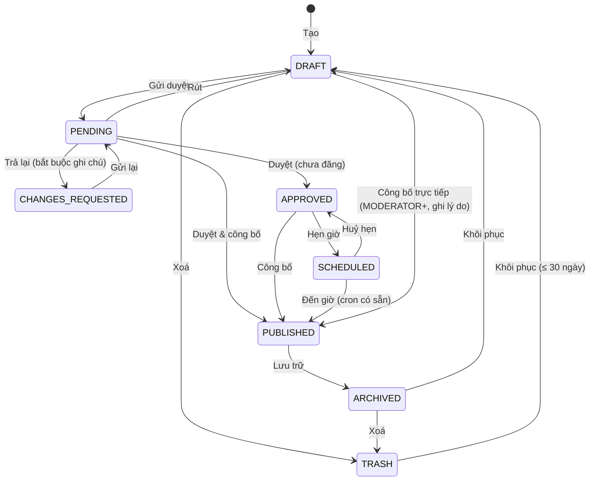

# TÀI LIỆU THIẾT KẾ KỸ THUẬT

# Tái cấu trúc toàn diện hệ thống website TsuDEV (tsudev.com) - v2.0

| Thuộc tính          | Giá trị                                                                                                                      |
| ------------------- | ---------------------------------------------------------------------------------------------------------------------------- |
| Mã tài liệu         | TSU-TDD-2026-001                                                                                                             |
| Phiên bản           | **2.0** (thay v1.0 cùng ngày; v1.0 giữ nguyên làm hồ sơ)                                                                     |
| Ngày lập            | 19/11/2026                                                                                                                   |
| Chủ sở hữu sản phẩm | TsuDEV (vai trò OWNER)                                                                                                       |
| Đối tượng đọc       | Lập trình viên full-stack, kỹ sư hạ tầng/bảo mật, UI/UX                                                                      |
| Nguồn hiện trạng    | `docs/thiet-ke/ra-quet-20261119.md` (rà quét P1, mã F-xx / F-P1-xx) + mã nguồn repo `tsudev-org/tsudev` tại commit `f1d6225` |
| Kế hoạch thực thi   | phiếu `logs/handover/20261119-65_ke-hoach-tai-cau-truc-toan-dien.md` (phase P4-P9)                                           |
| Trạng thái          | Chương 1-13 (P2) xong; chương 14-23 do phase P3 viết nối                                                                     |
| Bản sao review      | `docs/thiet-ke/tsu-tdd-v2.md` trong repo (qua PR). Tệp này và bản sao phải giống nhau                                        |

> **Quy ước từ khoá**: **PHẢI** = bắt buộc; **NÊN** = khuyến nghị mạnh, bỏ qua phải ghi lý do; **CÓ THỂ** = tuỳ chọn.
> Mỗi yêu cầu có mã để truy vết trong PR và test nghiệm thu:
> `PR-` nguyên tắc · `IA-` kiến trúc thông tin · `DS-` design system · `UI-` app shell · `PG-` trang công khai ·
> `ED-` Studio/trình soạn · `WF-` quy trình duyệt · `ST-` Settings · `AD-` Admin · `MD-` modal/popup/toast ·
> `MO-` chuyển động. Cột **Giải quyết** dẫn mã phát hiện ở bản rà quét; cột **File sẽ sửa** là đường dẫn có thật trong
> repo tại ngày lập (đường dẫn kết thúc bằng `(mới)` là tệp sẽ tạo). Cột **Phase** khớp mục 2 của phiếu kế hoạch.
>
> **Khác v1.0 ở đâu**: v1.0 viết từ ảnh chụp, không đọc mã. v2.0 bám hiện trạng thật: Next 16 **Pages Router** trên
> Cloudflare Workers (OpenNext), 3 service Express gộp `backend-bundle` trên Render free, Neon Postgres 18, R2, hạn
> mức **0đ**; Tiptap 3 + Markdown (ADR-0001, ADR-0003); token từ `.standards/` + `tokens/extensions.tsudev-web.json`;
> font Chivo Mono; chỉ chế độ Sáng · Tối · Hệ thống. Đề xuất nào của v1.0 trái các điều đó đều bị thay, có ghi lý do.

---

## Mục lục

1. Tóm tắt điều hành
2. Hiện trạng đã đo (tóm từ rà quét P1)
3. Mục tiêu, nguyên tắc, chỉ số thành công
4. Kiến trúc thông tin & sơ đồ URL (Pages Router)
5. Design system theo token thật
6. App shell
7. Đặc tả trang công khai
8. TsuDEV Studio - viết và xuất bản
9. Quy trình kiểm duyệt, phát hành, gắn nhãn
10. Khu vực Tài khoản (Settings)
11. Khu vực Quản trị (Admin)
12. Danh mục Modal / Popup / Drawer / Toast
13. Chuyển động & vi tương tác
    14-23. (phase P3) Kiến trúc kỹ thuật, dữ liệu, API, bảo mật, pháp lý, giám sát, hiệu năng/SEO/a11y, CI/CD, lộ trình

---

## 1. Tóm tắt điều hành

tsudev.com là cổng phát hành của hệ sinh thái TsuDEV: danh bạ ứng dụng (`/apps`, dữ liệu tĩnh `ECOSYSTEM_APPS`),
bản phát hành có SHA-256 do máy chủ tính + chữ ký Ed25519, blog, tài liệu, tài khoản dùng chung (mật khẩu Argon2id,
TOTP, passkey, OIDC provider cho app khác). Phần nền **mạnh hơn v1.0 tưởng**: đã có quy trình
Nháp → Chờ duyệt → Hẹn giờ → Công khai → Lưu trữ, lịch sử phiên bản, trình soạn Tiptap, trung tâm bảo mật cá nhân
và quản trị, nhật ký kiểm toán chỉ-thêm, CSP có băm/nonce, HSTS preload.

Cái yếu là **lớp trình bày và sự gắn kết**: trang `/author` dồn form + thống kê + danh sách vào một trang 2.618 px
(F-04), có hai lối tạo bài song song (form thô và trình soạn); trang công khai **vẽ sai** phần lớn cú pháp mà trình
soạn cho chèn (F-P1-01, P0); giao diện admin mở cho MEMBER (F-P1-02, API vẫn chặn); `/settings/profile` một cột dài
có lỗi a11y critical (F-10, F-P1-05); menu tài khoản thiếu lối vào Studio/Quản trị/Bảo mật (F-15); không có bảng lệnh
Ctrl+K (F-P1-12), không có trang chi tiết app (F-11), changelog, security.txt (F-18); xác nhận nguy hiểm dùng
`confirm()` của trình duyệt ở 9 tệp.

Đợt tái cấu trúc làm 5 việc, mỗi việc gắn phase:

1. **Sửa cái đang hỏng trước** (đầu P4): bộ vẽ Markdown dùng chung `marked` (ADR-0003), bỏ mặc định "Công bố" (F-01,
   F-P1-08), tràn ngang trang chủ 390 px (F-P1-03).
2. **Studio** (P4 frontend, P7 có migration): `/author` thành không gian làm việc 3 vùng, một lối viết duy nhất, tự
   lưu, tải ảnh R2, xem trước thật, điểm SEO; sau đó trạng thái Yêu cầu sửa / Đã duyệt / Thùng rác, nhãn biên tập,
   checklist phía máy chủ.
3. **App shell + Settings** (P5): menu tài khoản đủ lối vào, bảng lệnh Ctrl+K dùng `/api/search`, mega-menu Hệ sinh
   thái, chân trang gọn; `SettingsLayout` có thanh bên; `AdminGate` + `AdminLayout` dùng chung.
4. **Trang công khai** (P6): `/apps/[slug]`, docs 3 cột, blog theo chuyên mục, `/changelog`, `/security`.
5. **Tuân thủ và cứng hoá** (P8-P9): báo cáo nội dung, takedown có SLA, xuất/xoá dữ liệu cá nhân, header và CSP chặt
   hơn, đo liên tục (Lighthouse CI, axe trong E2E).

Mọi đề xuất giữ **0đ** (`docs/free-tier.md`): không Valkey, Meilisearch, ClamAV, Vault, K8s hay máy chủ WebSocket
thường trực. Tìm kiếm = Postgres + `unaccent`; quét tệp = magic bytes + danh sách loại (bản phát hành đã có
VirusTotal); WAF = Cloudflare; nhật ký = Workers Logs/Render + bảng sự kiện trong Postgres.

---

## 2. Hiện trạng đã đo (tóm từ rà quét P1)

Chi tiết và cách đo: `docs/thiet-ke/ra-quet-20261119.md`. Chương này chỉ giữ những gì các chương sau dẫn tới.

### 2.1. Nền tảng

| Lớp             | Hiện trạng                                                                                                                                    |
| --------------- | --------------------------------------------------------------------------------------------------------------------------------------------- |
| Frontend        | MỘT app `apps/frontend-main`: Next 16 **Pages Router**, React 19, Tailwind 4, OpenNext trên Cloudflare Workers; 7 trang đọc là ISR (cache R2) |
| BFF             | `pages/api/*/[...path].ts` proxy tới service; ký khẳng định danh tính bằng `INTERNAL_IDENTITY_SECRET`; IP người gọi qua `lib/clientIp.ts`     |
| Backend         | content (4001), storage (4002), auth (4004) - Express, gộp `services/backend-bundle` trên Render free                                         |
| Dữ liệu         | Neon Postgres 18 qua `@tsudev/db` (Prisma); R2 cho tệp phát hành + ảnh                                                                        |
| Trình soạn      | Tiptap 3 + `@tiptap/markdown` (`components/MarkdownEditor.tsx`) ở `/author/posts/[slug]` (gồm `new`); form textarea thô ở `/author`           |
| Bộ vẽ công khai | `lib/md.ts` - regex tự viết, **lệch trình soạn** (F-P1-01) ⇒ ADR-0003 thay bằng `marked` 17.0.6                                               |
| Giao diện chung | `packages/ui`: `SiteHeader`, `SiteFooter`, `Layout`, `Modal`, `Toast`, `Input`, `Button`, `Card`, `Badge`, `EmptyState`, `TableOfContents`... |
| Quyền           | `Role` GUEST<MEMBER<VIP<AUTHOR<MODERATOR<ADMIN<OWNER; `requireRole()` đọc DB, fail closed; ADMIN/OWNER bắt buộc TOTP (`MFA_REQUIRED`)         |

### 2.2. Điểm mạnh giữ nguyên

- Quy trình bài viết có trạng thái, hẹn giờ, lịch sử phiên bản (`/author/posts/[slug]/history`), so khác biệt theo
  dòng (`lib/lineDiff.ts`), xoá mềm có trigger chặn xoá cứng.
- Bảo mật: Argon2id, passkey, TOTP + mã dự phòng, step-up (`StepUpDialog`), thu hồi phiên (`sessionVersion`),
  `SecurityEvent`, `TrustAuditLog` chỉ-thêm, Turnstile, rate limit trên Postgres, CSP băm + nonce, HSTS preload,
  `X-Frame-Options: DENY`, COOP/CORP.
- Tương phản màu: 0 lỗi ở cả Sáng lẫn Tối (cổng `packages/ui/test/contrast.test.ts`). CLS ≈ 0 mọi trang.
- RSS (`/feed.xml`), sitemap, ISR giữ bản cũ khi upstream lỗi (`keepStaleOnFailure`).

### 2.3. Phát hiện còn mở (đầu vào của chương 3-13)

| Mã      | Mức | Tóm tắt                                                                                  | Chương xử lý |
| ------- | --- | ---------------------------------------------------------------------------------------- | ------------ |
| F-P1-01 | P0  | Trang công khai không vẽ nghiêng/gạch/H4/danh sách số/`---`/bảng/trích dẫn/chú thích ảnh | 7, 8         |
| F-01    | P1  | Ô "Công bố" mặc định tích ở `/author`                                                    | 8            |
| F-P1-08 | P2  | Như F-01 ở form "Thêm dự án mới" `/admin/projects`                                       | 11           |
| F-P1-02 | P1  | MEMBER/AUTHOR mở được giao diện 4 trang `/admin/*`                                       | 4, 11        |
| F-P1-03 | P1  | Trang chủ cuộn ngang 24 px ở 390 px (`HomeShowcase.tsx`)                                 | 7            |
| F-P1-04 | P1  | Nút Menu di động thiếu `aria-expanded`; 768-1279 px không có ô tìm                       | 6            |
| F-P1-05 | P1  | `/settings/profile` 5 ô không gắn nhãn (axe critical)                                    | 10           |
| F-02    | P2  | Không tự lưu, không thùng rác; "Xoá" ở danh sách xoá ngay                                | 8, 9         |
| F-04    | P2  | `/author` một trang dài, tham số URL trộn                                                | 8            |
| F-05    | P2  | Hai lối tạo bài (form thô + Tiptap)                                                      | 8            |
| F-06    | P2  | Nhóm tài liệu là chữ tự do                                                               | 8, 9         |
| F-07    | P2  | `/docs` danh sách không có thanh bên                                                     | 7            |
| F-08    | P2  | "Viết bài" ở menu công khai                                                              | 6            |
| F-10    | P2  | `/settings/profile` 4 thẻ dọc 2.470 px, mỗi thẻ một nút lưu                              | 10           |
| F-11    | P2  | Không có `/apps/[slug]`                                                                  | 7            |
| F-12    | P3  | Ô chọn trên thẻ app không chú thích                                                      | 7            |
| F-13    | P2  | Blog chưa có trang chuyên mục/thẻ, ảnh bìa trên danh sách                                | 7            |
| F-14    | P2  | Chân trang cột Hệ sinh thái 11 dòng, lộ tên repo                                         | 6            |
| F-15    | P1  | Menu tài khoản chỉ có Hồ sơ/Đăng xuất (cả OWNER)                                         | 6            |
| F-16    | P2  | `/docs` một cột chừa trống nửa phải                                                      | 7            |
| F-17    | P3  | Thống kê tác giả chỉ 2 số                                                                | 8            |
| F-18    | P2  | Không có `/.well-known/security.txt`, `/changelog`                                       | 7            |
| F-P1-06 | P2  | Chân trang: `heading-order` + `link-in-text-block` ở mọi trang                           | 6            |
| F-P1-07 | P2  | `/search`: `nested-interactive`, listbox không tên                                       | 6, 7         |
| F-P1-09 | P2  | Nút thanh công cụ trình soạn: nhãn ARIA khác chữ hiện                                    | 8            |
| F-P1-10 | P2  | 3 trang admin không có `h1`                                                              | 11           |
| F-P1-11 | P2  | Turnstile `aria-prohibited-attr`; `definition-list` ở `/ung-ho`; hai `nav` trùng nhãn    | 6, 7         |
| F-P1-12 | P2  | Không có bảng lệnh Ctrl+K                                                                | 6            |
| F-P1-13 | P3  | `/author/posts/new/history` trả 200 thay vì 404                                          | 8            |
| F-P1-14 | P3  | CSP `connect-src` chặn `data:` từ Turnstile (ồn nhật ký)                                 | P3 (ch. 17)  |
| F-P1-15 | P3  | Trang gác quyền trả 200 + vỏ, không `noindex`                                            | 4            |
| F-MOD   | P2  | `confirm()` trình duyệt ở 9 tệp; không hệ toast chung; trạng thái rỗng là chữ trơn       | 12           |

`F-MOD` gom ghi chép mục 7 của bản rà quét (không có mã riêng ở đó). F-03 sai (đã có trung tâm bảo mật), F-09 đã
đóng - không có yêu cầu nào trong tài liệu này cho hai mã đó.

---

## 3. Mục tiêu, nguyên tắc, chỉ số thành công

### 3.1. Nguyên tắc

| Mã    | Nguyên tắc                                                                                                                                                                                                          |
| ----- | ------------------------------------------------------------------------------------------------------------------------------------------------------------------------------------------------------------------- |
| PR-01 | **Tách vùng theo vai trò**: Công khai · Tài khoản · Studio · Quản trị. Người đọc không thấy công cụ nội bộ trong điều hướng công khai; lối vào Studio/Quản trị nằm trong menu tài khoản.                            |
| PR-02 | **API là ranh giới thật, giao diện chỉ là lịch sự**. Gác quyền ở trang (`AdminGate`) để không vẽ form vô nghĩa; quyền vẫn do `requireRole()` đọc DB quyết định. Không thêm hệ quyền thứ hai.                        |
| PR-03 | **An toàn theo mặc định**: mọi thao tác có hậu quả công khai (đăng, xoá, đổi quyền, thu hồi) mặc định ở trạng thái an toàn, có xác nhận bằng `Modal` (không `confirm()`), và hoàn tác được khi dữ liệu cho phép.    |
| PR-04 | **Một nguồn sự thật cho mỗi thứ**: Markdown cho nội dung (ADR-0003), `config/topology.json` cho cổng/tên miền, token `.standards/` + `tokens/extensions.tsudev-web.json` cho màu, `ECOSYSTEM_APPS` cho danh bạ app. |
| PR-05 | **0đ là ràng buộc cứng**: đề xuất cần dịch vụ trả phí hoặc tiến trình thường trực thứ hai ⇒ ghi "không làm" kèm lý do, hoặc thay bằng phương án chạy trên Workers/Render free/Neon/R2.                              |
| PR-06 | **Tiếng Việt trước tiên**: nhãn, lỗi, slug không dấu; ngày `DD/MM/YYYY` qua `lib/format.ts`; gạch ngang chỉ `-`.                                                                                                    |
| PR-07 | **A11y và hiệu năng là điều kiện nghiệm thu**: mỗi phase giao diện kết thúc với 0 lỗi axe critical + serious trên các trang nó chạm, không cuộn ngang ở 390 px.                                                     |
| PR-08 | **Không giả**: mục chưa có backend ghi "sắp có" và vô hiệu, không vẽ dữ liệu giả (luật phiếu P5).                                                                                                                   |
| PR-09 | **Cổng chống tái phát đi cùng bản sửa**: mỗi lỗi đã đo (F-xx) khi sửa PHẢI kèm test hoặc kiểm tra CI bắt lại được nó (vd. test khứ hồi ADR-0003, kiểm `overflowX` 390 px, axe trong E2E).                           |

### 3.2. Chỉ số thành công (đo 60 ngày sau P9)

Mốc gốc lấy từ rà quét P1 mục 6 (lượt 2, máy đo có tải - mốc thô). v1.0 đặt "Hiệu năng ≥ 95"; v2.0 hạ về mức đạt
được trên Workers free với trang chủ có băng chuyền, và đo bằng Lighthouse CI thay vì máy dev có tải.

| Chỉ số                                                | Mốc 19/11/2026                       | Mục tiêu                        |
| ----------------------------------------------------- | ------------------------------------ | ------------------------------- |
| Lighthouse di động `/` `/apps` `/blog` `/docs` (Perf) | 65 / 80 / 89 / 59                    | ≥ 85 cả bốn (Lighthouse CI, P9) |
| Lighthouse A11y / Best Practices / SEO                | 95 / 100 / 100                       | 100 / 100 / 100                 |
| LCP di động p75                                       | 1,9-3,2 s                            | < 2,5 s                         |
| CLS                                                   | ≈ 0                                  | < 0,05 (giữ)                    |
| axe critical + serious trên 33 route                  | ≥ 7 luật vi phạm (bản rà quét mục 5) | 0                               |
| Cuộn ngang ở 390 px                                   | 1 trang (`/`)                        | 0, có kiểm trong E2E            |
| Cú pháp thanh công cụ vẽ sai trên trang công khai     | 8 loại (ADR-0003)                    | 0, có test khứ hồi              |
| Trang `/admin/*` vẽ form cho người thiếu quyền        | 4/7                                  | 0/7                             |
| `confirm()` của trình duyệt                           | 9 tệp                                | 0 (grep trong CI)               |
| Header bảo mật (securityheaders.com)                  | chưa đo điểm; thiếu security.txt     | A+ và có security.txt (P9)      |
| Tài khoản ADMIN/OWNER có 2FA                          | 100 % (backend ép `MFA_REQUIRED`)    | giữ 100 %                       |
| Bài đăng nhầm do mặc định "Công bố"                   | có khả năng (F-01)                   | 0 - mặc định Nháp               |

---

## 4. Kiến trúc thông tin & sơ đồ URL (Pages Router)

### 4.1. Bốn vùng

| Vùng      | Ai vào                      | Vỏ trang (chương 6)     | Gác ở trang                    | Gác thật (API)                                   |
| --------- | --------------------------- | ----------------------- | ------------------------------ | ------------------------------------------------ |
| Công khai | mọi người                   | `Layout` + `SiteHeader` | -                              | `/api` content: xác thực tuỳ chọn                |
| Tài khoản | MEMBER+                     | `SettingsLayout` (mới)  | `useSession` ⇒ chuyển `/login` | `/api/identity/*` theo phiên                     |
| Studio    | AUTHOR+ (duyệt: MODERATOR+) | `StudioLayout` (mới)    | `RoleGate min="AUTHOR"` (mới)  | `/api/author/*` `requireRole('AUTHOR')`          |
| Quản trị  | ADMIN+ (accounts: OWNER)    | `AdminLayout` (mới)     | `RoleGate min="ADMIN"`         | `/api/admin/*` `requireAdmin()` + `MFA_REQUIRED` |

v1.0 đề xuất route groups của App Router; v2.0 giữ **Pages Router**: mỗi vùng là một component vỏ bọc trang (gán qua
`Page.getLayout` trong `pages/_app.tsx`), không đổi router (đổi router cần ADR riêng và đụng ISR/OpenNext - không
có lợi ích tương xứng ở quy mô này).

### 4.2. Sơ đồ URL

Ký hiệu: **(có)** đã tồn tại · **(mới)** tạo mới · **(đổi)** đổi đường dẫn, có chuyển hướng. Trang ISR giữ nguyên
danh sách trong `test/isrPages.test.ts`; trang mới công khai có dữ liệu từ DB thì PHẢI vào danh sách đó.

```
CÔNG KHAI
/                                  Trang chủ                                    (có, ISR)
/apps                              Danh bạ ứng dụng (tĩnh, ECOSYSTEM_APPS)      (có)
/apps/[slug]                       Chi tiết ứng dụng + bản phát hành            (mới, P6, ISR)
/install                           Cài bằng một lệnh (tách khay từ /apps)       (mới, P6, tĩnh)
/blog  /blog/[slug]                Blog                                         (có, ISR)
/blog/chuyen-muc/[slug]            Bài theo chuyên mục (model Category có sẵn) (mới, P6, ISR)
/docs  /docs/[slug]                Tài liệu (3 cột ở P6)                        (có, ISR)
/projects  /projects/[slug]        /projects → /apps (có); [slug] giữ cho dự án không phải app
/changelog                         Nhật ký thay đổi từ bản phát hành             (mới, P6, ISR)
/security                          Chính sách bảo mật, công bố lỗ hổng          (mới, P6, tĩnh)
/.well-known/security.txt          RFC 9116                                     (mới, P6)
/search?q=                         Tìm kiếm hợp nhất                            (có)
/privacy /terms /rules /ung-ho     Pháp lý, ủng hộ                              (có)
/feed.xml /sitemap.xml /robots.txt                                              (có)

XÁC THỰC (giữ nguyên đường dẫn - link trong thư đã gửi trỏ vào chúng)
/login /signup /forgot-password /reset-password /verify-email
/confirm-email-change /revoke-sessions /oidc/interaction/[uid]

TÀI KHOẢN (đăng nhập)
/settings                          → /settings/profile                          (mới, P5)
/settings/profile                  Hồ sơ công khai                              (có, làm lại P5)
/settings/account                  Email, tên đăng nhập, bí danh email           (mới, P5 - tách từ profile)
/settings/security                 Mật khẩu, 2FA, passkey, tư thế bảo mật       (có)
/settings/sessions                 Phiên & thiết bị                             (mới, P5 - tách từ security)
/settings/privacy                  Quyền riêng tư, xuất/xoá dữ liệu             (mới, P5 vỏ; P8 chức năng)
/settings/activity                 Sự kiện bảo mật của chính mình               (mới, P5 - SecurityEventList có sẵn)
/settings/connected                Ứng dụng OIDC đã cấp quyền                   (mới, P5 vỏ "sắp có" nếu chưa có API)

STUDIO (AUTHOR+)
/studio                            Tổng quan cá nhân                            (đổi từ /author, P4)
/studio/posts                      Bảng bài viết                                (mới, P4 - tách từ /author)
/studio/posts/[slug]               Trình soạn ("new" = bài mới)                 (đổi từ /author/posts/[slug])
/studio/posts/[slug]/history       Lịch sử & so sánh                            (đổi)
/studio/docs  /studio/docs/[slug]  Tài liệu                                     (mới, P4 - từ AuthorDocs)
/studio/media                      Ảnh đã tải lên R2 (GET /api/files)            (mới, P4)
/studio/review                     Hàng chờ duyệt (MODERATOR+)                   (đổi từ /admin/review, P7)

QUẢN TRỊ (ADMIN+)
/admin                             Bảng điều khiển                              (có)
/admin/accounts                    Tài khoản & vai trò (OWNER)                  (có)
/admin/content                     Nội dung toàn site                           (có)
/admin/projects                    Dự án & bản phát hành                        (có)
/admin/security                    Trung tâm bảo mật                            (có)
/admin/release-security            An ninh phát hành                            (có)
/admin/moderation                  Báo cáo nội dung + takedown SLA              (mới, P8)
/admin/audit                       Nhật ký kiểm toán (TrustAuditLog, SecurityEvent) (mới, P8)
```

**Không làm so với v1.0 (có lý do):** `/games/*` (trò chơi là site ngoài, danh bạ `ECO_GAMES` đã đủ); `/status`
(cần máy đo ngoài thường trực - P9 dùng dịch vụ uptime miễn phí và chỉ liên kết ra); `/authors/[username]`,
`/blog/series/*`, `/studio/calendar`, `/studio/analytics` riêng (để sau P7 khi có `seriesId`; lịch hẹn giờ hiển thị
trong `/studio/posts` lọc theo SCHEDULED); `/admin/roles` (thang vai trò cố định trong enum - xem chương 9);
`/admin/redirects`, `/admin/settings` cờ tính năng (không có kho cấu hình động 0đ đáng làm); `/feed.json`; tiền tố
`/legal/*` (đổi `/privacy` `/terms` làm gãy link trong thư và trang đồng ý OIDC, không được gì); `/mfa`, `/logout`
riêng (đã nằm trong luồng `/login` và next-auth).

### 4.3. Yêu cầu

| Mã    | Yêu cầu                                                                                                                                                                                                                                                                   | Giải quyết       | File sẽ sửa                                                                                                  | Phase |
| ----- | ------------------------------------------------------------------------------------------------------------------------------------------------------------------------------------------------------------------------------------------------------------------------- | ---------------- | ------------------------------------------------------------------------------------------------------------ | ----- |
| IA-01 | Mỗi trang gác quyền khai `Page.getLayout` + vai trò tối thiểu; `RoleGate` đọc `session.role`, trong lúc chờ phiên vẽ khung xương, thiếu quyền vẽ `EmptyState` "Không có quyền" + liên kết về trang trước. KHÔNG gọi API khi thiếu quyền.                                  | F-P1-02          | `pages/_app.tsx`, `components/RoleGate.tsx` (mới)                                                            | P5    |
| IA-02 | `/author*` → `/studio*` bằng `redirects()` **308** (giữ query); giữ chuyển hướng vô thời hạn (rẻ, không có lý do bỏ). Liên kết nội bộ đổi sang `/studio` trong cùng PR; grep `'/author'` trong `apps/` và `packages/ui` phải còn 0 ngoài bảng chuyển hướng.               | F-04             | `next.config.js`, `packages/ui/src/components/SiteHeader.tsx`, `pages/author.tsx` → `pages/studio/index.tsx` | P4    |
| IA-03 | `/admin/review` → `/studio/review` (308) khi trang chuyển vùng; quyền xem = MODERATOR+.                                                                                                                                                                                   | -                | `next.config.js`, `pages/admin/review.tsx`                                                                   | P7    |
| IA-04 | Danh sách dùng `page`/`page_size` (+ `sort`, `status`, `q`) theo `.standards/docs/DATA_TABLE.md` qua `lib/useUrlPaging.ts`. MỘT danh sách mỗi URL - bỏ cặp `doc_page`/`doc_page_size` khi Bài viết và Tài liệu tách trang. (v1.0 đề xuất `per_page`: trái quy ước chung.) | F-04             | `lib/useUrlPaging.ts`, `pages/studio/posts.tsx` (mới), `pages/studio/docs/index.tsx` (mới)                   | P4    |
| IA-05 | Tiền tố riêng tư `/studio`, `/settings`, `/admin`, `/author` trả `X-Robots-Tag: noindex, nofollow` và `Cache-Control: private, no-store` từ `proxy.ts`; `robots.txt` thêm `Disallow` cho các tiền tố đó.                                                                  | F-P1-15          | `proxy.ts`, `pages/robots.txt.ts`, `test/csp.test.ts`                                                        | P5    |
| IA-06 | Trang công khai mới có dữ liệu DB (`/apps/[slug]`, `/blog/chuyen-muc/[slug]`, `/changelog`) là ISR, dùng `keepStaleOnFailure()` và được thêm vào `test/isrPages.test.ts`; vào `sitemap.xml`.                                                                              | F-11, F-13, F-18 | `lib/isr.ts`, `test/isrPages.test.ts`, `pages/sitemap.xml.ts`                                                | P6    |
| IA-07 | `/settings` (không đuôi) chuyển `/settings/profile`; mục Settings chưa có API vẽ trạng thái "Sắp có" vô hiệu (PR-08), không ẩn.                                                                                                                                           | F-10             | `next.config.js`, `components/SettingsLayout.tsx` (mới)                                                      | P5    |

---

## 5. Design system theo token thật

### 5.1. Định hướng thẩm mỹ

Giữ đúng hướng chủ dự án đã chốt (10/11 và 16/11/2026), không dựng "Owl Terminal" của v1.0 thành hệ màu mới:

- **Đen tuyền `#0A0A0A` + xanh logo** (`--primary` `#38BDF8` Tối / `#0868C4` Sáng; nhấn `--accent` `#3B9EFF`/`#0E7490`),
  bố cục học supabase.com: một nền liền mạch, thẻ = bề mặt + viền hairline, hover đậm viền.
- **Chỉ Sáng · Tối · Hệ thống**; "Hệ thống" giải trong JavaScript trước khi vẽ, không treo `prefers-color-scheme`.
  Bộ chọn ở chân trang (`ThemeToggle.tsx`).
- Dấu ấn riêng được GIỮ từ v1.0 vì làm được bằng token sẵn có: **dải lệnh** (lệnh cài đặt có dấu nhắc + nút Chép +
  "Đã chép") - đã có ở `components/InstallCommands.tsx`, chuẩn hoá thành component dùng chung; **lưới mạch mờ** ở hero
  dùng `--grid-line` + `--glow` (đã có `tsu-hero-bg`).
- **Không** thêm màu riêng cho từng sản phẩm như v1.0 đề xuất: 10+ màu nhấn làm vỡ mã màu nhóm hành động `--icon-*`
  (giới hạn 6 có chủ đích, `docs/design-system.md`). Phân biệt app bằng biểu tượng (`ecosystem.ts > icon`, ô
  `.tsu-monogram`) và màu nền tảng `--platform-*` có sẵn.

### 5.2. Token (nguồn duy nhất)

Đường đi: `.standards/tokens/design-tokens.json` (chỉ đọc) + `tokens/extensions.tsudev-web.json` ⇒ `npm run
tokens:sync` ⇒ `packages/ui/src/tokens.css` (artifact, KHÔNG sửa tay; `tokens:check` canh). Bảng ánh xạ v1.0 → token thật
để lập trình viên đọc v1.0 không đặt biến mới:

| v1.0 đề xuất                              | Token thật                                                                                                                                       |
| ----------------------------------------- | ------------------------------------------------------------------------------------------------------------------------------------------------ |
| `--bg`, `--surface-1..3`                  | `--bg-base`, `--bg-surface`, `--bg-subtle`, `--bg-hover`                                                                                         |
| `--border`, `--border-strong`             | `--border`, `--border-strong` (chỉ trang trí), `--border-control` (ranh giới ô/nút, ≥ 3:1)                                                       |
| `--text`, `--text-muted`, `--text-subtle` | `--text-primary`, `--text-secondary`, `--text-muted`, `--text-link`                                                                              |
| `--brand-400/500/600`, `--brand-glow`     | `--primary`, `--primary-hover`, `--primary-active`, `--on-primary`, `--accent`, `--glow`                                                         |
| `--success/warning/danger/info`           | như tên + `-ink` (chữ) + `-tint` (nền nhạt) + `--on-status`                                                                                      |
| `--radius-*`, `--space-*`                 | `--radius-none/sm/md/lg`, `--sp-1..12`                                                                                                           |
| `--dur-*`, `--ease-*`                     | `--motion-fast/base/slow`, `--motion-easing(-enter/-exit/-emphasized)`, `--motion-stagger-1..3`                                                  |
| (không có)                                | `--z-dropdown/sticky/modal-overlay/modal/toast/tooltip`, `--overlay`, `--focus-ring`, `--shadow-sm/md/lg`, `--control-h`, `--row-h`, `--measure` |

### 5.3. Kiểu chữ

| Vai trò             | Font / token                                | Ghi chú                                                            |
| ------------------- | ------------------------------------------- | ------------------------------------------------------------------ |
| Giao diện, nội dung | Be Vietnam Pro (`--font-family`)            | Đã có, subset `vietnamese`; số 0 trơn                              |
| Mã, lệnh, slug      | **Chivo Mono** (`--font-mono`)              | v1.0 nói JetBrains Mono - SAI, chủ dự án đã bỏ (số 0 có chấm)      |
| Thang cỡ            | `--fs-xs/sm/body-web/h4..h1/display-sm..lg` | Thân bài: `--fs-body-web-lg`, `--lh-long`, rộng tối đa `--measure` |

### 5.4. Thư viện thành phần

Không thêm Radix/Chromatic như v1.0 (phụ thuộc lớn cho lợi ích nhỏ; Chromatic không 0đ). Mở rộng `packages/ui` hiện
có, mỗi component mới có story trong `packages/ui/src/stories/` và test vai trò ARIA:

| Có sẵn (giữ)                                                                                                                                                                                | Thêm mới (phase)                                                                                                                                                                                                                                                                                                     |
| ------------------------------------------------------------------------------------------------------------------------------------------------------------------------------------------- | -------------------------------------------------------------------------------------------------------------------------------------------------------------------------------------------------------------------------------------------------------------------------------------------------------------------- |
| `Button`, `Input`, `Card`, `Badge`, `Avatar`, `Modal`, `Toast`, `Upload`, `EmptyState`, `Stat`, `TableOfContents`, `SectionHeading`, `Article`, `Container`, `Icon`, `Logo`, `RecordFooter` | `ConfirmDialog` (P4), `Drawer` (P4), `Disclosure` (nút + `aria-expanded`, KHÔNG `role=menu` - lý do ở `SiteHeader.tsx` `UserMenu`, P5), `Tabs` (P4), `CommandPalette` (P5), `CommandStrip` (P6, rút từ `InstallCommands`), `Skeleton` (P4), `Callout` (P4), `TagInput` chip (P4), `StickyBar` (P4/P5), `Switch` (P5) |

### 5.5. Yêu cầu

| Mã    | Yêu cầu                                                                                                                                                                                              | Giải quyết | File sẽ sửa                                                                           | Phase |
| ----- | ---------------------------------------------------------------------------------------------------------------------------------------------------------------------------------------------------- | ---------- | ------------------------------------------------------------------------------------- | ----- |
| DS-01 | Component mới chỉ dùng token (grep mã hex trong `packages/ui/src/components` = 0 ngoài `Logo`). Màu chữ trên nền đặc dùng `--on-primary`/`--on-status`, không cắm trắng.                             | -          | `packages/ui/src/components/*` (mới)                                                  | P4-P6 |
| DS-02 | Mỗi cặp màu mới (vd. nền `Callout` × chữ) thêm vào `packages/ui/test/contrast.test.ts`, đạt AA ở cả hai chế độ.                                                                                      | -          | `packages/ui/test/contrast.test.ts`                                                   | P4    |
| DS-03 | `ConfirmDialog` dựng trên `Modal` có sẵn: tiêu đề, mô tả hậu quả, nút nguy hiểm dùng `--danger`, tuỳ chọn "gõ lại tên để xác nhận"; trả Promise để thay `confirm()` một-đổi-một.                     | F-MOD      | `packages/ui/src/components/ConfirmDialog.tsx` (mới), `packages/ui/src/index.tsx`     | P4    |
| DS-04 | `Input` bắt buộc gắn nhãn: nhận `label` và tự sinh `id` (`useId`) cho `<label htmlFor>`; thiếu `label` và `aria-label` ⇒ cảnh báo dev.                                                               | F-P1-05    | `packages/ui/src/components/Input.tsx`                                                | P5    |
| DS-05 | `CommandStrip` (dải lệnh) dùng chung cho `/apps`, `/install`, `/apps/[slug]`, khối mã trong bài: `--font-mono`, dấu nhắc trang trí `aria-hidden`, nút Chép có trạng thái đọc cho trình đọc màn hình. | F-11       | `packages/ui/src/components/CommandStrip.tsx` (mới), `components/InstallCommands.tsx` | P6    |
| DS-06 | `EmptyState` có biến thể `error` và `forbidden`, nhận hành động gợi ý (nút/liên kết); thay các câu chữ trơn "Không tải được..." ở trang admin/studio.                                                | F-MOD      | `packages/ui/src/components/EmptyState.tsx`                                           | P4-P5 |
| DS-07 | Storybook: mỗi component mới một story; nghiệm thu bằng đếm story vẽ được (Storybook không nằm trong CI - `docs/design-system.md` §Storybook).                                                       | -          | `packages/ui/src/stories/*` (mới)                                                     | P4-P6 |
| DS-08 | Mật độ `data-density="compact"` bật mặc định trong `StudioLayout` và `AdminLayout` (bảng nhiều dòng); công khai giữ comfortable.                                                                     | F-04       | `components/StudioLayout.tsx` (mới), `components/AdminLayout.tsx` (mới)               | P4-P5 |

---

## 6. App shell

### 6.1. Bốn vỏ trang

| Vỏ                | Dùng cho                  | Cấu trúc                                                                                                                                                  | Tệp                                                                                      |
| ----------------- | ------------------------- | --------------------------------------------------------------------------------------------------------------------------------------------------------- | ---------------------------------------------------------------------------------------- |
| `Layout` (có)     | trang công khai, xác thực | `SiteHeader` + nội dung (`Container`) + `SiteFooter`                                                                                                      | `packages/ui/src/components/Layout.tsx`                                                  |
| `DocsLayout`      | `/docs/[slug]`            | `Layout` + thanh bên trái (cây theo chuyên mục) + nội dung `--measure` + mục lục phải (`TableOfContents` có sẵn); dưới 1024 px gập thanh bên vào `Drawer` | `components/DocsLayout.tsx` (mới)                                                        |
| `SettingsLayout`  | `/settings/*`             | `Layout` + thanh bên trái (nhóm mục) + nội dung tối đa 720 px + `StickyBar` lưu                                                                           | `components/SettingsLayout.tsx` (mới)                                                    |
| `WorkspaceLayout` | `/studio/*`, `/admin/*`   | `SiteHeader` thu gọn + thanh bên thu gọn được (nhớ trạng thái ở localStorage) + vùng làm việc toàn rộng; KHÔNG `SiteFooter`; `data-density="compact"`     | `components/WorkspaceLayout.tsx` (mới); `StudioLayout`, `AdminLayout` là cấu hình của nó |

### 6.2. Header công khai

```
┌──────────────────────────────────────────────────────────────────────────────────────┐
│ [logo tsudev]  Hệ sinh thái ▾  Ứng dụng  Tài liệu  Blog      [Tìm…  Ctrl K]  [Avatar ▾] │
└──────────────────────────────────────────────────────────────────────────────────────┘
Khách: thay Avatar bằng  Đăng nhập (ghost) + Tải ứng dụng (primary)  - giữ như hiện nay.
```

- Bỏ "Trang chủ" (logo đã là lối về) và "Viết bài" (vào menu tài khoản) - F-08.
- Không chuông thông báo (chưa có hệ thông báo; PR-08) và không nút giao diện ở header (bộ chọn đã chốt ở chân trang).
- "Trò chơi" không lên header: là site ngoài, nằm trong mega-menu.
- Mega-menu **Hệ sinh thái**: lưới theo `EcoCategory` (Hệ thống · Tệp · Mạng · Tiện ích) + cột "Trò chơi" từ `ECO_GAMES`;
  mỗi mục: biểu tượng (`EcoIcon`), tên, mô tả một dòng, chấm nền tảng; cột phải "Cài bằng một lệnh" → `/install`.
  Dữ liệu lấy thẳng `ECOSYSTEM_APPS` (tĩnh, không gọi API). Mẫu disclosure: mở bằng bấm/Enter/Space (KHÔNG mở bằng
  hover - hover gây mở nhầm và không dùng được trên cảm ứng), đóng bằng Esc/bấm ngoài/focus rời, trả focus về nút.
- Ô tìm hiện từ `md` (768 px) dạng nút "Tìm… Ctrl K" mở `CommandPalette`; ô gõ trực tiếp hiện nay (chỉ ≥ `xl`) bỏ - F-P1-04.

### 6.3. Bảng lệnh `Ctrl/⌘ + K`

- Hộp thoại (`Modal` + combobox ARIA 1.2): nhóm **Ứng dụng** (lọc cục bộ `ECOSYSTEM_APPS`, không cần mạng), **Bài viết
  & Tài liệu** (gọi `/api/search?q=&page_size=5`, debounce 200 ms, hủy bằng `AbortController`), **Lệnh nhanh** theo vai
  trò (Viết bài mới, Mở Studio, Quản trị, Bảo mật tài khoản, Đổi giao diện, Đăng xuất).
- Tìm không dấu do backend lo (`unaccent` + `searchBodyNorm` - SEARCH_AND_FILTER); lọc app cục bộ dùng cùng hàm bỏ dấu.
  v1.0 đòi "chịu lỗi gõ": không làm (cần `pg_trgm` - để P3 cân nhắc ở chương dữ liệu).
- Phím: ↑↓ chọn, Enter mở, Ctrl/⌘+Enter tab mới, Esc đóng; `/` khi không ở ô nhập cũng mở. Phím tắt không bắt khi
  đang gõ trong ô nhập/trình soạn (trình soạn có `/` riêng).
- Một combobox dùng lại cho `/search` - sửa F-P1-07 một lần (option KHÔNG chứa liên kết lồng; listbox có `aria-label`).

### 6.4. Menu tài khoản

```
┌──────────────────────────────┐
│ (Avatar) Tên hiển thị        │
│ @username · Tác giả          │   ← vai trò bằng chữ Việt, không lộ email đầy đủ
├──────────────────────────────┤
│ Studio                       │   ← AUTHOR+
│ Quản trị                     │   ← ADMIN+
├──────────────────────────────┤
│ Hồ sơ                        │
│ Bảo mật                      │
│ Cài đặt                      │
├──────────────────────────────┤
│ Đăng xuất                    │
└──────────────────────────────┘
```

Giữ mẫu disclosure có sẵn (Tab qua các liên kết; Esc trả focus). Email chỉ hiện ở `/settings/account` (giảm lộ khi
chia sẻ màn hình). Mục theo vai trò đọc `session.role`; khi phiên `pending` dùng `authHint` như cơ chế hiện có để
không nháy.

### 6.5. Chân trang

```
┌─────────────────────────────────────────────────────────────────────────────┐
│ [logo] TsuDEV - mô tả 2 dòng      Sản phẩm   Tài nguyên   Tài khoản   Pháp lý │
├─────────────────────────────────────────────────────────────────────────────┤
│ Hệ sinh thái: [ic][ic][ic][ic][ic][ic][ic][ic][ic][ic]   Xem tất cả →        │
├─────────────────────────────────────────────────────────────────────────────┤
│ © tsudev  [Sáng | Tối | Hệ thống]                                            │
└─────────────────────────────────────────────────────────────────────────────┘
```

Lưới biểu tượng thay cột 11 dòng (F-14); nhãn là **tên sản phẩm** (`name`), không tên repo (phiếu TC1). Bỏ "Trạng
thái" và số phiên bản của v1.0 (không có nguồn đo 0đ thường trực - chương 19). ⚠️ Chân trang + logo chạm cổng "Bảo vệ
bản quyền" ⇒ PR P5 phần này cần `nguyentrangtinhsu` duyệt; agent dừng và báo.

### 6.6. Di động (< 768 px)

- Header: logo + nút tìm (mở `CommandPalette` toàn màn hình) + nút Menu mở `Drawer` (trái → phải) có accordion Hệ sinh
  thái; nút Menu có `aria-expanded` + `aria-controls` (F-P1-04).
- Studio/Admin dưới 1024 px: đọc, duyệt/trả lại, sửa nhanh; trình soạn đầy đủ hiện gợi ý "dùng màn hình ≥ 1024 px"
  nhưng KHÔNG chặn (vẫn soạn được).
- Vùng chạm ≥ 44 × 44 px (`--control-h` comfortable ≥ 36 px + đệm).

### 6.7. Yêu cầu

| Mã    | Yêu cầu                                                                                                                                                                                                | Giải quyết       | File sẽ sửa                                                                                                | Phase                |
| ----- | ------------------------------------------------------------------------------------------------------------------------------------------------------------------------------------------------------ | ---------------- | ---------------------------------------------------------------------------------------------------------- | -------------------- |
| UI-01 | Bỏ mục `home` và `author` khỏi `NAV`; thêm nút "Hệ sinh thái" (mega-menu, mục 6.2).                                                                                                                    | F-08             | `packages/ui/src/components/SiteHeader.tsx`                                                                | P5                   |
| UI-02 | Mega-menu đọc `ECOSYSTEM_APPS` + `ECO_GAMES`, nhãn là tên sản phẩm; disclosure bấm-để-mở, Esc/bấm-ngoài đóng; test bàn phím.                                                                           | F-14             | `packages/ui/src/components/EcosystemMenu.tsx` (mới), `packages/ui/src/lib/ecosystem.ts`                   | P5                   |
| UI-03 | `CommandPalette` theo mục 6.3; mở bằng Ctrl/⌘+K và `/`; gọi `/api/search` (không thêm endpoint); kết quả là `option` không chứa liên kết lồng.                                                         | F-P1-12, F-P1-07 | `packages/ui/src/components/CommandPalette.tsx` (mới), `pages/api/search.ts` (không đổi), `pages/_app.tsx` | P5                   |
| UI-04 | `/search` dùng lại combobox của UI-03; listbox có tên; axe 0 serious.                                                                                                                                  | F-P1-07          | `pages/search.tsx`                                                                                         | P5                   |
| UI-05 | Menu tài khoản thêm Studio (AUTHOR+), Quản trị (ADMIN+), Bảo mật, Cài đặt; hiện vai trò bằng chữ; bỏ email đầy đủ.                                                                                     | F-15             | `packages/ui/src/components/SiteHeader.tsx` (`UserMenu`)                                                   | P5                   |
| UI-06 | Nút Menu di động: `aria-expanded`, `aria-controls`, mở `Drawer` có bẫy focus; hai `nav` có nhãn khác nhau ("Chính", "Chính - di động").                                                                | F-P1-04, F-P1-11 | `packages/ui/src/components/SiteHeader.tsx`, `packages/ui/src/components/Drawer.tsx` (mới)                 | P5                   |
| UI-07 | Chân trang: tiêu đề cột `h2.sr-only` "Liên kết chân trang" + cột là `h3` (hết `heading-order`); liên kết trong đoạn mô tả gạch chân (hết `link-in-text-block`); lưới biểu tượng thay cột Hệ sinh thái. | F-P1-06, F-14    | `packages/ui/src/components/SiteFooter.tsx`                                                                | P5 ⛔ cổng bản quyền |
| UI-08 | `WorkspaceLayout` (thanh bên thu gọn, breadcrumb, nút tạo chính) dùng cho Studio + Admin; không `SiteFooter`.                                                                                          | F-04, F-P1-10    | `components/WorkspaceLayout.tsx` (mới), `pages/_app.tsx`                                                   | P4-P5                |
| UI-09 | E2E kiểm `document.documentElement.scrollWidth <= 390` trên mọi trang công khai ở khổ 390 px.                                                                                                          | F-P1-03          | `e2e/tests/layout-390.spec.js` (mới)                                                                       | P5                   |

---

## 7. Đặc tả trang công khai

Áp chung cho mọi trang chương này: bộ vẽ Markdown theo ADR-0003 (PG-01) là điều kiện trước mọi khối nội dung mới;
trang có dữ liệu DB là ISR (IA-06); không cuộn ngang ở 390 px (UI-09); ngày qua `lib/format.ts`.

### 7.1. Bộ vẽ nội dung (nền của blog, docs, dự án, xem trước)

Thay `lib/md.ts` (regex) bằng `marked` 17.0.6 + lớp an toàn đúng như ADR-0003 mục 4; giữ chữ ký `renderMarkdown`,
`extractHeadings`, `slugifyHeading`. Phần tử vẽ ra và lớp CSS:

| Markdown                        | HTML                                  | Ghi chú giao diện                                                                                          |
| ------------------------------- | ------------------------------------- | ---------------------------------------------------------------------------------------------------------- |
| `*a*` `~~a~~` `**a**` `` `a` `` | `em` `del` `strong` `code`            | `code` nội dòng nền `--bg-subtle`, `--font-mono`                                                           |
| `##`-`####`                     | `h2`-`h4` có `id` (slug)              | neo `#` hiện khi hover, sao chép liên kết mục                                                              |
| `1.` `-` lồng, `- [ ]`          | `ol` `ul` lồng, ô việc chỉ đọc        | ô việc `disabled`, có nhãn                                                                                 |
| `---`, bảng GFM                 | `hr`, `table` trong khung cuộn ngang  | bảng bọc `div[tabindex=0][role=region][aria-label]` để cuộn được bằng bàn phím, không làm trang cuộn ngang |
| `> a`, `> [!NOTE]`...           | `blockquote`, `aside.callout-<loại>`  | 5 loại map `--info/--success/--primary/--warning/--danger` + `-tint`                                       |
| ``       | `figure > img + figcaption`           | `loading="lazy"`, `decoding="async"`; ảnh R2 có `width/height` nếu biết                                    |
| dòng URL YouTube/Vimeo riêng    | `iframe` `youtube-nocookie.com`/Vimeo | `title` bắt buộc; CSP `frame-src` mở đúng 2 miền (`proxy.ts`)                                              |
| khối mã ` ```lang `             | `pre > code.language-*` + nút Chép    | tô màu cú pháp phía máy chủ lúc ISR nếu gói ≤ 30 KB; không thì để P9                                       |

### 7.2. Trang chủ `/`

Giữ khối hiện có (hero, tìm app, băng chuyền, ziczac #327, blog mới) - chủ dự án vừa duyệt ở phiên 64. Chỉ sửa:
tràn ngang 390 px của `article.tsu-sc` (F-P1-03); băng chuyền và hiệu ứng hiện dần tôn trọng
`prefers-reduced-motion` (chương 13); thêm khối "Mới phát hành" (5 bản gần nhất, từ cùng nguồn `/changelog`) và
"Vì sao tin TsuDEV" (ký Ed25519 + SHA-256 máy chủ + liên kết `/security`). KHÔNG làm terminal gõ chữ tự chạy của
v1.0 (TBT di động trang chủ đã cao nhất - rà quét mục 6) và không "đăng ký nhận tin" (cần dịch vụ thư hàng loạt +
quản lý đồng ý - ngoài 0đ).

### 7.3. Danh bạ `/apps` và `/install`

- Bộ lọc nền tảng/danh mục + sắp xếp (Tên · Mới cập nhật) phản ánh vào URL (`?platform=&category=&sort=`); trang vẫn
  tĩnh, đọc query phía trình duyệt.
- Ô chọn trên thẻ (`SelectCircle`) có nhãn hiện "Thêm vào lệnh cài" + `aria-pressed` (F-12); khi ≥ 1 app được chọn,
  thanh nổi đáy (`InstallTray` có sẵn) hiện lệnh theo nền tảng đoán từ UA (`guessInstallTarget`) + nút Chép.
- Bấm thân thẻ → `/apps/[id]`; nút Website/GitHub là nút phụ mở tab mới, `rel="noopener noreferrer"`.
- `/install`: toàn bộ khối "Cài bằng lệnh" + bộ dựng lệnh (hệ điều hành → kênh → app, dùng `installPlan()`), hướng dẫn
  kiểm khoá APT/RPM và SHA-256 từng bước. `/apps` giữ bản rút gọn + liên kết.

### 7.4. Chi tiết ứng dụng `/apps/[slug]` (mới)

`slug` = `EcoApp.id`. Dữ liệu: phần tĩnh từ `ECOSYSTEM_APPS` (tên, mô tả, nền tảng, kênh cài, website, releases); phần
động - nếu tồn tại `Project` cùng slug - lấy bản phát hành đã niêm phong qua `/api/projects/:slug` (đường hiện có của
`/projects/[slug]`). App không có `Project` vẫn có trang đầy đủ, tab Phát hành chỉ liên kết GitHub Releases.

```
┌──────────────────────────────────────────────────────────────────────────┐
│ Ứng dụng / Hệ thống / Tsu Cwico                                            │
│ [icon]  Tsu Cwico                                                          │
│         Một dòng mô tả                                                     │
│         [Windows] [Hệ thống]                                               │
│         [Tải về (nền tảng đoán từ UA)]  [Website ↗]  [GitHub ↗]            │
├── Tổng quan | Cài đặt | Phát hành | Tài liệu | Bài viết ──────────────────┤
│ Mô tả (Markdown của Project nếu có)          │ Cài nhanh (CommandStrip)    │
│                                              │ SHA-256 [Chép] · Chữ ký ✓   │
│                                              │ Cách tự kiểm tra →          │
└──────────────────────────────────────────────┴─────────────────────────────┘
```

Tab là liên kết neo trong trang (một URL, không tải lại); "Tài liệu"/"Bài viết" lọc qua `/api/search?q=<tên app>` cho
tới khi P7 có liên kết bài ↔ app thật. JSON-LD `SoftwareApplication` (`operatingSystem`, `applicationCategory`,
`softwareVersion` nếu có bản phát hành). KHÔNG đọc User-Agent Client Hints mới (đã có `guessInstallTarget(ua)`).
KHÔNG nút "Theo dõi" (chưa có hệ thông báo).

### 7.5. Blog

- `/blog`: bài ghim (sau P7 khi có `featured`; trước đó bài mới nhất) · chip chuyên mục (từ `Category`) · lưới thẻ
  (ảnh bìa nếu có, chuyên mục, tiêu đề, tóm tắt, ngày, thời gian đọc) · phân trang `page`/`page_size`.
- `/blog/chuyen-muc/[slug]`: như trên, lọc một chuyên mục, có `feed.xml?category=` (mở rộng `pages/feed.xml.ts`).
- `/blog/[slug]`: thanh tiến độ đọc (CSS `animation-timeline: scroll()` nếu trình duyệt hỗ trợ, không thì ẩn - không
  JS cuộn); breadcrumb; tác giả · ngày · thời gian đọc · "Cập nhật lần cuối" (từ `updatedAt` khi khác `publishedAt`
  > 24 h); mục lục dính bên phải ≥ 1280 px; cuối bài: bài trước/sau cùng chuyên mục, nút **Báo cáo nội dung** (modal
  > MD-08, chức năng P8).
- Bình luận: không làm (v1.0 cũng hoãn).

### 7.6. Tài liệu

- `/docs`: ô tìm (mở `CommandPalette` lọc `type=doc`), lưới chuyên mục (`lib/docCategories.ts`), "Cập nhật gần đây".
  Bỏ khoảng trống nửa phải (F-16) bằng lưới 2-3 cột.
- `/docs/[slug]`: `DocsLayout` 3 cột (cây chuyên mục · nội dung · mục lục), trước/sau trong cùng chuyên mục, "Cập
  nhật DD/MM/YYYY". Giữ URL phẳng `/docs/[slug]` - KHÔNG đổi sang `/docs/:product/:path` của v1.0 (gãy mọi liên kết đã
  phát ra trong app và README; lợi ích đạt được bằng chuyên mục + breadcrumb). Không phiên bản tài liệu theo phiên
  bản phần mềm (chưa có nhu cầu đo được). Nút "Trang này có hữu ích?" - không làm tới khi có nơi lưu (P8 cân nhắc).

### 7.7. Trang khác

- `/changelog` (mới): dòng thời gian bản phát hành đã công bố (`ProjectRelease` đã niêm phong) lọc theo app; nguồn
  RSS riêng `feed.xml?type=release` (mở rộng route có sẵn).
- `/security` (mới) + `/.well-known/security.txt` (RFC 9116: `Contact`, `Expires` ≤ 1 năm, `Policy`,
  `Preferred-Languages: vi, en`, `Canonical`): chính sách công bố lỗ hổng, JWKS ký bản phát hành
  (`/.well-known/tsudev-release-jwks.json` có sẵn), cách tự kiểm chữ ký. Tệp tĩnh trong `public/.well-known/`.
- Trang lỗi: giữ `pages/404.tsx`, `pages/_error.tsx` (503 + `Retry-After`, mã `UPSTREAM_UNAVAILABLE`) - thêm ô tìm và
  liên kết về; KHÔNG thêm `pages/500.tsx` (nuốt mã 503 - CLAUDE.md). Không lộ stack trace.
- `/ung-ho`: sửa `definition-list` (F-P1-11). Turnstile ở `/signup` `/ung-ho`: bỏ `aria-label` khỏi khung không vai trò
  (F-P1-11).

### 7.8. Yêu cầu

| Mã    | Yêu cầu                                                                                                                                                    | Giải quyết | File sẽ sửa                                                                                         | Phase            |
| ----- | ---------------------------------------------------------------------------------------------------------------------------------------------------------- | ---------- | --------------------------------------------------------------------------------------------------- | ---------------- |
| PG-01 | Bộ vẽ `marked` 17.0.6 + lớp an toàn (ADR-0003); test khứ hồi cho mọi nút thanh công cụ; `md.test.ts`/`md.property.test.ts` xanh không nới kỳ vọng an toàn. | F-P1-01    | `lib/md.ts`, `apps/frontend-main/package.json`, `test/md.test.ts`, `test/mdRoundTrip.test.ts` (mới) | P4 (đầu)         |
| PG-02 | CSS nội dung cho `figure`, `aside.callout-*`, bảng cuộn, `ol` lồng, ô việc - chỉ dùng token.                                                               | F-P1-01    | `styles/globals.css`, `packages/ui/src/components/Article.tsx`                                      | P4               |
| PG-03 | CSP `frame-src` thêm đúng `https://www.youtube-nocookie.com https://player.vimeo.com`; test khẳng định không có `*`.                                       | F-P1-01    | `proxy.ts`, `test/csp.test.ts`                                                                      | P4               |
| PG-04 | Sửa tràn ngang khối ziczac ở 390 px (`w-full` + bỏ lề âm/`md:w-[88%]` chỉ từ `md`), kiểm bằng UI-09.                                                       | F-P1-03    | `components/HomeShowcase.tsx`                                                                       | P5 (vá sớm được) |
| PG-05 | `SelectCircle` có nhãn hiện + `aria-pressed`; bộ lọc `/apps` vào URL.                                                                                      | F-12       | `components/SelectCircle.tsx`, `components/EcoAppCard.tsx`, `pages/apps.tsx`                        | P6               |
| PG-06 | Trang `/install` tách khối cài đặt + bộ dựng lệnh.                                                                                                         | -          | `pages/install.tsx` (mới), `components/InstallCommands.tsx`, `components/InstallTray.tsx`           | P6               |
| PG-07 | `/apps/[slug]` theo mục 7.4, `getStaticPaths` từ `ECOSYSTEM_APPS`, ISR khi gọi Project; JSON-LD hợp lệ (test).                                             | F-11       | `pages/apps/[slug].tsx` (mới), `components/Seo.tsx`, `test/isrPages.test.ts`                        | P6               |
| PG-08 | `/blog` chip chuyên mục + `/blog/chuyen-muc/[slug]` + `feed.xml?category=`.                                                                                | F-13       | `pages/blog/index.tsx`, `pages/blog/chuyen-muc/[slug].tsx` (mới), `pages/feed.xml.ts`               | P6               |
| PG-09 | `/blog/[slug]`: tiến độ đọc CSS, "Cập nhật lần cuối", bài trước/sau, nút Báo cáo (vỏ).                                                                     | F-13       | `pages/blog/[slug].tsx`                                                                             | P6               |
| PG-10 | `DocsLayout` 3 cột; `/docs` lưới chuyên mục hết khoảng trống phải.                                                                                         | F-07, F-16 | `components/DocsLayout.tsx` (mới), `pages/docs/index.tsx`, `pages/docs/[slug].tsx`                  | P6               |
| PG-11 | `/changelog` + RSS bản phát hành.                                                                                                                          | F-18       | `pages/changelog.tsx` (mới), `pages/feed.xml.ts`                                                    | P6               |
| PG-12 | `/security` + `public/.well-known/security.txt` (Expires có lịch nhắc gia hạn trong `logs/STATE.md`).                                                      | F-18       | `pages/security.tsx` (mới), `apps/frontend-main/public/.well-known/security.txt` (mới)              | P6               |
| PG-13 | Trang lỗi có ô tìm + liên kết về; giữ 503/`Retry-After`.                                                                                                   | -          | `pages/404.tsx`, `pages/_error.tsx`                                                                 | P6               |
| PG-14 | `/ung-ho` `dl` hợp lệ; Turnstile bỏ `aria-label` sai.                                                                                                      | F-P1-11    | `pages/ung-ho.tsx`, `components/Turnstile.tsx`                                                      | P6               |

---

## 8. TsuDEV Studio - viết và xuất bản

Nền: `docs/de-xuat-trang-viet-bai.md` (đã chốt: Giai đoạn A trước, ảnh R2) + ADR-0001/0003 (Markdown, `marked`).
v1.0 đề xuất TipTap 2 + JSON + Yjs/Hocuspocus: **bác** - đã có Tiptap 3, ADR-0003 giữ Markdown, cộng tác thời gian
thực cần máy chủ WebSocket thường trực (ngoài 0đ, đề xuất mục Giai đoạn C).

### 8.1. Bố cục `WorkspaceLayout` cho Studio

```
┌────┬──────────────────────────────────────────────────────────────────┐
│logo│ Studio / Bài viết                        [Tìm Ctrl K] [+ Viết bài] (Av) │
├────┼──────────────────────────────────────────────────────────────────┤
│ Tq │                                                                  │
│ Bv │                       Vùng làm việc                              │
│ Tl │                                                                  │
│ Ản │                                                                  │
│ Dy │  ← Hàng chờ duyệt (MODERATOR+, kèm số đếm)                       │
│ «  │                                                                  │
└────┴──────────────────────────────────────────────────────────────────┘
```

Thanh bên: Tổng quan · Bài viết · Tài liệu · Ảnh · Hàng chờ duyệt (MODERATOR+). Biểu tượng có nhãn chữ khi mở rộng,
`title` + `aria-label` khi thu gọn. Bỏ so với v1.0: Lịch xuất bản, Phân tích, Chuỗi bài, Cài đặt Studio (mục 4.2).

### 8.2. Tổng quan `/studio`

- Thẻ số (`Stat`): Nháp của tôi · Chờ duyệt · Hẹn giờ · Đã công bố · Lượt xem 30 ngày + tổng (dữ liệu
  `PostViewDaily` có sẵn; v1.0 muốn sparkline 7/30 ngày - làm được từ cùng bảng, thêm ở P7 cùng F-17).
- "Tiếp tục viết": 3 nháp sửa gần nhất. "Cần bạn xử lý": bài bị trả lại (sau P7), bài hẹn giờ 7 ngày tới.
- Bỏ form "Viết bài mới" 13 ô của `/author` (F-04, F-05): MỘT lối tạo bài là nút "+ Viết bài" → `/studio/posts/new`.

### 8.3. Danh sách `/studio/posts`

```
Bộ lọc trạng thái (tab): Tất cả | Nháp | Chờ duyệt | Hẹn giờ | Đã công bố | Lưu trữ | (Thùng rác - P7)
┌─────────────────────────────────────────────────────────────────────────┐
│ Tìm…  [Chuyên mục ▾]  [Tác giả ▾ - MODERATOR+]          Số dòng [10 ▾]   │
├──┬───────────────────────────┬────────────┬────────┬────────┬──────────┬─┤
│☐ │ Tiêu đề                   │ Trạng thái │ Tác giả│ Lượt xem│ Cập nhật │⋯│
└──┴───────────────────────────┴────────────┴────────┴────────┴──────────┴─┘
Chọn nhiều: Gửi duyệt · Lưu trữ · Xoá (ConfirmDialog)
```

- Bảng theo `.standards/docs/DATA_TABLE.md` (bộ chọn số dòng, `RecordFooter`), phân trang máy chủ qua
  `/api/author/posts?status=&q=&page=&page_size=`. Không ảo hoá (quy mô vài trăm bài).
- Menu `⋯`: Mở · Xem trước · Lịch sử · Sao chép liên kết · Nhân bản (P7) · Lưu trữ · Xoá. "Sửa nhanh" = `Drawer`
  phải (tiêu đề, slug nếu chưa công bố, chuyên mục, thẻ, hẹn giờ) thay form "Sửa nhanh" hiện tại.
- "Xoá" mở `ConfirmDialog` nêu rõ "bài chuyển sang trạng thái đã xoá, khôi phục được ở Thùng rác" (sau P7) - không
  còn `window.confirm` (F-MOD, F-02).

### 8.4. Trình soạn `/studio/posts/[slug]`

Bố cục 3 vùng + thanh hành động dính đúng như `docs/de-xuat-trang-viet-bai.md` mục 2 (không chép lại). Thanh
thanh tra (phải) có tab: **Xuất bản** · **Phân loại** · **SEO & chia sẻ** · **Kiểm tra** · **Lịch sử** (· **Duyệt**
sau P7). Nút chính theo vai trò + trạng thái:

| Vai trò    | Bài Nháp                               | Bài Chờ duyệt                   | Bài Công khai                                     |
| ---------- | -------------------------------------- | ------------------------------- | ------------------------------------------------- |
| AUTHOR     | **Gửi duyệt** (phụ: Lưu nháp)          | Rút về nháp                     | Cập nhật (vào lại hàng duyệt nếu luật P7 yêu cầu) |
| MODERATOR+ | **Công bố ▾** (Công bố ngay · Hẹn giờ) | **Duyệt & công bố ▾** / Trả lại | Cập nhật · Lưu trữ                                |

Không ô "Công bố" kiểu checkbox ở bất kỳ đâu (F-01). Mọi chuyển trạng thái đi qua `/api/author/posts/:slug/transition`
có sẵn (bảng chuyển hợp lệ ở `services/content-service/src/postWorkflow.ts`).

### 8.5. Thư viện ảnh `/studio/media`

- Lưới ảnh đã tải (`GET /api/files` có sẵn, MEMBER+ - Studio chỉ hiện ảnh của chính mình, MODERATOR+ thấy tất).
  Chi tiết: kích thước, định dạng, ngày, nút Chép Markdown ``.
- Alt bắt buộc ở thời điểm CHÈN vào bài (lưu trong Markdown) - không có bảng media để lưu alt riêng (cần migration;
  để P7 cân nhắc). "Nơi đang dùng": tìm `url` trong `contentMd` qua `/api/search` - không làm ở A.
- Không chuyển mã video/HLS (ngoài 0đ): video chỉ nhúng YouTube/Vimeo (ADR-0003).

### 8.6. Ảnh OG

Không dựng dịch vụ ảnh OG (Satori trên Workers tốn CPU-ms của gói free và cần nạp font ~ 1 MB). Thay: ảnh OG mặc định
tĩnh theo chuyên mục trong `public/brand/` + `coverImageUrl` khi có. Đánh giá lại ở P9 nếu số đo CPU cho phép.

### 8.7. Thống kê

Giữ thuật toán lượt xem hiện có (`lib/luotXem.ts`, `pages/api/views.ts`, `PostViewDaily` - không lưu IP thô). Không
dùng Plausible/Umami/ClickHouse (v1.0) - thêm tiến trình hoặc dịch vụ. Độ sâu cuộn/thời gian đọc: không làm.

### 8.8. Yêu cầu

| Mã    | Yêu cầu                                                                                                                                                                                                                                                                                                | Giải quyết | File sẽ sửa                                                                                                                               | Phase    |
| ----- | ------------------------------------------------------------------------------------------------------------------------------------------------------------------------------------------------------------------------------------------------------------------------------------------------------ | ---------- | ----------------------------------------------------------------------------------------------------------------------------------------- | -------- |
| ED-01 | Bỏ `published: true` khỏi giá trị khởi tạo; form nhanh bị gỡ hẳn khi `/studio` thay `/author` - trước đó đổi mặc định thành Nháp ngay đầu P4.                                                                                                                                                          | F-01       | `pages/author.tsx` (dòng 84, nhãn dòng 606)                                                                                               | P4 (đầu) |
| ED-02 | MỘT lối tạo bài: `/studio` không còn form 13 ô; nút "+ Viết bài" → `/studio/posts/new`.                                                                                                                                                                                                                | F-04, F-05 | `pages/author.tsx` → `pages/studio/index.tsx`, `pages/studio/posts.tsx` (mới)                                                             | P4       |
| ED-03 | `WorkspaceLayout` cho Studio (mục 8.1), trang tách: tổng quan / bài / tài liệu / ảnh; `AuthorDocs` thành `/studio/docs`.                                                                                                                                                                               | F-04       | `components/WorkspaceLayout.tsx` (mới), `components/AuthorDocs.tsx`, `pages/studio/docs/index.tsx` (mới)                                  | P4       |
| ED-04 | Trình soạn 3 vùng + thanh hành động dính + trạng thái lưu ("Đang lưu… / Đã lưu HH:mm / Lỗi - thử lại").                                                                                                                                                                                                | F-04       | `pages/author/posts/[slug].tsx` → `pages/studio/posts/[slug].tsx`                                                                         | P4       |
| ED-05 | Menu `/` chèn khối, menu nổi khi bôi chọn, bảng, danh sách việc, chú thích ảnh, callout `> [!NOTE]`, nhúng video - mỗi khối có ca trong test khứ hồi (PG-01).                                                                                                                                          | F-P1-01    | `components/MarkdownEditor.tsx`, `test/mdRoundTrip.test.ts` (mới)                                                                         | P4       |
| ED-06 | Nhãn ARIA nút thanh công cụ bắt đầu bằng chữ hiện ("H2 - Tiêu đề cấp 2").                                                                                                                                                                                                                              | F-P1-09    | `components/MarkdownEditor.tsx`                                                                                                           | P4       |
| ED-07 | Tải ảnh: kéo-thả/dán/chọn tệp → nén WebP ở trình duyệt (canvas, cạnh dài ≤ 2000 px, chất lượng 0,82) → presign PUT `/api/storage/*` → chèn Markdown; hộp thoại alt bắt buộc trước khi chèn. Máy chủ: presign chỉ ký `image/webp                                                                        | png        | jpeg                                                                                                                                      | gif      | avif` và trần kích thước (việc backend nhỏ, không migration; chi tiết ở chương 17 - P3). | -   | `components/MarkdownEditor.tsx`, `lib/imageUpload.ts` (mới), `services/storage-service/src/index.ts` | P4  |
| ED-08 | Tự lưu: localStorage mỗi lần gõ (debounce 1 s, khoá theo slug, khôi phục có hỏi); máy chủ mỗi 30 s KHI nội dung đổi và bài là Nháp. Vì mỗi lần lưu hiện tạo `PostRevision` (`recordRevision`), backend PHẢI gộp: cùng người sửa trong 10 phút ⇒ cập nhật revision cuối thay vì thêm (không migration). | F-02       | `pages/studio/posts/[slug].tsx` (đổi tên ở ED-04), `lib/useAutosave.ts` (mới), `services/content-service/src/index.ts` (`recordRevision`) | P4       |
| ED-09 | Cảnh báo rời trang khi chưa lưu (`beforeunload` + chặn `routeChangeStart` bằng `ConfirmDialog`).                                                                                                                                                                                                       | F-02       | `pages/studio/posts/[slug].tsx` (đổi tên ở ED-04)                                                                                         | P4       |
| ED-10 | Phát hiện sửa chồng: client gửi `updatedAt` đã đọc; máy chủ trả **409** nếu khác, giao diện mở `ConfirmDialog` "Bài đã được sửa lúc HH:mm bởi X" (Tải bản mới / Xem khác biệt / Ghi đè - ghi đè chỉ MODERATOR+). P4 làm ở mức so `updatedAt` (không migration); P7 nâng lên `If-Match`.                | F-02       | `pages/studio/posts/[slug].tsx` (đổi tên ở ED-04), `services/content-service/src/index.ts`                                                | P4       |
| ED-11 | Xem trước dùng đúng `renderMarkdown` + CSS bài thật, chuyển Máy tính/Di động (khung 390 px), Sáng/Tối. Không "liên kết xem trước có ký" của v1.0 ở A (cần token + route mới - để P7).                                                                                                                  | -          | `pages/studio/posts/[slug].tsx` (đổi tên ở ED-04), `packages/ui/src/components/Article.tsx`                                               | P4       |
| ED-12 | Tab Kiểm tra (phía trình duyệt ở A): tiêu đề ≤ 70, mô tả ≤ 160, có ảnh bìa, ảnh thiếu alt, tiêu đề nhảy cấp, liên kết `http:`, đoạn > 120 từ, số từ, thời gian đọc. Cùng hàm dùng lại phía máy chủ ở P7 (WF-05).                                                                                       | F-17       | `lib/contentChecks.ts` (mới), `lib/seoTitle.ts`                                                                                           | P4       |
| ED-13 | Ô thẻ dạng chip có gợi ý từ thẻ đã dùng; slug tự suy không dấu, khoá sau khi công bố (đổi slug đã công bố cần chuyển hướng - P7).                                                                                                                                                                      | F-06       | `packages/ui/src/components/TagInput.tsx` (mới), `pages/studio/posts/[slug].tsx` (đổi tên ở ED-04)                                        | P4       |
| ED-14 | Phím tắt: Ctrl+S lưu, Ctrl+Shift+P xem trước, Ctrl+Enter hành động chính; bảng phím tắt `?`.                                                                                                                                                                                                           | -          | `pages/studio/posts/[slug].tsx` (đổi tên ở ED-04)                                                                                         | P4       |
| ED-15 | `/studio/posts/new/history` (và slug không tồn tại) trả 404.                                                                                                                                                                                                                                           | F-P1-13    | `pages/author/posts/[slug]/history.tsx` → `pages/studio/posts/[slug]/history.tsx`                                                         | P4       |
| ED-16 | `/studio/media`: lưới ảnh từ `GET /api/files`, chép Markdown.                                                                                                                                                                                                                                          | -          | `pages/studio/media.tsx` (mới)                                                                                                            | P4       |
| ED-17 | Ô nhóm tài liệu chọn từ danh sách `lib/docCategories.ts` (không còn chữ tự do); thêm nhóm mới chỉ MODERATOR+.                                                                                                                                                                                          | F-06       | `components/AuthorDocs.tsx`, `lib/docCategories.ts`                                                                                       | P4       |
| ED-18 | E2E: viết → tải ảnh → lưu → gửi duyệt → MODERATOR công bố → trang công khai vẽ đủ khối; đăng nhập qua bước TOTP (`totpCode()`).                                                                                                                                                                        | PR-09      | `e2e/tests/cms.spec.js`, `e2e/tests/upload.spec.js`                                                                                       | P4       |

---

## 9. Quy trình kiểm duyệt, phát hành, gắn nhãn

### 9.1. Vai trò và quyền

Không đổi thang `Role` và không thêm hệ "chuỗi quyền" hay Row-Level Security như v1.0: CLAUDE.md cấm dựng hệ phân
quyền thứ hai; `requireRole()` đọc `User.role` trong DB, fail closed, là nguồn duy nhất. Ánh xạ vai trò v1.0:

| v1.0                 | Vai trò thật | Ghi chú                                                              |
| -------------------- | ------------ | -------------------------------------------------------------------- |
| Member               | MEMBER       | đọc, báo cáo nội dung (P8), tải ảnh (`/api/storage` MEMBER+ hiện có) |
| Contributor / Author | AUTHOR       | viết, gửi duyệt, rút, lưu trữ bài của mình; KHÔNG tự công bố         |
| Reviewer / Editor    | MODERATOR    | duyệt, trả lại, công bố, sửa bài người khác, quản lý chuyên mục/nhãn |
| Admin                | ADMIN        | + trang quản trị, dự án/bản phát hành, xử lý báo cáo; bắt buộc TOTP  |
| Owner                | OWNER        | + quản lý tài khoản (cấp tối đa ADMIN); chỉ cấp bằng seed/DB         |

Quy tắc giữ/thêm:

- Kiểm ở **service** (`postWorkflow.ts` + `requireRole`), giao diện chỉ ẩn nút (PR-02).
- **Hai người** (người duyệt khác tác giả): NÊN, không PHẢI - hiện site có rất ít MODERATOR, ép four-eyes sẽ khoá
  OWNER khỏi bài của chính mình. Thay bằng: MODERATOR+ tự công bố bài của mình được, nhưng PHẢI ghi lý do khi bỏ qua
  hàng duyệt (`note` trong `PostStatusEvent` - có sẵn cột) và sự kiện hiện trong nhật ký kiểm toán (P8).
- Không ai tự nâng vai trò; useradmin cấp tối đa ADMIN (đã đúng, giữ).

### 9.2. Máy trạng thái

Hiện có (`services/content-service/src/postWorkflow.ts`): DRAFT, PENDING, SCHEDULED, PUBLISHED, ARCHIVED; `reject`
và `withdraw` đều về DRAFT (ghi chú trả lại chỉ nằm ở `PostStatusEvent`); AUTHOR sửa tiêu đề/nội dung bài đã đăng ⇒
bài về PENDING (gỡ khỏi công khai trong lúc chờ). Đích P7 (migration thêm giá trị enum - Postgres `ADD VALUE` được,
không `DROP`):



- **TRASH không phải giá trị enum mới**: là `deletedAt IS NOT NULL` (cột + trigger chặn xoá cứng đã có từ migration
  `20260817220700_newsroom_no_hard_delete`). Thùng rác = danh sách `deletedAt` trong 30 ngày, khôi phục = đặt `deletedAt`
  về null. Sau 30 ngày: không khôi phục được từ giao diện; xoá vĩnh viễn hay giữ là câu hỏi lưu trữ dữ liệu của
  chương 18 (P3) - trigger hiện cố ý chặn, KHÔNG gỡ trong P7.
- **Sửa bài đã công bố**: giữ quyết định 14/11/2026 (về PENDING khi AUTHOR sửa) vì `contentMd` là nguồn sự thật duy
  nhất (không có "bản sửa chờ duyệt" song song như v1.0 - cần bảng thứ hai). P7 bổ sung "Sửa nhỏ" cho MODERATOR+: giữ
  PUBLISHED, vẫn ghi revision + sự kiện.
- **Hạn chế pháp lý (RESTRICTED, HTTP 451)**: không thêm ở P7; thuộc takedown của P8 (chương 11, 18).
- Mọi chuyển trạng thái chỉ qua `POST /api/author/posts/:slug/transition` có sẵn; cạnh không có trong bảng ⇒ 409 (giữ).

### 9.3. Kiểm tra trước công bố (phía máy chủ, P7)

Cùng một hàm `contentChecks` (ED-12) chạy ở trình duyệt (gợi ý) và ở service khi `approve`/`publish` (chặn). Chỉ giữ
kiểm tra làm được không cần dịch vụ ngoài:

| Kiểm tra                                                                                       | Mức                                |
| ---------------------------------------------------------------------------------------------- | ---------------------------------- |
| Có tiêu đề, mô tả (`metaDescription`), chuyên mục                                              | Chặn                               |
| Mọi ảnh có alt (Markdown `` alt rỗng)                                                     | Chặn                               |
| Không có bí mật lộ: mẫu khoá riêng (`-----BEGIN`), token kiểu `ghp_`/`sk-`/AWS, email/SĐT/CCCD | Chặn (MODERATOR+ bỏ qua kèm lý do) |
| Liên kết `http:` (không TLS)                                                                   | Cảnh báo                           |
| Tiêu đề ≤ 70, mô tả ≤ 160, tiêu đề không nhảy cấp                                              | Cảnh báo                           |
| Nhãn "Đã kiểm chứng" ⇒ có ≥ 1 nguồn tham khảo (`references` có sẵn)                            | Chặn                               |
| Tác giả đánh dấu "có dùng AI" ⇒ phải có nhãn "Có hỗ trợ AI"                                    | Chặn                               |

Bỏ so với v1.0: kiểm liên kết gãy nền (cần job HTTP định kỳ), Google Safe Browsing/URLhaus (khoá API + gọi ngoài từ
Render - để P9 cân nhắc), bộ lọc từ khoá cấm (quản trị danh sách từ khoá chưa có chủ - để P8 cân nhắc cùng báo cáo).

### 9.4. Phân loại và nhãn

1. **Chuyên mục** (`Category` có sẵn, 1 bài = 1 chuyên mục): quản lý ở `/admin/content` (có sẵn API
   `/api/admin/categories`). Không phân cấp.
2. **Thẻ** (`Post.tags String[]` + chỉ mục GIN có sẵn): phẳng; gợi ý từ thẻ đã dùng (ED-13). Gộp thẻ trùng = thao tác
   MODERATOR+ đổi hàng loạt (P7, không bảng mới).
3. **Nhãn biên tập** (P7, migration: cột `labels` mảng enum `EditorialLabel` trên `Post`):

| Nhãn          | Hiện      | Ai gắn     | Ý nghĩa                               |
| ------------- | --------- | ---------- | ------------------------------------- |
| Đã kiểm chứng | Công khai | MODERATOR+ | Người duyệt đã kiểm nguồn             |
| Có hỗ trợ AI  | Công khai | tác giả    | Có dùng AI tạo sinh cho chữ/ảnh       |
| Đã cập nhật   | Công khai | tự động    | Sửa nội dung > 24 h sau khi công bố   |
| Lỗi thời      | Công khai | MODERATOR+ | Không còn đúng với phiên bản hiện tại |
| Ưu tiên       | Nội bộ    | MODERATOR+ | Cần duyệt gấp (sắp đầu hàng chờ)      |
| Giữ pháp lý   | Nội bộ    | ADMIN+     | Cấm sửa/xoá (P8, gắn với takedown)    |

Bỏ "Nội dung tài trợ" (không có quan hệ thương mại nào để gắn) và "Cần rà soát" theo hạn (cần cron mới). Bookmark cá
nhân trong Studio: không làm (bảng mới, giá trị thấp ở quy mô vài người viết).

### 9.5. Thông báo

v1.0 đòi trung tâm thông báo SSE/WebSocket + Telegram/Slack: **không làm** (kết nối thường trực trên Render free ngủ
sau 15 phút). Thay:

- Trong ứng dụng: số đếm "Chờ duyệt" trên thanh bên Studio + "Cần bạn xử lý" ở `/studio` - lấy khi tải trang
  (`/api/author/posts?status=`), không đẩy.
- Thư điện tử (P7, tuỳ chọn mỗi người ở `/settings/notifications` - cần cột tuỳ chọn): bài bị trả lại / được công bố
  ⇒ tác giả; bài mới chờ duyệt ⇒ MODERATOR+. Dùng `sendMail` có sẵn của auth-service (cùng hạn mức gửi thư của
  `docs/free-tier.md`); content-service gọi qua đường nội bộ có `INTERNAL_API_TOKEN`.

### 9.6. Yêu cầu

| Mã    | Yêu cầu                                                                                                                                                                                                                  | Giải quyết | File sẽ sửa                                                                                                               | Phase      |
| ----- | ------------------------------------------------------------------------------------------------------------------------------------------------------------------------------------------------------------------------ | ---------- | ------------------------------------------------------------------------------------------------------------------------- | ---------- |
| WF-01 | Thêm `CHANGES_REQUESTED`, `APPROVED` vào `PostStatus` (migration mới); `reject` → CHANGES_REQUESTED; cạnh theo 9.2; `statusFields` cập nhật (`published` chỉ PUBLISHED/SCHEDULED).                                       | F-02       | `packages/db/prisma/schema.prisma`, `packages/db/prisma/migrations/<mới>`, `services/content-service/src/postWorkflow.ts` | P7 ⛔ Neon |
| WF-02 | Thùng rác: danh sách `deletedAt` ≤ 30 ngày + khôi phục; "Xoá" ở Studio = đặt `deletedAt` (đã là xoá mềm) kèm `ConfirmDialog`.                                                                                            | F-02       | `services/content-service/src/index.ts`, `pages/studio/posts.tsx` (mới)                                                   | P7         |
| WF-03 | Công bố bỏ qua hàng duyệt bởi MODERATOR+ bắt buộc `note`; hiện trong nhật ký kiểm toán.                                                                                                                                  | -          | `services/content-service/src/postWorkflow.ts`                                                                            | P7         |
| WF-04 | "Sửa nhỏ" MODERATOR+ giữ PUBLISHED, ghi revision + `PostStatusEvent` loại `minor_edit`.                                                                                                                                  | -          | `services/content-service/src/index.ts`, `pages/studio/posts/[slug].tsx` (đổi tên ở ED-04)                                | P7         |
| WF-05 | `contentChecks` chạy phía service khi approve/publish; mục Chặn ⇒ 422 kèm danh sách; dùng chung mã với ED-12 (đặt trong `packages/types` hoặc package thuần dùng được trên cả Workers lẫn Node).                         | -          | `packages/types/src/contentChecks.ts` (mới), `services/content-service/src/postWorkflow.ts`, `lib/contentChecks.ts`       | P7         |
| WF-06 | Nhãn biên tập (enum + cột mảng), gắn theo quyền ở bảng 9.4; nhãn công khai hiện trên `/blog/[slug]` (`Badge`).                                                                                                           | -          | `packages/db/prisma/schema.prisma`, `services/content-service/src/index.ts`, `pages/blog/[slug].tsx`                      | P7 ⛔ Neon |
| WF-07 | Khoá lạc quan đầy đủ: `If-Match` = `updatedAt` ISO trên PUT bài; 412 khi lệch (nâng ED-10).                                                                                                                              | F-02       | `services/content-service/src/index.ts`, `pages/api/content/[...path].ts`                                                 | P7         |
| WF-08 | Cột Giai đoạn B (`subtitle`, `coverCaption`, `coverCredit`, `seoTitle`, `canonicalUrl`, `ogImageUrl`, `noindex`, `featured`, `seriesId`) theo `docs/de-xuat-trang-viet-bai.md`; thứ tự migration do chương 15 (P3) chốt. | -          | `packages/db/prisma/schema.prisma`                                                                                        | P7 ⛔ Neon |
| WF-09 | Thư thông báo duyệt (tuỳ chọn mỗi người) qua `sendMail` của auth-service, endpoint nội bộ.                                                                                                                               | -          | `services/auth-service/src/index.ts`, `services/content-service/src/index.ts`                                             | P7         |
| WF-10 | `/studio/review`: hàng chờ PENDING sắp theo nhãn Ưu tiên rồi thời gian gửi; xem khác biệt so với bản công bố trước (`lib/lineDiff.ts`); Duyệt / Trả lại (ghi chú bắt buộc).                                              | -          | `pages/admin/review.tsx` → `pages/studio/review.tsx`                                                                      | P7         |

---

## 10. Khu vực Tài khoản (Settings)

### 10.1. Bố cục `SettingsLayout`

```
┌───────────────────────────────────────────────────────────────────────────┐
│ SiteHeader                                                                │
├───────────────────┬───────────────────────────────────────────────────────┤
│ (Avatar) Tên      │  Hồ sơ                                                │
│ @username · Tác giả│  Thông tin này hiện CÔNG KHAI dưới bài viết của bạn   │
│ ───────────────── │  ┌───────────────────────────────────────────────┐    │
│ Hồ sơ          ●  │  │ Avatar [Đổi]   Tên hiển thị [............]      │    │
│ Tài khoản         │  │ Giới thiệu [.......................] 63/500    │    │
│ Bảo mật        !  │  │ Xem trước thẻ tác giả                           │    │
│ Phiên & thiết bị  │  └───────────────────────────────────────────────┘    │
│ Thông báo  Sắp có │                                                       │
│ Quyền riêng tư    │                                                       │
│ Hoạt động         │                                                       │
│ Ứng dụng kết nối  │ ┌ Thanh lưu dính (chỉ khi có thay đổi) ────────────┐ │
│                   │ │ Có thay đổi chưa lưu      [Huỷ]  [Lưu thay đổi]   │ │
└───────────────────┴─┴───────────────────────────────────────────────────┴─┘
```

- Thanh bên là `nav aria-label="Cài đặt"`, mục hiện tại `aria-current="page"`; dấu `!` ở Bảo mật khi
  `securityPosture` báo thiếu 2FA/passkey (dữ liệu `/api/identity/security/posture` có sẵn).
- MỘT nút lưu cho mỗi trang (thanh dính), thay "mỗi thẻ một nút lưu" (F-10); trừ thao tác tự thân là luồng riêng
  (đổi mật khẩu, đổi email, thêm passkey) - giữ nút riêng trong thẻ của nó vì cần step-up.
- Di động: `/settings` là danh sách mục; mỗi mục mở trang con có nút "← Cài đặt".

### 10.2. Nội dung từng mục (theo API có thật)

| Trang                     | Nội dung                                                                                                                                                                               | API (có sẵn trừ khi ghi)                                       |
| ------------------------- | -------------------------------------------------------------------------------------------------------------------------------------------------------------------------------------- | -------------------------------------------------------------- |
| `/settings/profile`       | Avatar (biến thể có sẵn, `Avatar`), tên hiển thị, giới thiệu ≤ 500, xem trước thẻ tác giả                                                                                              | `profile/get`, `profile/update`                                |
| `/settings/account`       | Email + trạng thái xác minh, đổi email (luồng có sẵn: xác minh địa chỉ mới, báo về địa chỉ cũ); tên đăng nhập, vai trò (chỉ đọc); bí danh email (`EmailAliases`)                       | `email/change`, `confirm-email-change`, `alias/*`              |
| `/settings/security`      | Tư thế bảo mật, mật khẩu, passkey (danh sách/xoá), TOTP + mã dự phòng                                                                                                                  | `password/change`, `passkey/*`, `totp/*`, `security/posture`   |
| `/settings/sessions`      | "Đăng xuất mọi thiết bị khác". Danh sách từng thiết bị: **Sắp có** - phiên hiện là JWT không trạng thái + `sessionVersion`, không có bảng phiên để liệt kê (cần migration - chương 15) | `security/revoke-all`                                          |
| `/settings/activity`      | Sự kiện bảo mật của chính mình (`SecurityEventList`)                                                                                                                                   | `security/events`                                              |
| `/settings/privacy`       | Xoá tài khoản (thời gian chờ **30 ngày** đã có - `ACCOUNT_DELETION_GRACE_MS`), vô hiệu hoá tài khoản; **Tải dữ liệu của tôi** (P8)                                                     | `account/delete`, `account/deactivate`; xuất dữ liệu (mới, P8) |
| `/settings/notifications` | **Sắp có** tới WF-09 (P7)                                                                                                                                                              | (mới, P7)                                                      |
| `/settings/connected`     | Ứng dụng OIDC đã cấp quyền + thu hồi: **Sắp có** nếu provider chưa lộ danh sách grant (P5 kiểm `services/auth-service/src/oidc.ts`)                                                    | (mới nếu cần)                                                  |

Không làm so với v1.0: ngôn ngữ/múi giờ/định dạng ngày (site một ngôn ngữ, giờ ghim `Asia/Ho_Chi_Minh` - `lib/format.ts`);
zxcvbn (~400 KB) - dùng kiểm độ dài + HIBP k-anonymity nếu chương 17 (P3) chọn; vị trí theo tỉnh (cần GeoIP); khoá
phần cứng riêng (passkey đã bao); đại từ nhân xưng, liên kết mạng xã hội `rel=me` (cột mới, giá trị thấp).

### 10.3. Thao tác nhạy cảm

- Đổi mật khẩu/email, thêm/xoá passkey, tắt TOTP, tạo lại mã dự phòng, xoá tài khoản, xuất dữ liệu PHẢI qua step-up
  (`StepUpDialog` + `/api/identity/step-up` có sẵn). Thời hạn step-up giữ theo cấu hình hiện có của auth-service.
- Sau đổi mật khẩu: hộp thoại "Đăng xuất các thiết bị khác?" mặc định CÓ.
- Mọi thay đổi bảo mật ghi `SecurityEvent` (đã có) và gửi thư về địa chỉ đã xác minh (P8 rà lại đủ các sự kiện).

### 10.4. Yêu cầu

| Mã    | Yêu cầu                                                                                                                                             | Giải quyết | File sẽ sửa                                                                                                                                 | Phase |
| ----- | --------------------------------------------------------------------------------------------------------------------------------------------------- | ---------- | ------------------------------------------------------------------------------------------------------------------------------------------- | ----- |
| ST-01 | `SettingsLayout` (mục 10.1), gắn qua `getLayout`; `/settings` → `/settings/profile`.                                                                | F-10       | `components/SettingsLayout.tsx` (mới), `pages/_app.tsx`, `next.config.js`                                                                   | P5    |
| ST-02 | Mọi ô dùng `Input` có `label` gắn `id` (DS-04); axe 0 critical/serious trên 8 trang Settings.                                                       | F-P1-05    | `pages/settings/profile.tsx`, `pages/settings/security.tsx`, `packages/ui/src/components/Input.tsx`                                         | P5    |
| ST-03 | Tách `/settings/profile` thành Hồ sơ (công khai) + Tài khoản (email, bí danh, thông tin chỉ đọc); bỏ thẻ "Không đổi được ở đây" thành dòng chỉ đọc. | F-10       | `pages/settings/profile.tsx`, `pages/settings/account.tsx` (mới), `components/EmailAliases.tsx`                                             | P5    |
| ST-04 | Thanh lưu dính `StickyBar` hiện khi form bẩn; cảnh báo rời trang; Ctrl+S lưu.                                                                       | F-10       | `packages/ui/src/components/StickyBar.tsx` (mới), `pages/settings/profile.tsx`                                                              | P5    |
| ST-05 | Tách `/settings/sessions` + `/settings/activity` từ `/settings/security`; "Vùng nguy hiểm" chuyển sang `/settings/privacy`.                         | F-10       | `pages/settings/security.tsx`, `pages/settings/sessions.tsx` (mới), `pages/settings/activity.tsx` (mới), `pages/settings/privacy.tsx` (mới) | P5    |
| ST-06 | Mục chưa có API vẽ trạng thái "Sắp có" vô hiệu (PR-08), không dữ liệu giả.                                                                          | -          | `pages/settings/notifications.tsx` (mới), `pages/settings/connected.tsx` (mới)                                                              | P5    |
| ST-07 | Xác nhận thu hồi/xoá/tắt 2FA dùng `ConfirmDialog` (thay `confirm()` trong `settings/security.tsx`, `EmailAliases`).                                 | F-MOD      | `pages/settings/security.tsx`, `components/EmailAliases.tsx`                                                                                | P5    |
| ST-08 | Xuất dữ liệu cá nhân tự phục vụ (JSON: hồ sơ, bài, sự kiện bảo mật của mình) - tạo đồng bộ, trả tệp tải ngay (không job nền), step-up bắt buộc.     | -          | `services/auth-service/src/index.ts`, `pages/settings/privacy.tsx` (mới)                                                                    | P8    |

---

## 11. Khu vực Quản trị (Admin)

### 11.1. Truy cập

- ADMIN+ và TOTP bắt buộc (backend đã ép `MFA_REQUIRED`; giao diện hiện `MfaRequiredNotice`). Thao tác nguy hiểm
  (đổi vai trò, thu hồi phiên người khác, xoá, xoay khoá) qua step-up có sẵn.
- `RoleGate min="ADMIN"` trên MỌI trang `/admin/*` (hiện chỉ 3/7 trang có màn "Không có quyền" - F-P1-02). API vẫn là
  ranh giới thật (PR-02).
- v1.0 đề xuất Cloudflare Access/Zero Trust: CÓ THỂ (gói free tới 50 người dùng) - nhưng chặn luôn đường
  `/api/admin/*` mà BFF gọi; chương 17 (P3) quyết, không làm ở P5.

### 11.2. Trang

| Trang                     | Hiện trạng                            | Đích                                                                                                                                                                  | Phase |
| ------------------------- | ------------------------------------- | --------------------------------------------------------------------------------------------------------------------------------------------------------------------- | ----- |
| `/admin`                  | thẻ liên kết                          | Bảng điều khiển: số bài chờ duyệt, báo cáo mở (P8), sự kiện bảo mật 24 h (`/api/identity/security/events`), cảnh báo hạn `security.txt`                               | P5    |
| `/admin/accounts` (OWNER) | có, thiếu `h1`                        | thêm `h1`, bảng DATA_TABLE, đổi vai trò cần lý do (ghi `TrustAuditLog` - đã có), xác nhận bằng `ConfirmDialog`                                                        | P5    |
| `/admin/content`          | có                                    | chuyên mục (`/api/admin/categories`), nhóm tài liệu, gộp thẻ (P7)                                                                                                     | P5/P7 |
| `/admin/projects`         | có; mặc định tích "Công bố" (F-P1-08) | mặc định Nháp; form 21 ô chia nhóm có `Tabs`; `ReleaseManager` dùng `ConfirmDialog`                                                                                   | P4/P5 |
| `/admin/security`         | có, thiếu `h1`                        | thêm `h1`, giữ nội dung                                                                                                                                               | P5    |
| `/admin/release-security` | có, thiếu `h1`                        | thêm `h1`, giữ nội dung                                                                                                                                               | P5    |
| `/admin/review`           | có                                    | chuyển `/studio/review` (IA-03)                                                                                                                                       | P7    |
| `/admin/moderation` (mới) | -                                     | hàng báo cáo nội dung (MD-08) + takedown: nguồn, số văn bản, cơ quan, thời điểm nhận, **đồng hồ SLA** (giá trị luật định do chương 18 - P3 tra), người xử lý, kết quả | P8    |
| `/admin/audit` (mới)      | -                                     | xem `TrustAuditLog` + `PostStatusEvent` + `SecurityEvent` hợp nhất; lọc người/hành động/thời gian; xuất CSV                                                           | P8    |

Không làm so với v1.0: "Vai trò & quyền" ma trận (thang cố định); "Danh mục sản phẩm" trong DB (danh bạ là
`ecosystem.ts` + catalog sinh tự động - chuyển sang DB là đổi nguồn sự thật, cần ADR); đồng bộ GitHub Releases qua
webhook (bản phát hành tự host đã có luồng niêm phong riêng); "Chuyển hướng", "Cài đặt hệ thống/cờ tính năng"; "Tuân
thủ" sổ đăng ký xử lý dữ liệu - là TÀI LIỆU (chương 18), không cần trang; xác minh chuỗi băm nhật ký (trigger chỉ-thêm
đã chặn sửa/xoá ở DB - chương 17 đánh giá có cần thêm).

### 11.3. Yêu cầu

| Mã    | Yêu cầu                                                                                                                               | Giải quyết | File sẽ sửa                                                                                                                    | Phase      |
| ----- | ------------------------------------------------------------------------------------------------------------------------------------- | ---------- | ------------------------------------------------------------------------------------------------------------------------------ | ---------- |
| AD-01 | `RoleGate` trên cả 7 trang admin; MEMBER/AUTHOR thấy `EmptyState forbidden`, KHÔNG thấy form, KHÔNG gọi API; E2E bằng `alice`, `bob`. | F-P1-02    | `pages/admin/*.tsx`, `components/RoleGate.tsx` (mới), `e2e/tests/smoke.spec.js`                                                | P5         |
| AD-02 | `AdminLayout` (cấu hình `WorkspaceLayout`) có `h1` = tiêu đề trang, breadcrumb.                                                       | F-P1-10    | `components/AdminLayout.tsx` (mới), `pages/admin/accounts.tsx`, `pages/admin/security.tsx`, `pages/admin/release-security.tsx` | P5         |
| AD-03 | Form "Thêm dự án mới" mặc định chưa công bố.                                                                                          | F-P1-08    | `pages/admin/projects.tsx`                                                                                                     | P4 (đầu)   |
| AD-04 | Thay `confirm()` ở `accounts.tsx`, `projects.tsx`, `ReleaseManager.tsx` bằng `ConfirmDialog`; đổi vai trò bắt buộc lý do.             | F-MOD      | `pages/admin/accounts.tsx`, `pages/admin/projects.tsx`, `components/ReleaseManager.tsx`                                        | P5         |
| AD-05 | Bảng điều khiển `/admin` có số liệu thật (không giả, PR-08).                                                                          | -          | `pages/admin/index.tsx`                                                                                                        | P5         |
| AD-06 | `/admin/moderation` + takedown SLA (bảng mới - migration).                                                                            | -          | `pages/admin/moderation.tsx` (mới), `packages/db/prisma/schema.prisma`, `services/content-service/src/index.ts`                | P8 ⛔ Neon |
| AD-07 | `/admin/audit` hợp nhất 3 nguồn nhật ký, chỉ đọc.                                                                                     | -          | `pages/admin/audit.tsx` (mới), `services/auth-service/src/index.ts`, `services/content-service/src/index.ts`                   | P8         |

---

## 12. Danh mục Modal / Popup / Drawer / Toast

### 12.1. Chọn loại

| Loại                  | Dùng khi                                                      | Không dùng khi                            | Component (`packages/ui`)             |
| --------------------- | ------------------------------------------------------------- | ----------------------------------------- | ------------------------------------- |
| Dialog                | quyết định/nhập ngắn, chặn luồng                              | nội dung dài, form > 6 ô                  | `Modal` (có)                          |
| ConfirmDialog         | hành động phá huỷ/khó hoàn tác                                | thông báo thường                          | `ConfirmDialog` (mới, DS-03)          |
| Drawer                | sửa nhanh/chi tiết mà giữ ngữ cảnh danh sách; menu di động    | luồng nhiều bước                          | `Drawer` (mới)                        |
| Disclosure            | lựa chọn nhỏ gắn một nút (menu tài khoản, mega-menu, hẹn giờ) | nội dung phải đọc                         | `Disclosure` (mới, rút từ `UserMenu`) |
| Toast                 | phản hồi không chặn (đã lưu, đã chép, có Hoàn tác)            | lỗi cần hành động ⇒ thông báo trong trang | `Toast` (có) + `ToastProvider` (mới)  |
| Thông báo trong trang | lỗi form, trạng thái toàn trang (mất mạng, phiên hết hạn)     | -                                         | `Callout` (mới)                       |

### 12.2. Danh mục

| Mã    | Thành phần             | Loại                  | Hành vi                                                                                                | Phase |
| ----- | ---------------------- | --------------------- | ------------------------------------------------------------------------------------------------------ | ----- |
| MD-01 | Bảng lệnh Ctrl+K       | Dialog                | mục 6.3                                                                                                | P5    |
| MD-02 | Mega-menu Hệ sinh thái | Disclosure            | bấm để mở, KHÔNG hover (mục 6.2)                                                                       | P5    |
| MD-03 | Menu tài khoản         | Disclosure            | mục 6.4 (giữ mẫu có sẵn)                                                                               | P5    |
| MD-04 | Khay cài đặt `/apps`   | Thanh nổi đáy         | `InstallTray` có sẵn; `aria-live="polite"` khi số app đổi                                              | P6    |
| MD-05 | Menu di động           | Drawer trái           | bẫy focus, Esc đóng                                                                                    | P5    |
| MD-06 | Tải ứng dụng           | Dialog                | `DownloadModal` có sẵn - giữ                                                                           | -     |
| MD-07 | Xác thực lại (step-up) | Dialog                | `StepUpDialog` có sẵn; passkey trước, mật khẩu + TOTP dự phòng                                         | -     |
| MD-08 | Báo cáo nội dung       | Dialog                | lý do (radio), mô tả ≤ 1000, Turnstile, rate limit Postgres có sẵn; trả mã tham chiếu                  | P8    |
| MD-09 | Bật TOTP               | Dialog nhiều bước     | QR → mã → lưu mã dự phòng (bắt buộc tích "đã lưu"); thay luồng trong trang hiện tại nếu P5 đo thấy rối | P5    |
| MD-10 | Xoá tài khoản          | ConfirmDialog         | gõ tên đăng nhập + step-up; nêu thời gian chờ 30 ngày                                                  | P5    |
| MD-11 | Sửa nhanh bài/tài liệu | Drawer phải 480 px    | lưu không đóng; Esc hỏi khi có thay đổi                                                                | P4    |
| MD-12 | Chèn ảnh               | Dialog                | tab Tải lên / Thư viện (`/api/files`) / URL; alt bắt buộc, chú thích tuỳ chọn                          | P4    |
| MD-13 | Hẹn giờ công bố        | Disclosure            | ngày + giờ, ghi rõ "GMT+7", hiển thị `HH:mm DD/MM/YYYY`                                                | P4    |
| MD-14 | Gửi duyệt              | Dialog                | ghi chú cho người duyệt + kết quả `contentChecks`                                                      | P4    |
| MD-15 | Quyết định duyệt       | Dialog                | Duyệt / Trả lại (ghi chú bắt buộc khi trả lại)                                                         | P7    |
| MD-16 | Công bố bỏ qua duyệt   | ConfirmDialog         | bắt buộc lý do (WF-03)                                                                                 | P7    |
| MD-17 | So sánh phiên bản      | Dialog toàn màn hình  | `lib/lineDiff.ts`; nút Khôi phục tạo revision mới                                                      | P4    |
| MD-18 | Xoá / vào thùng rác    | ConfirmDialog + Toast | Toast có **Hoàn tác** 10 s (sau P7 khi có khôi phục)                                                   | P4/P7 |
| MD-19 | Đổi vai trò            | ConfirmDialog         | lý do bắt buộc + step-up                                                                               | P5    |
| MD-20 | Ghi nhận takedown      | Drawer lớn            | form có cấu trúc (mục 11.2)                                                                            | P8    |
| MD-21 | Sửa chồng              | ConfirmDialog         | ED-10                                                                                                  | P4    |
| MD-22 | Rời trang chưa lưu     | ConfirmDialog         | ED-09, ST-04                                                                                           | P4/P5 |
| MD-23 | Toast hệ thống         | Toast                 | tối đa 3 xếp chồng, tự ẩn 4 s (lỗi không tự ẩn), dưới-phải (≥ 768) / trên (di động), `z-toast`         | P4    |
| MD-24 | Phím tắt               | Dialog                | `?` mở danh sách theo ngữ cảnh                                                                         | P4    |

Không làm: lightbox ảnh có zoom (CÓ THỂ ở P6 nếu `/apps/[slug]` có ảnh chụp màn hình), banner đồng ý cookie (site
không đặt cookie phân tích/quảng cáo - Cloudflare Insights không cookie; chương 18 xác nhận), banner phiên sắp hết
hạn (phiên next-auth tự gia hạn), popover Chia sẻ riêng (dùng nút "Chép liên kết" + Web Share API trên di động ngay
cuối bài).

### 12.3. Yêu cầu chung cho lớp phủ

| Mã    | Yêu cầu                                                                                                                                                          | Giải quyết | File sẽ sửa                                                                           | Phase |
| ----- | ---------------------------------------------------------------------------------------------------------------------------------------------------------------- | ---------- | ------------------------------------------------------------------------------------- | ----- |
| MD-30 | Bẫy focus, trả focus về phần tử kích hoạt, `aria-modal`, `aria-labelledby`, khoá cuộn nền có bù thanh cuộn - kiểm lại `Modal` có sẵn và dùng chung cho `Drawer`. | -          | `packages/ui/src/components/Modal.tsx`, `packages/ui/src/components/Drawer.tsx` (mới) | P4    |
| MD-31 | Không Dialog lồng Dialog (dùng bước trong cùng hộp); một hộp chặn tại một thời điểm.                                                                             | -          | `packages/ui/src/components/Modal.tsx`                                                | P4    |
| MD-32 | Đóng bằng Esc / nút đóng / bấm nền - trừ `ConfirmDialog` và form có thay đổi; giữ luật "một nút thoát" (`test/modalMotNutThoat.test.ts`).                        | -          | `packages/ui/src/components/ConfirmDialog.tsx` (mới), `test/modalMotNutThoat.test.ts` | P4    |
| MD-33 | **0 lời gọi `window.confirm`/`alert`/`prompt`** trong `apps/` và `packages/ui` - test quét nguồn mới chặn tái phát.                                              | F-MOD      | `test/khongConfirm.test.ts` (mới), 9 tệp ở rà quét mục 7                              | P4-P5 |
| MD-34 | `ToastProvider` ở `_app.tsx` + hook `useToast()`; `Toast` hiện có thành phần tử con của hàng đợi.                                                                | F-MOD      | `packages/ui/src/components/Toast.tsx`, `pages/_app.tsx`                              | P4    |
| MD-35 | Drawer "Sửa nhanh" phản ánh vào URL (`?sua=<slug>`) để tải lại vẫn mở; Dialog nhất thời thì không.                                                               | -          | `pages/studio/posts.tsx` (mới)                                                        | P4    |
| MD-36 | Trạng thái rỗng/lỗi dùng `EmptyState` (DS-06) có hành động gợi ý thay chữ trơn.                                                                                  | F-MOD      | `pages/admin/*.tsx`, `pages/studio/*` (mới)                                           | P4-P5 |

---

## 13. Chuyển động & vi tương tác

Chỉ dùng token chuyển động có sẵn (`--motion-fast/base/slow`, `--motion-easing*`, `--motion-stagger-1..3`) và CSS
thuần. **Không** thêm Motion/Framer Motion như v1.0 (≈ 30-50 KB JS cho trang đọc vốn đã nặng TBT - rà quét mục 6).
`globals.css` đã có khối `prefers-reduced-motion` ép transition về ~0 và `useScrollReveal` không bật gì khi giảm
chuyển động - mọi hiệu ứng mới PHẢI đi qua hai cơ chế đó.

| Ngữ cảnh              | Hiệu ứng                                                                                                                         | Token                                                                 |
| --------------------- | -------------------------------------------------------------------------------------------------------------------------------- | --------------------------------------------------------------------- |
| Chuyển trang          | CÓ THỂ: `document.startViewTransition` quanh `routeChangeStart/Complete` (cross-fade); trình duyệt không hỗ trợ ⇒ không hiệu ứng | `--motion-base`                                                       |
| Dialog                | nền `--overlay` mờ dần; hộp `opacity` + `scale(.98→1)`                                                                           | vào `--motion-slow`, ra `--motion-base`, `--motion-easing-enter/exit` |
| Drawer                | trượt `translateX`                                                                                                               | `--motion-slow`, `--motion-easing-emphasized`                         |
| Disclosure / dropdown | fade + dịch 4 px theo hướng mở                                                                                                   | `--motion-base`                                                       |
| Hover thẻ             | đậm viền (`--border-strong`) - KHÔNG nâng/glow (ngôn ngữ supabase đã chốt)                                                       | `--motion-fast`                                                       |
| Nút Chép              | icon → dấu kiểm + "Đã chép" 1,5 s, `aria-live="polite"`                                                                          | `--motion-fast`                                                       |
| Skeleton              | ánh quét nhẹ lặp; tắt hẳn dưới reduced-motion                                                                                    | 1,2 s                                                                 |
| Tự lưu                | chấm trạng thái nhịp nhẹ khi đang lưu; chữ trạng thái là nguồn sự thật cho trình đọc màn hình                                    | `--motion-slow`                                                       |
| Hiện dần khi cuộn     | giữ `useScrollReveal` + `--motion-stagger-*` (đã có)                                                                             | -                                                                     |

Bỏ hiệu ứng gõ chữ ở dải lệnh (v1.0): làm chậm việc chép lệnh - mục đích chính của dải lệnh.

| Mã    | Yêu cầu                                                                                                                   | Giải quyết          | File sẽ sửa                                                                      | Phase |
| ----- | ------------------------------------------------------------------------------------------------------------------------- | ------------------- | -------------------------------------------------------------------------------- | ----- |
| MO-01 | Chỉ animate `transform`/`opacity`; thời lượng/easing chỉ từ token (grep `ms` cứng trong component mới = 0).               | -                   | `packages/ui/src/components/*` (mới), `styles/globals.css`                       | P4-P6 |
| MO-02 | Mọi hiệu ứng mới tắt dưới `prefers-reduced-motion`; băng chuyền trang chủ dừng tự chạy (có nút tạm dừng theo WCAG 2.2.2). | F-P1-03 (cùng khối) | `components/HomeShowcase.tsx`, `styles/globals.css`, `test/scrollReveal.test.ts` | P5    |
| MO-03 | View transition chỉ là tăng cường dần; không đổi hành vi khi API vắng mặt; tắt dưới reduced-motion.                       | -                   | `pages/_app.tsx`                                                                 | P6    |
| MO-04 | Hover thẻ = đổi màu viền, không dịch chuyển (không gây CLS, giữ ngôn ngữ thiết kế đã chốt).                               | -                   | `packages/ui/src/components/Card.tsx`                                            | P5    |

---

> **Hết phần 1 (chương 1-13, phase P2, 19/11/2026).** Chương 14-23 (kiến trúc, dữ liệu, API, bảo mật, pháp lý, giám
> sát, hiệu năng/SEO/a11y, CI/CD, lộ trình chi tiết P4-P9) do phase P3 viết nối vào đây. Các điểm chương 1-13 đã
> chuyển cho P3 quyết: bảng phiên để liệt kê thiết bị (10.2), trần kích thước + loại tệp của presign (ED-07), xoá
> vĩnh viễn sau 30 ngày thùng rác so với trigger chặn xoá cứng (9.2), Cloudflare Access cho `/admin` (11.1), HIBP
> k-anonymity (10.2), `pg_trgm` cho tìm kiếm chịu lỗi gõ (6.3), giá trị SLA takedown luật định (11.2), CSP
> `connect-src` cho Turnstile (F-P1-14).
